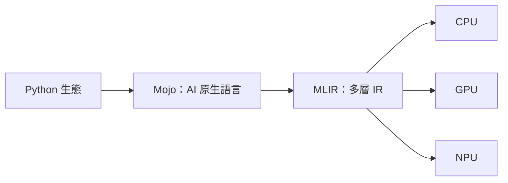
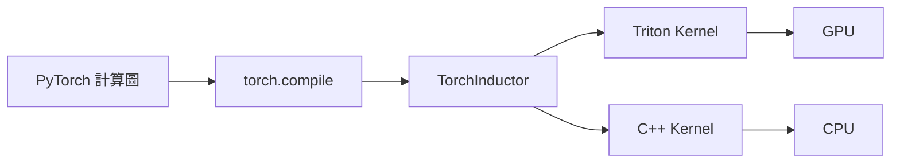
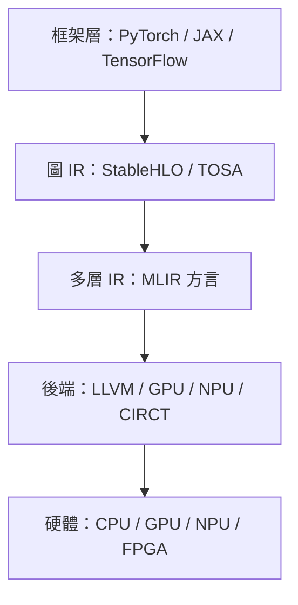

# 8.3　生態編譯：從 Modular 與 Mojo 到 AI 編譯器堆疊

> 本節導論：編譯器不再只是「一個工具」，而是「一個生態的入口」。從 Modular 的 Mojo 語言，到 IREE、TorchInductor、Triton，現代 AI 編譯器堆疊正試圖把「整個計算生態」直接對接異質算力。本節梳理這個生態的形狀。

## 8.3.1 什麼是「生態編譯」

傳統編譯器的邊界很清楚：輸入一種語言，輸出一種機器碼。

「生態編譯」的野心更大：**它要編譯「整個生態」**——多種語言、多種框架、多種硬體，全部透過一個統一的編譯堆疊對接。

這需要三件事：

* **統一的 IR**：讓不同來源（Python、PyTorch、JAX）都能降到同一個 IR。
* **多目標後端**：同一份 IR 能降到 CPU、GPU、NPU、FPGA。
* **開放的擴充**：廠商能加入自己的硬體支援，而不必改動核心。

MLIR 正是這個「統一 IR」的候選。

## 8.3.2 Modular 與 Mojo：為 AI 設計的語言與編譯器

**Modular** 是一家 2022 年成立的公司，2023 年發布 **Mojo** 語言。它的目標是解決「兩種語言問題」（6.2 節）在 AI 時代的版本：

* **Python 的易用性**：語法接近 Python，降低門檻。
* **C 的效能**：靜態型別、所有權、編譯期最佳化。
* **AI 原生**：內建張量型別、自動微分、異質硬體支援。

Mojo 的編譯器（基於 MLIR）試圖做到：**用一種語言，同時滿足「好寫」與「快跑」**，並直接對接 GPU/NPU。

## 8.3.3 IREE：端到端的 MLIR 編譯器

**IREE（Intermediate Representation Execution Environment）** 是 Google 基於 MLIR 的端到端編譯器，專注於「把 ML 模型部署到各種硬體」。

它的特點是：

* **從模型到執行**：直接吃 TensorFlow/PyTorch 模型，產出可執行的模組。
* **多後端**：CPU、GPU、Vulkan、CUDA 等。
* **執行期整合**：編譯器與執行期（runtime）協同設計，減少啟動開銷。

IREE 代表了「編譯器 + 執行期」一體化的趨勢——這正是與姊妹作《AI 時代的異質作業系統》的交會點。

## 8.3.4 TorchInductor 與 Triton：PyTorch 的編譯路徑

PyTorch 2.0（2023）引入 **torch.compile**，其後端之一是 **TorchInductor**：

* 把 PyTorch 計算圖降成 **Triton**（GPU）或 C++（CPU）程式碼。
* 用「生成的 Kernel」取代「預先寫好的算子」。
* 依賴 MLIR 風格的 IR 與降階。

這條路徑的意義是：**主流框架開始「編譯化」**。不再是「呼叫預先編譯的算子」，而是「為每個計算圖生成專屬的 Kernel」。

## 8.3.5 編譯器堆疊的分層

把上述拼起來，現代 AI 編譯器堆疊大致分四層：

每一層都有自己的角色：

* **框架層**：捕捉使用者的計算意圖。
* **圖 IR**：標準化算子，跨框架交換。
* **多層 IR**：漸進式降階與最佳化。
* **後端**：對接具體硬體。

## 8.3.6 生態編譯的三個張力

這個生態不是沒有矛盾。它有三個根本張力：

* **標準化 vs 差異化**：統一的 IR 利於移植，但廠商想差異化自己的硬體。
* **開源 vs 閉源**：開源生態利於擴散，但廠商想保護自己的編譯器。
* **通用 vs 專用**：通用編譯器覆蓋廣，但專用編譯器能榨出極限。

這些張力，決定了編譯器生態的演化方向：**核心開源標準化，邊緣專用差異化**。

## 8.3.7 歷史的迴響：從 GCC 到 LLVM 到 MLIR

回顧歷史，編譯器生態經歷三次「統一」：

* **GCC（1987）**：統一的開源編譯器，支援多語言。
* **LLVM（2003）**：統一的 IR 與可組合 pass，成為現代後端標準。
* **MLIR（2019）**：統一的多層 IR，支援異質與領域特定。

每一次統一，都擴大了「可編譯的範圍」：從語言，到目標，到抽象層次。MLIR 的野心，是把「整個計算生態」納入同一個框架。

## 8.3.8 本節小結

* 生態編譯：編譯「整個生態」，需要統一 IR、多目標後端、開放擴充。
* Modular/Mojo：AI 原生語言，解決兩種語言問題。
* IREE：端到端 MLIR 編譯器，編譯期與執行期一體化。
* TorchInductor/Triton：主流框架「編譯化」，生成專屬 Kernel。
* 堆疊四層：框架、圖 IR、多層 IR、後端。
* 三個張力：標準化 vs 差異化、開源 vs 閉源、通用 vs 專用。
* 歷史三次統一：GCC、LLVM、MLIR。

至此，第 3 部結束。我們建立了「多層 IR + 網狀管線」的技術骨架。下一部，我們看 AI 如何反過來賦能編譯器：LLM 在編譯工坊裡的三條前線。
