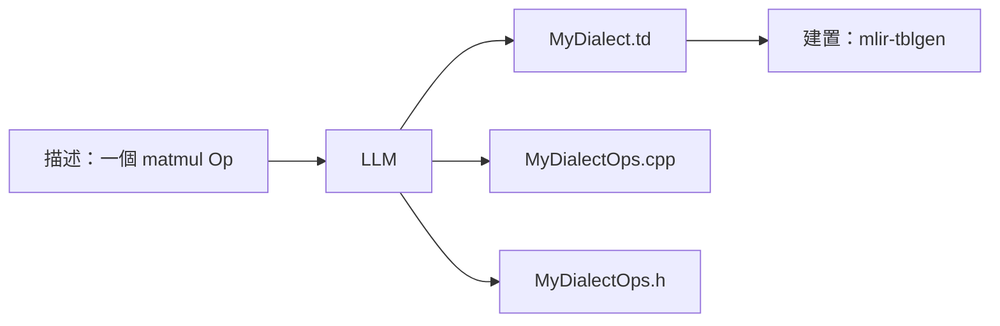

# 9.1　輔助開發：Dialect 樣板與 Pass 草稿

> 本節導論：LLM 在編譯器工程中的第一條前線，不是「取代編譯器」，而是「加速編譯器的開發」。從 MLIR Dialect 的樣板程式碼，到 LLVM Pass 的草稿，再到指令模式匹配規則，LLM 正在把「寫編譯器」這件事的門檻大幅降低。

## 9.1.1 編譯器開發的「樣板地獄」

寫一個新的 MLIR Dialect 或 LLVM Pass，有大量重複的樣板程式碼：

* **Operation 定義**：TableGen 的 ODS 宣告、C++ 的建構子、驗證器。
* **Pass 骨架**：`runOnOperation()`、`getDependentDialects()`、Pattern 註冊。
* **指令模式**：`InstructionSelector` 的匹配規則、`SelectionDAG` 的 pattern。

這些樣板有幾個特點：

* **高度結構化**：有固定的格式與命名慣例。
* **重複性高**：不同 Dialect/Pass 的骨架幾乎一樣。
* **易錯**：命名、型別、註冊順序稍有錯就編不過。

這正是 LLM 擅長的領域：**生成結構化、有明確模式的程式碼**。

## 9.1.2 LLM 生成 MLIR Dialect 樣板

給 LLM 一個簡短的描述，它就能生成一個可編譯的 Dialect 骨架：

```
請生成一個名為 "mydialect" 的 MLIR Dialect，
包含一個名為 "matmul" 的 Operation，
接受兩個 tensor 輸入，回傳一個 tensor。
```

LLM 可以產出：

* `MyDialect.td`：TableGen 定義。
* `MyDialect.cpp`：Dialect 註冊。
* `MyDialectOps.cpp`：Operation 實作。
* `MyDialectOps.h`：標頭檔。



這把「寫一個 Dialect 從幾天縮短到幾小時」。

## 9.1.3 生成 LLVM Pass 草稿

同樣地，LLM 能生成 Pass 的骨架：

```
請生成一個 LLVM FunctionPass，
把所有的 add 指令，若兩個運算元相同，改成 shl 1。
```

LLM 會產出：

* Pass 的類別宣告。
* `runOnFunction()` 的實作。
* Pattern 匹配與改寫。
* 註冊到 PassManager 的程式碼。

這些草稿通常「大致正確」，工程師只需微調與測試。**LLM 不是取代工程師，而是把「從零開始」變成「從草稿開始」**。

## 9.1.4 生成指令模式匹配規則

後端的指令選擇，需要大量的「模式匹配」規則。例如：

> 「若看到 `(a * b) + c`，且目標有 FMA 指令，就匹配成 FMA。」

這些規則在 TableGen 中是結構化的 pattern。LLM 能根據「運算語意」與「目標指令描述」，生成對應的 pattern。

這對異質後端尤其有用：每個新硬體都有新的指令，LLM 能快速生成匹配規則，降低「適配新硬體」的成本（呼應 4.3 節的碎片化問題）。

## 9.1.5 LLM 輔助開發的三個風險

LLM 生成編譯器程式碼，有三個必須警惕的風險：

* **語意錯誤**：LLM 可能生成「語法正確、語意錯誤」的程式碼。例如 Pass 的改寫不保義。
* **樣板僵化**：LLM 傾向生成「常見樣板」，可能不適合特殊需求。
* **過度信任**：工程師可能跳過測試，直接採用生成程式碼，埋下 bug。

因此，LLM 生成的程式碼，必須經過 **嚴格的測試與驗證**（呼應第 2 章）。

## 9.1.6 一個工作流：LLM 起草，人與工具驗證

一個負責任的工作流是：

1. **LLM 起草**：生成樣板、骨架、pattern。
2. **人工審查**：檢查語意是否正確。
3. **自動測試**：用 `mlir-opt`、`llvm-lit` 跑回歸測試。
4. **差分驗證**：用翻譯驗證（2.1 節）確認改寫保義。
5. **合併**：通過所有檢查後才合入。

這個工作流，把 LLM 的「生成速度」與「驗證的嚴格性」結合，是生成時代開發編譯器的正解。

## 9.1.7 對編譯器工程的長期影響

長期來看，LLM 輔助開發會改變編譯器工程的面貌：

* **門檻降低**：更多人能寫 Dialect、Pass、後端。
* **迭代加速**：新硬體的適配時間從「月」縮短到「週」。
* **知識沉澱**：LLM 能從大量開源編譯器中學習模式，形成「編譯器知識庫」。

但也可能帶來 **同質化** 的風險：大家都用相似的樣板，創新可能減少。這是需要警惕的。

## 9.1.8 本節小結

* 編譯器開發有大量樣板：Dialect、Pass、指令模式。
* LLM 擅長生成結構化樣板，把「從零開始」變成「從草稿開始」。
* 三個風險：語意錯誤、樣板僵化、過度信任。
* 工作流：LLM 起草、人工審查、自動測試、差分驗證。
* 長期影響：門檻降低、迭代加速、可能的同質化。

下一節，我們看第二條前線：用 profiling 回饋指導 LLM 生成高效 Kernel。
