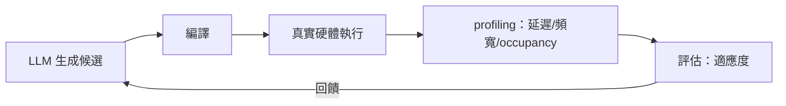
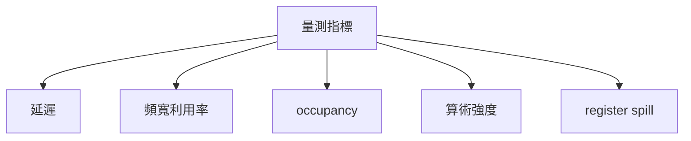

# 9.2　效能回饋迴圈：Profiling-Guided 的 Kernel 生成

> 本節導論：LLM 能生成 Kernel，但「生成」不等於「生成得好」。第二條前線是把 **真實硬體的效能回饋** 餵回生成迴圈：用延遲、頻寬、occupancy 等指標，引導 LLM 在候選空間中演化，逐步逼近最優 Kernel。

## 9.2.1 為什麼「生成」不夠，需要「回饋」

LLM 生成的 Kernel，往往「看起來合理、跑起來慢」。原因包括：

* **硬體細節缺失**：LLM 不知道目標 GPU 的 Shared Memory 大小、Warp 排程細節。
* **tuning 參數盲目**：tile 大小、block 大小、unroll 次數，LLM 只能猜。
* **缺乏實測**：LLM 沒有「跑過」這個 Kernel，不知道它實際多快。

所以關鍵是：**把「實測效能」變成生成迴圈的一部分**。

## 9.2.2 回饋迴圈的結構

一個 profiling-guided 的生成迴圈，包含五步：

1. **生成**：LLM 依提示與歷史，生成多個候選 Kernel。
2. **編譯**：把候選編譯成可執行的 Kernel。
3. **執行與量測**：在真實硬體上跑，量測延遲、頻寬、occupancy。
4. **評估**：把量測結果轉成「適應度分數」。
5. **回饋**：把分數與 profiling 資訊，餵回 LLM，生成下一輪。

這是一個 **演化式搜尋（evolutionary search）**：LLM 是「變異算子」，profiling 是「適應度函數」。

## 9.2.3 用哪些指標作為回饋

回饋的指標，決定了搜尋的方向。常用的指標包括：

* **延遲（latency）**：Kernel 執行的絕對時間。
* **頻寬利用率（bandwidth utilization）**：實際頻寬 / 峰值頻寬。
* **occupancy**：同時駐留的 Warp 比例（呼應 3.2 節）。
* **算術強度（arithmetic intensity）**：FLOPs / Bytes（呼應 3.1 節）。
* **暫存器溢出（register spill）**：是否因暫存器不足而溢出。

這些指標不只是「分數」，更是「診斷資訊」：LLM 可以根據「occupancy 太低」推斷「暫存器用太多」，進而調整。

## 9.2.4 與 Auto-Tuning 的關係

這條路線，與傳統的 **auto-tuning**（如 TVM 的 Ansor、Halide 的 autoscheduler）有相似之處，但有關鍵差異：

| 面向 | 傳統 auto-tuning | LLM-guided |
|---|---|---|
| 搜尋空間 | 預先定義的排程參數 | 開放式（LLM 可生成新結構） |
| 變異方式 | 參數擾動 | 語意級改寫 |
| 知識來源 | 領域啟發式 | 預訓練的程式知識 |

傳統 auto-tuning 在「固定模板」內搜尋參數；LLM-guided 則能「改寫結構」，搜尋空間更大。兩者可以互補：先用 LLM 生成結構，再用 auto-tuning 調參數。

## 9.2.5 一個具體例子：矩陣乘 Kernel 的演化

以矩陣乘為例，演化過程可能是：

* **第 1 輪**：LLM 生成基本的三重迴圈 Kernel，延遲很高。
* **第 2 輪**：profiling 顯示「頻寬利用率低」，LLM 加入 tiling。
* **第 3 輪**：profiling 顯示「occupancy 低」，LLM 減少暫存器使用。
* **第 4 輪**：profiling 顯示「算術強度不足」，LLM 加入暫存器分塊（register blocking）。
* **第 N 輪**：收斂到接近硬體極限的 Kernel。

這個過程，本質上是「用 profiling 引導 LLM 逐步發現最佳化」。

## 9.2.6 回饋迴圈的三個挑戰

這條路線不是沒有困難：

* **量測成本**：每次都要在真實硬體上跑，成本高、速度慢。需要「 surrogate model」（代理模型）來減少實測次數。
* **噪聲**：硬體效能有噪聲（溫度、頻率、競爭），量測不穩定。需要多次量測與統計。
* **局部最優**：演化式搜尋容易卡在局部最優。需要「多樣性」與「重啟」機制。

## 9.2.7 與第 2 章的驗證整合

生成高效 Kernel 之後，還要驗證「它是否正確」。這正是第 2 章的用武之地：

* **差分測試**：生成的 Kernel 與參考實作，數值是否一致。
* **翻譯驗證**：最佳化後的 Kernel，是否保義。
* **不變式檢查**：記憶體存取是否越界、型別是否一致。

**效能與正確性，必須同時滿足**。一個「快但不對」的 Kernel，毫無價值。

## 9.2.8 本節小結

* 生成不等於生成得好，需要真實效能回饋。
* 迴圈五步：生成、編譯、執行、評估、回饋。
* 指標：延遲、頻寬、occupancy、算術強度、spill。
* 與 auto-tuning 互補：LLM 改結構，auto-tuning 調參數。
* 挑戰：量測成本、噪聲、局部最優。
* 必須與驗證整合：快且正確才有價值。

下一節，我們看第三條前線：用學習模型，取代編譯器裡寫死的啟發式代價模型。
