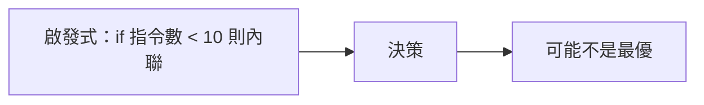
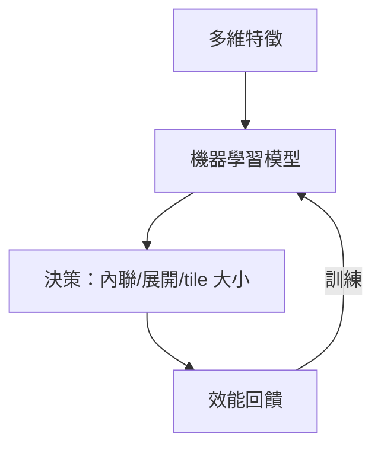

# 9.3　以學習模型取代啟發式代價模型

> 本節導論：編譯器裡有大量「寫死的啟發式」（heuristics）：這個迴圈該不該展開？這個函式該不該內聯？這個 tile 該多大？這些決策背後，往往是一個粗糙的「代價模型（cost model）」。本節談如何用學習模型取代它們，在龐大的搜尋空間中找到更好的解。

## 9.3.1 啟發式代價模型的困境

傳統編譯器的決策，依賴「人工設計的啟發式」。例如：

* **內聯決策**：函式夠小就內聯（門檻是「幾條指令」）。
* **迴圈展開**：迴圈次數已知且不大就展開。
* **暫存器配置**：用圖著色，溢出時 spill「最不常用」的變數。

這些啟發式的問題是：

* **粗糙**：用單一數字（如「指令數」）代表複雜的權衡。
* **靜態**：不隨工作負載、硬體、資料分布調整。
* **局部**：決策之間互相影響，啟發式卻常獨立判斷。

## 9.3.2 為什麼機器學習能贏

機器學習的優勢在於：**從資料中學習複雜的、非線性的權衡**。

* **多維特徵**：不只看「指令數」，還看「迴圈結構、資料分布、快取行為、歷史 profiling」。
* **可訓練**：隨硬體、工作負載更新，不必重寫啟發式。
* **全域視野**：可以學習「決策之間的互動」，而非獨立判斷。

## 9.3.3 三個具體應用

**（1）內聯與向量化的決策。**
Google 的 **MLGO（Machine Learning Guided Optimizations）** 專案，用強化學習決定「哪些函式該內聯」，在 LLVM 上取得了超越啟發式的效果。

**（2）排程與 tiling 的搜尋。**
TVM 的 **Ansor** 用學習模型引導排程搜尋，在龐大的 tiling/parallel/unroll 空間中，找到比人工調優更好的配置。

**（3）演算法本身的發現。**
DeepMind 的 **AlphaTensor（2022）** 用強化學習發現更快的矩陣乘法演算法；**AlphaDev（2023）** 發現更快的排序演算法。這些是「用學習取代人類啟發式」的極致案例——連「演算法怎麼寫」都交給搜尋。

## 9.3.4 代價模型的兩種形式

學習式代價模型，有兩種常見形式：

* **分析式（analytical）**：用公式估算（如 8.2 節的 $ T = \alpha + \text{Bytes}/BW $），參數用學習校準。
* **學習式（learned）**：直接用神經網路，從特徵預測效能。

分析式的優點是可解釋、可泛化；學習式的優點是精確、能捕捉複雜互動。實務上常混合使用。

## 9.3.5 搜尋空間的爆炸

為什麼需要學習模型？因為搜尋空間太大。以一個矩陣乘的排程為例，決策包括：

* tile 大小（多維）。
* 迴圈順序（多種排列）。
* 平行化策略（thread/block/warp）。
* 向量化寬度。
* unroll 次數。

這些決策的組合，可能達到 $ 10^{10} $ 以上。**窮舉不可能，啟發式不夠好，學習式剛好填補這個空缺**。

$$
|\mathcal{S}| = \prod_{i} |\text{decision}_i| \gg \text{預算}
$$

## 9.3.6 訓練資料從哪來

學習式代價模型，需要訓練資料。來源包括：

* **實測**：在真實硬體上跑，量測效能（最準，但最貴）。
* **模擬**：用模擬器估算（較便宜，但可能不準）。
* **遷移學習**：從相似硬體/工作負載遷移（降低成本）。

實務上，常用「少量實測 + 大量模擬 + 遷移」的混合策略。

## 9.3.7 與編譯器架構的整合

把學習模型放進編譯器，有兩種方式：

* **替換式**：直接替換原有的啟發式（如 MLGO 替換內聯啟發式）。
* **引導式**：不替換，而是「建議」候選，由原有流程驗證與選擇。

替換式更激進，但風險高；引導式更保守，但安全。實務上，先從「引導式」開始，逐步過渡到「替換式」。

## 9.3.8 風險與邊界

學習式代價模型，也有風險：

* **分布漂移**：訓練資料與實際工作負載不符，模型失準。
* **不可解釋**：神經網路的決策難以解釋，除錯困難。
* **對抗性**：惡意輸入可能讓模型做出災難性決策。

因此，學習式模型仍需 **形式化護欄**：不論模型建議什麼，最終都要通過不變式檢查（呼應 2.3 節）。

## 9.3.9 本節小結

* 啟發式代價模型粗糙、靜態、局部。
* 機器學習能學多維、可訓練、有全域視野的權衡。
* 三個應用：MLGO（內聯）、Ansor（排程）、AlphaTensor/AlphaDev（演算法）。
* 兩種形式：分析式、學習式，常混合。
* 搜尋空間爆炸是學習模型的用武之地。
* 風險：分布漂移、不可解釋、對抗性，需要形式化護欄。

下一章，我們看終極形態：當編譯器、作業系統與硬體設計的邊界徹底融合。
