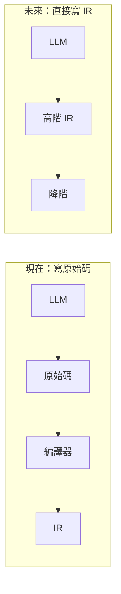
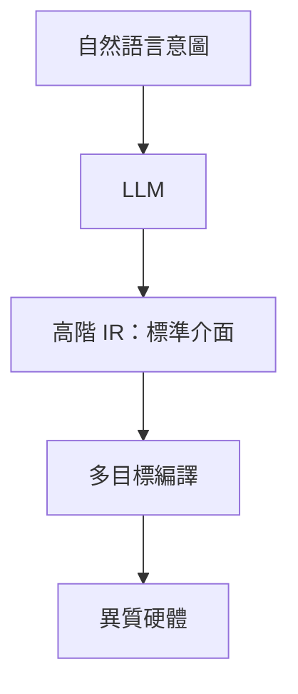
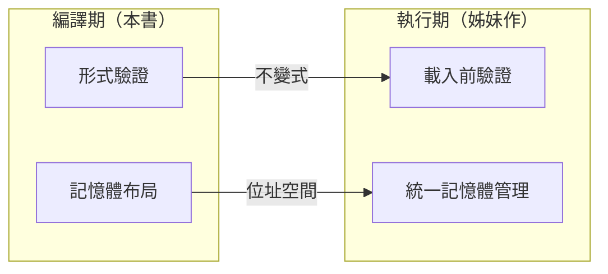

# 10.1　AI 寫 Code 輸出高階 IR 與作業系統交接

> 本節導論：如果 LLM 直接輸出高階 IR，而非原始碼，編譯與執行的整個鏈條會如何改變？本節談「IR 成為 AI 與硬體之間的標準介面」，以及編譯器如何與《AI 時代的異質作業系統》在驗證器與統一記憶體介面上無縫交接。

## 10.1.1 從「寫程式」到「寫 IR」

目前的主流是：AI 寫原始碼（Python、C++），再由編譯器降階。但有一個更激進的可能：**AI 直接寫高階 IR**。

這有幾個好處：

* **跳過語法解析**：不必生成「語法合法的原始碼」，直接生成結構化的 IR。
* **保留語意**：IR 保留「這是矩陣乘」的語意，不會像原始碼那樣被語法稀釋。
* **可直接驗證**：IR 可以在生成當下就被 verifier 檢查。

## 10.1.2 IR 作為「意圖與硬體」的標準介面

當 IR 成為 LLM 的直接輸出，它就變成「意圖」與「硬體」之間的標準介面：

* **上游**：LLM 把自然語言意圖，翻譯成高階 IR。
* **下游**：編譯器把高階 IR，降階成異質硬體。

這個介面的好處是：**LLM 不必知道硬體細節，硬體也不必知道 LLM**。兩者透過 IR 解耦。

這正是姊妹作《AI 時代的異質作業系統》所說的「IR 成為系統介面」的延伸：**IR 不只是編譯器的內部表示，而是整個系統的 ABI**。

## 10.1.3 與作業系統的兩個交接點

編譯器與作業系統，有兩個關鍵交接點：

**（1）驗證器（Verifier）。**
編譯期做形式驗證與差分測試；執行期做「載入前驗證」（如 eBPF verifier）。兩者是同一套不變式的兩道防線：編譯期守「降階保義」，執行期守「載入安全」。

**（2）統一記憶體介面。**
編譯器決定「資料怎麼擺、怎麼搬」；作業系統提供「統一記憶體」（HBM/DRAM/CXL）與「跨晶片調度」。編譯期的布局決策，必須與執行期的記憶體管理協同。

## 10.1.4 無狀態算力流的編譯支援

姊妹作提到「生成—驗證—執行—銷毀」的無狀態算力流。編譯器在其中扮演什麼角色？

* **快速編譯**：一次性軟體要求「秒級編譯」，不能像傳統編譯器那樣跑幾分鐘。
* **可驗證**：生成的 IR 必須能被快速驗證，才能安全執行。
* **可組合**：不同來源的 IR 片段，要能組合成一個完整的執行單元。

這對編譯器提出新要求：**編譯速度、驗證速度、組合能力**，與傳統「極致最佳化」的目標不同。

## 10.1.5 一個具體場景：意圖驅動的部署

設想一個場景：使用者說「把這個模型部署到邊緣裝置，延遲要低於 10ms」。

* **LLM** 把意圖翻譯成高階 IR（模型 + 約束）。
* **編譯器** 根據約束，搜尋最佳的分裂與降階策略，生成 CPU/GPU/NPU 的混合程式。
* **作業系統** 載入、驗證、調度，在邊緣裝置上執行。

這個場景，正是兩本書共同描繪的未來：**意圖 → IR → 硬體**，編譯器與作業系統各司其職。

## 10.1.6 責任與治理

當 LLM 直接寫 IR，責任問題更尖銳（呼應 1.2 節）：

* 誰保證 IR 的語意正確？
* 誰負責驗證降階的保義？
* 誰承擔執行的後果？

答案仍是：**人類與形式化工具握有最終簽名權**。LLM 可以生成，但「放行」必須經過驗證閘門。

## 10.1.7 本節小結

* AI 直接寫高階 IR：跳過語法、保留語意、可直接驗證。
* IR 成為「意圖與硬體」的標準介面，解耦 LLM 與硬體。
* 與 OS 兩個交接點：驗證器、統一記憶體介面。
* 無狀態算力流要求：快速編譯、可驗證、可組合。
* 治理：人類與形式化工具握有最終簽名權。

下一節，我們看更根本的融合：軟硬體共同設計，讓算子、方言、微架構、指令同步演化。
