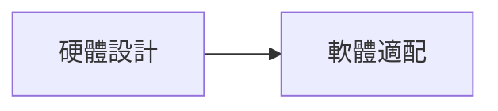
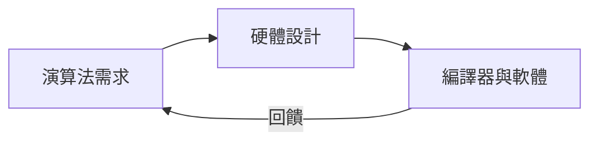
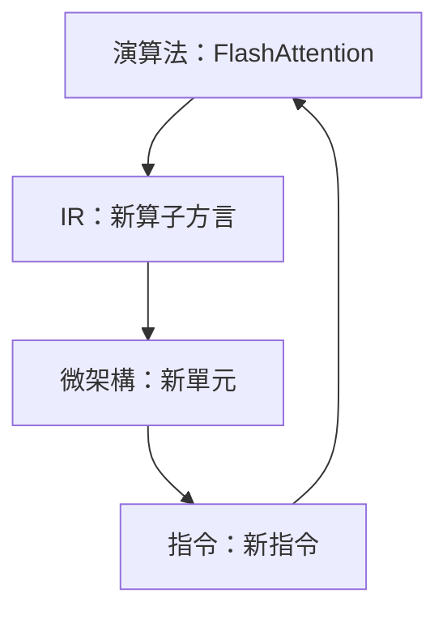
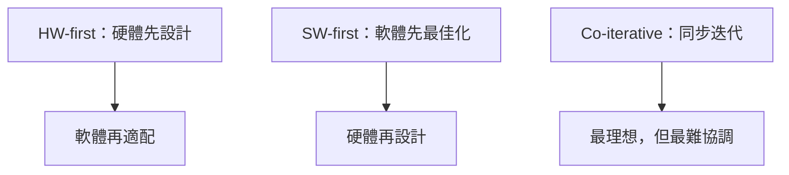

# 10.2　軟硬體共同設計：算子方言微架構同步演化

> 本節導論：編譯器不該只是「被動適配硬體」。在 AI 時代，最好的結果來自 **軟硬體共同設計（HW/SW Co-Design）**：演算法算子、IR 方言、微架構單元、晶片擴充指令，同步演化。本節談這種協同的本質與方法。

## 10.2.1 從「適配」到「共設計」

傳統流程是「硬體先做好，軟體再適配」：

這造成一個問題：硬體設計者不知道軟體需要什麼，軟體開發者只能被動接受硬體的限制。

**共同設計** 則是把兩者拉在一起：

這樣，硬體可以為「實際的工作負載」而設計，軟體也能為「硬體的特性」而最佳化。

## 10.2.2 四個層次的同步演化

共同設計，涉及四個層次的同步：

* **演算法層**：新的算子（如 FlashAttention、MoE）驅動新的硬體需求。
* **IR 層**：新的方言（如 `stablehlo` 的新算子）表達新的計算模式。
* **微架構層**：新的單元（如 Tensor Core、脈動陣列）支援新的運算。
* **指令層**：新的指令（如矩陣乘、量化）直接對接硬體。

這四個層次形成一個循環：演算法驅動硬體，硬體驅動 IR，IR 驅動編譯器，編譯器再回饋演算法。

## 10.2.3 一個經典案例：Tensor Core

NVIDIA 的 **Tensor Core**（2017 年隨 Volta 架構推出）是共同設計的典範：

* **硬體**：專門的矩陣乘加單元，支援混合精度。
* **軟體**：cuBLAS、cuDNN 為其最佳化。
* **編譯器**：Triton、TVM 能自動生成使用 Tensor Core 的 Kernel。
* **IR**：`linalg`、`gpu` 方言支援「矩陣乘」到 Tensor Core 的映射。

Tensor Core 的成功，不是單一層的勝利，而是四層協同的結果。

## 10.2.4 共同設計的三種模式

共同設計，有三種常見模式：

**（1）硬體先行（HW-first）。**
先設計硬體，再讓編譯器適配。適合「硬體創新」的場景，但軟體滯後。

**（2）軟體先行（SW-first）。**
先在現有硬體上最佳化軟體，再據此設計新硬體。適合「演算法創新」的場景。

**（3）協同迭代（Co-iterative）。**
軟硬體同步迭代，每輪都根據對方的回饋調整。最理想，但也最難協調。

## 10.2.5 編譯器在共同設計中的角色

編譯器在共同設計中，扮演「翻譯者」與「回饋者」的雙重角色：

* **翻譯者**：把高階計算，翻譯成硬體能執行的形式。
* **回饋者**：把「編譯時發現的困難」（如某運算難以映射），回饋給硬體設計者。

例如，若編譯器發現「稀疏矩陣乘」在現有硬體上效率極低，這個回饋可以驅動「稀疏加速單元」的設計。這就是編譯器作為「硬體設計的感測器」。

## 10.2.6 共同設計的工具：MLIR 的角色

MLIR 的多層 IR，讓共同設計更容易：

* **統一的 IR**：硬體設計者與軟體開發者，用同一套 IR 溝通。
* **可擴充的方言**：新硬體只需加一個 target 方言，不必改動整個編譯器。
* **漸進式降階**：可以在不同層次探索「軟硬體介面」的最佳位置。

CIRCT 就是這個思想的體現：用 MLIR 做硬體設計，讓「編譯器」與「硬體合成」共用同一套基礎設施。

## 10.2.7 組織與流程的挑戰

共同設計不只是技術問題，也是組織問題：

* **團隊協作**：硬體團隊與軟體團隊，需要共同的目標與溝通機制。
* **迭代週期**：硬體迭代慢（數年），軟體迭代快（數月），需要協調。
* **激勵機制**：若硬體團隊與軟體團隊的 KPI 不同，協同就難以實現。

技術上可行的共同設計，往往受制於組織的現實。這是產業界面臨的真實挑戰。

## 10.2.8 本節小結

* 從「適配」到「共設計」：硬體與軟體一起演化。
* 四層同步：演算法、IR、微架構、指令。
* Tensor Core 是共同設計的典範。
* 三種模式：硬體先行、軟體先行、協同迭代。
* 編譯器是「翻譯者」與「回饋者」。
* MLIR 提供統一 IR，讓共同設計更容易。
* 挑戰不只技術，還有組織與流程。

下一節，我們為全書收尾：七十年輪迴的終章，以及「苦工的消失」。
