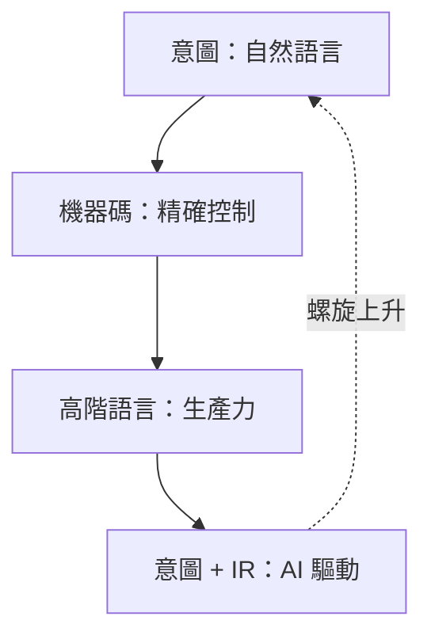

# 10.3　結語：七十年輪迴與苦工的消失

> 本節導論：編譯器的歷史，是一部「消除苦工」的歷史。七十年前，它消除「寫組合語言的苦工」；今天，它要消除「駕馭異質算力與硬體設計的苦工」。本節為全書收尾，也為姊妹作的交接畫下句點。

## 10.3.1 三次「苦工的消失」

回顧編譯器的歷史，可以分成三次「苦工的消失」：

**（1）1957 年：消除「寫組合語言」的苦工。**
FORTRAN 讓人類用高階語言寫程式，編譯器負責翻譯成機器碼。程式設計師不必再記暫存器、指令編碼。

**（2）2000 年代：消除「手動最佳化」的苦工。**
LLVM、GCC 等現代編譯器，讓人類不必手動做暫存器配置、指令排程、向量化。編譯器自動最佳化。

**（3）現在：消除「駕馭異質算力與硬體設計」的苦工。**
異質編譯器（MLIR、Triton、HLS），讓人類不必手動為每個硬體寫 Kernel、不必手動設計電路。編譯器自動分裂、降階、合成。

每一次「苦工的消失」，都伴隨一個抽象層次的提升：從機器碼，到高階語言，到意圖與 IR。

## 10.3.2 輪迴：回到「意圖」

有趣的是，這個歷史像一個輪迴：**從意圖出發，繞了一圈，又回到意圖**。

* 最早，人類用自然語言描述「要算什麼」。
* 後來，為了精確控制，人類下降到機器碼。
* 再後來，為了生產力，人類上升到高階語言。
* 現在，有了 AI 與 IR，人類又回到「描述意圖」，讓機器負責降階。

但這不是簡單的回到原點，而是「螺旋上升」：現在的「意圖」，背後有七十年的編譯技術支撐，能精確地降階到硬體。

## 10.3.3 本書的四個命題回顧

回到序章的四個關鍵詞，我們可以做個回顧：

* **多層抽象降階**：MLIR 的方言與漸進式降階（第 6–8 章），讓高階語意不被過早抹除。
* **機率性搜尋**：LLM 生成與 profiling 回饋（第 1、9 章），讓編譯從「套規則」變成「搜尋」。
* **形式化守門**：CompCert、翻譯驗證、差分測試（第 2 章），讓機率性生成有確定性保證。
* **軟硬體協同**：HLS、共設計、網狀管線（第 5、8、10 章），讓編譯器不只是翻譯，而是設計。

這四者，共同構成「網狀轉化系統」的全貌。

## 10.3.4 與姊妹作的交接

本書與《AI 時代的異質作業系統》，在同一個未來交會：

* **編譯器**：執行前，把意圖降階成硬體可執行的形式，並用形式化守門。
* **作業系統**：執行期，做安全驗證、統一記憶體、跨晶片調度。

兩者的交接點是 **IR 與驗證器**：編譯器產出「已驗證的 IR」，作業系統「載入、再驗證、執行」。

這是一個分工明確、又緊密協同的架構：**編譯器負責「執行前的一切」，作業系統負責「執行期的一切」**。

## 10.3.5 未竟的問題

本書沒有給出所有答案。幾個仍未解決的問題：

* **驗證的規模化**：如何在秒級內，驗證一個大型異質程式的正確性？
* **LLM 的可信度**：如何讓 LLM 的生成，從「大概正確」變成「可證明正確」？
* **共同設計的組織**：如何讓硬體與軟體團隊，真正協同而非各自為政？
* **標準化的邊界**：統一的 IR 與廠商差異化，如何平衡？

這些問題，將是下一個十年的研究前沿。

## 10.3.6 最後的命題

如果要用一句話總結本書：

> **編譯器的七十年，是從「消除寫組合語言的苦工」，走到「消除駕馭異質算力與硬體設計的苦工」。而 AI 時代的異質編譯器，就是那個把人類與 LLM 的意圖，透過多層 IR 拆解、搜尋、驗證，精準降階為 CPU 指令、GPU Kernel、NPU 排程與 FPGA 邏輯閘的超級引擎。**

它不是「語言翻譯機」，而是「意圖與硬體之間的網狀轉化系統」。

## 10.3.7 全書終

感謝讀者陪伴走過這趟旅程。從確定性的黃金律，到機率性的生成；從 CPU 的微架構，到 FPGA 的電路拓撲；從單一 IR 的崩壞，到 MLIR 的方言帝國；從 LLM 的輔助，到軟硬體的共同設計。

編譯器的故事，還在繼續。而它的下一個篇章，將由「意圖」、「IR」與「硬體」共同書寫。

> 延伸閱讀：姊妹作《AI 時代的異質作業系統》，從執行期的角度，補完這個故事的另一半。
