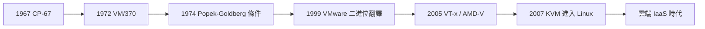
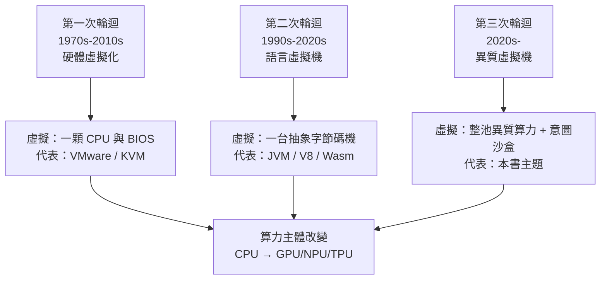

# 序章 0.1　1970 年代到 2020 年代的三次輪迴

> 本節導論：「虛擬機」這個詞在過去五十年裡，至少被三種完全不同的東西佔用過。理解這三次輪迴的差別，才能理解為什麼 AI 時代需要一台「第四種」虛擬機。

## 0.1.1 一個被反覆借用的名詞

「虛擬機（Virtual Machine）」是系統領域裡少見的、被三種截然不同技術共用同一個名字的例子。它們的目標、機制與失效模式都不一樣：

* **硬體虛擬機**（1970s 起）：在一顆物理 CPU 上切出多台獨立的「虛擬電腦」。
* **語言虛擬機**（1990s 起）：用字節碼與 JIT 實現「一次編寫，到處執行」。
* **異質虛擬機**（2020s 起，本書主題）：把整池異質算力抽象成可切分、可隔離、可即時編譯的執行環境。

三者共用「虛擬機」之名，是因為它們都在做同一件事的變體：**用一層軟體中介，把「下面真實存在的東西」與「上面看到的東西」解耦**。差別在於被解耦的究竟是什麼。

## 0.1.2 第一次輪迴：硬體虛擬化（1970s–2010s）

硬體虛擬化的思想比 PC 還老。1960 年代 IBM 的 CP-40 / CP-67 就嘗試在大型主機上切出多個「虛擬機器」，1972 年的 **VM/370** 是第一個商業化成功的例子。它的動機非常務實：大型主機太貴，要讓多個使用者、多個作業系統同時共用一台機器。

這條線在 1974 年被理論化。**Gerald Popek 與 Robert Goldberg** 發表 *Formal Requirements for Virtualizable Third Generation Architectures*，提出著名的「虛擬化三條件」：一致性地執行（fidelity）、效能（performance）、資源控制（resource control）。一台架構要被「有效率地虛擬化」，必須滿足：**所有會暴露特權狀態的敏感指令，都必須是會陷入（trap）的特權指令**。

這個條件在 x86 上曾長期不成立——有些敏感指令（如 `popf`）在 user mode 執行時不 trap，只是默默失敗。這正是 1999 年 **VMware** 靠「二進位翻譯（binary translation）」起家的原因：既然硬體不肯 trap，就在執行前把敏感指令改寫掉。直到 2005–2006 年 Intel VT-x 與 AMD-V 把硬體輔助虛擬化做進 CPU，這個問題才從架構層被解決。

2007 年，**KVM** 被合併進 Linux 2.6.20，把 Linux 核心本身變成一個 hypervisor；搭配 QEMU 做裝置模擬，成為雲端時代最主流的硬體虛擬化方案。至此，「一台機器跑多台虛擬電腦」成為資料中心的基本單位。

第一次輪迴的成功，讓「虛擬化」在很多人心裡等同於「虛擬一台 x86 電腦」。這個心智模型，正是本書第一部要打破的。

## 0.1.3 第二次輪迴：語言虛擬機（1990s–2020s）

第二條線走的是完全不同的路。它不模擬硬體，而是定義一台「抽象機器」，把程式編譯成這台機器的指令（字節碼，bytecode），再由執行期解釋或即時編譯成真實機器碼。

* **1995 年**，Sun 發布 Java 與 **JVM**。口號是「Write Once, Run Anywhere」：同一份 `.class` 字節碼可以在任何裝了 JVM 的平台上執行。JVM 的抽象機器模型（堆疊式指令、物件導向堆積、垃圾回收）成為一代軟體工程的基礎。
* **2008 年**，Google 開源 **V8**，用 JIT（隱藏類別、內聯快取、TurboFan）把 JavaScript 效能推進到足以跑複雜應用，也催生了 Node.js。
* **2017 年**，**WebAssembly**（Wasm）成為瀏覽器四大引擎的共同標準，2019 年成為 W3C 正式推薦標準。它把「可移植的安全字節碼」從語言層提升為一個通用的、與語言無關的編譯目標。

語言虛擬機的抽象層次比硬體虛擬機高：它不在乎底下是 x86 還是 ARM，只在乎「這台抽象機的語意」。它換來的是 **可攜性** 與 **安全沙盒**（字節碼在載入前可被驗證），代價是 **它只擅長控制流與純量資料**。

## 0.1.4 第三次輪迴：異質虛擬機（2020s–）

到了 2020 年代，支撐前兩次輪迴的兩個前提同時改變了。

**第一，算力主體換了。** 過去「計算」幾乎等於「CPU 跑指令」。今天一次大型模型推論或訓練，計算主體在 GPU、TPU、NPU 上。這些裝置的執行模型（SIMT、脈動陣列、空間資料流）與 CPU 完全不同，指令集不統一、記憶體層級各異、連「什麼是指令」都沒有共識。第一次輪迴的「模擬一顆 CPU」完全幫不上忙。

**第二，執行主體換了。** 過去程式的作者是人類，程式會被長期維護、反覆執行。今天 AI 代理可以在每秒生成、執行、銷毀成百上千段程式碼。第二次輪迴的「字節碼 + 單一執行緒控制流」也不夠用——它沒有張量原語，啟動與切換的成本也遠高於微秒級需求。

於是誕生了第三種虛擬機的定義：

> **它不虛擬一顆 CPU，也不只跑一段字節碼；它虛擬的是「一整池異質算力」，並把「AI 生成的意圖」安全地映射到這池算力上。**

## 0.1.5 三次輪迴其實是同一條軸線

把三次輪迴排在一起看，會發現它們其實是同一條軸線上的三個刻度：**被虛擬化的「東西」越來越抽象**。

* 第一次：虛擬化 **硬體資源**（CPU、記憶體、中斷、裝置）。
* 第二次：虛擬化 **執行語意**（控制流、物件、型別）。
* 第三次：虛擬化 **算力與意圖**（計算圖、張量、AI 生成的程式與其隔離邊界）。

每往上一層，虛擬機要處理的東西就越不「像機器」，越「像意圖」。而越像意圖，就越需要一個 **與硬體無關的抽象表示** 來承接——這正是本書反覆出現的主角：**多層 IR 與虛擬張量指令集**。

## 0.1.6 本節小結

* 虛擬機一詞先後被硬體虛擬化、語言虛擬機、異質虛擬機三種技術佔用。
* 第一次輪迴（VMware / KVM）解決「一台機器跑多台虛擬電腦」，靠 Popek–Goldberg 條件與硬體輔助。
* 第二次輪迴（JVM / V8 / Wasm）解決「一次編寫到處執行」，靠字節碼與 JIT。
* 第三次輪迴的驅動力是「算力主體」與「執行主體」同時改變，催生了以計算圖與沙盒為核心的異質虛擬機。

下一節，我們把這兩股驅動力拆開，看它們各自如何讓前兩次輪迴的假設失效。
