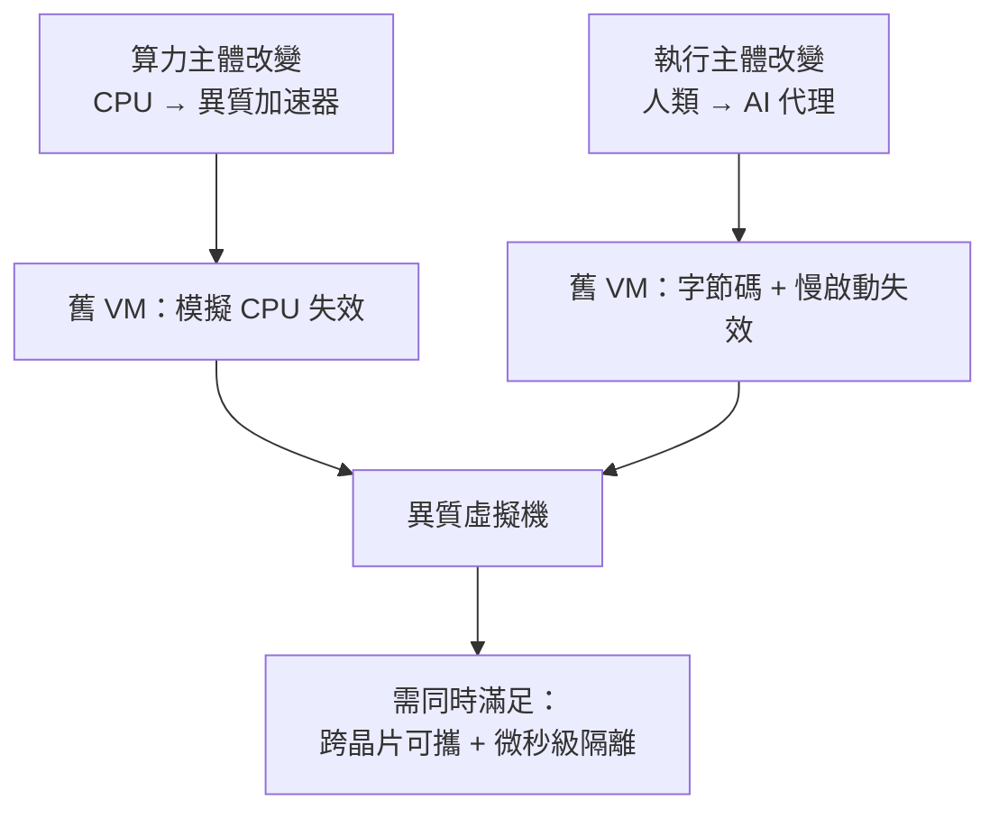

# 序章 0.2　當算力主體與執行主體同時改變

> 本節導論：一台虛擬機的設計，永遠是對「底下是什麼算力」與「上面跑什麼程式」這兩個問題的回答。當這兩個答案在十年內同時被改寫，舊虛擬機的每一個假設都會鬆動。

## 0.2.1 虛擬機的兩個隱含問題

任何虛擬機的設計，本質上都在回答兩個問題：

1. **向下：底下的算力長什麼樣？** 是單顆同質 CPU？還是 CPU + GPU + NPU + FPGA 的異質池？
2. **向上：上面跑的是什麼程式？** 是人類寫、長期維護的執行檔？還是 AI 即時生成、用完即毀的一次性邏輯？

前兩次輪迴各自固化了這兩個問題的答案：

| | 第一次輪迴（KVM） | 第二次輪迴（JVM） |
|---|---|---|
| 向下的算力 | 同質 x86 CPU | 任意 CPU（抽象機隱藏差異） |
| 向上的程式 | 完整 OS 與長期執行檔 | 人類寫的字節碼 |
| 隔離單位 | 虛擬電腦 | 類別載入器 / 行程 |
| 啟動成本 | 秒級 | 毫秒到秒級 |

AI 時代把這兩個答案 **同時** 改掉了。這不是漸進的演化，而是兩個獨立的斷裂點在同一時間疊加。

## 0.2.2 斷裂一：算力主體從 CPU 變成異質加速器

先看向下這一面。過去虛擬機面對的算力是「一顆（或少數幾顆）同質 CPU」，所以模擬一顆 CPU 就等於虛擬化了全部算力。但今天的算力分布是這樣的：

* **CPU**：少量、通用、擅長控制流與不規則計算。
* **GPU**：大量同質執行緒（SIMT），擅長稠密矩陣運算，有獨立 HBM。
* **TPU / NPU**：脈動陣列或專用矩陣單元，編譯期靜態排程，無投機執行。
* **FPGA**：空間資料流，電路即程式，可重構。

這四種算力的「指令集」根本沒有共同語言。問題不只是「不同指令集」——x86 與 ARM 至少都是「一連串指令改變暫存器」的模型。GPU 是「一群執行緒同步執行」，TPU 是「把資料流過一排乘法器」，FPGA 是「把計算燒成電路」。**它們連「什麼是程式」的定義都不同。**

於是第一次輪迴的虛擬化策略——「模擬一顆 CPU、讓 guest OS 跑在上面」——直接失效：你沒辦法用模擬 CPU 的方式去虛擬化一台脈動陣列。

## 0.2.3 斷裂二：執行主體從人類變成 AI 代理

再看向上這一面。過去的程式由人類撰寫、測試、部署、維護；這意味著程式數量少、生命週期長、值得為它付出較高的啟動與隔離成本。

AI 代理改變了這個成本結構：

* **程式數量爆炸**：一個代理為了完成一個任務，可能生成數十到數千個候選程式片段，逐一嘗試。
* **生命週期極短**：每段程式可能只執行幾毫秒就丟棄，從不進入長期維護。
* **來源不可信**：程式由機率模型生成，可能包含無窮迴圈、越權存取、記憶體爆炸。
* **需要多路徑試錯**：代理常需要「先試 A，失敗回滾，再試 B」，這要求執行環境能 **快速快照與分叉**。

這些需求直接撞上第二次輪迴的極限：JVM 的啟動與類別載入是毫秒到秒級，狀態是單一可變堆積，難以「複製整個執行狀態再分叉」。

## 0.2.4 兩個斷裂的交會：一個「維度災難」

把兩個斷裂放在同一張圖上，會看到問題的形狀：

關鍵在於：**這兩個需求不是相加，而是相乘。** 一台只解決「跨晶片可攜」的虛擬機（例如單純的計算圖執行期）可能完全沒有隔離能力；一台只解決「微秒級隔離」的沙盒（例如單純的 Wasm 執行期）可能完全不會用 GPU。AI 時代需要的是 **同時** 做到兩件事的機器——而這正是異質虛擬機的難點，也是本書第二、三部要分別攻克的兩個側面。

## 0.2.5 為什麼是「現在」？

值得追問：異質算力不是新事物（CUDA 自 2007 年就有），AI 寫 Code 也不是一夜成熟。為什麼「異質虛擬機」在 2020 年代中期才成為迫切命題？三個條件同時到位：

1. **異質化的深度**：過去加速器是「同質 ALU 的放大」，今天則是「不同計算模型並存」。當一個資料中心同時有 GPU、TPU、NPU、FPGA，單一抽象層再也無法用「模擬 CPU」蒙混過關。

2. **IR 基礎設施的成熟**：MLIR（2019 開源）、StableHLO（2022）、IREE / OpenXLA（2022–2023）讓「用一份計算圖 IR 表達跨硬體程式」第一次有了工業級基礎。沒有這層，虛擬 ISA 只是空談。

3. **沙盒技術的成熟**：Firecracker（2018）、gVisor（2018）、Wasm 標準化（2017–2019）、機密計算（SGX / SEV / TDX）相繼成熟，讓「微秒級隔離」從論文走進產品。

這三者的交會，使得「一台能同時抽象異質算力與隔離 AI 程式的虛擬機」從概念變成有工程路徑的現實。

## 0.2.6 本節小結

* 虛擬機設計永遠在回答「底下算力」與「上面程式」兩個問題。
* 第一個斷裂：算力主體從同質 CPU 變成異質加速器，模擬 CPU 的策略失效。
* 第二個斷裂：執行主體從人類變成 AI 代理，慢啟動與單一堆積的策略失效。
* 兩個斷裂相乘，要求異質虛擬機 **同時** 具備跨晶片可攜與微秒級隔離。
* MLIR、沙盒、機密計算三項技術在 2020 年代成熟，才讓這個命題有解。

下一節，我們把全書的核心命題正式寫下來，並給出整本書的技術地圖。
