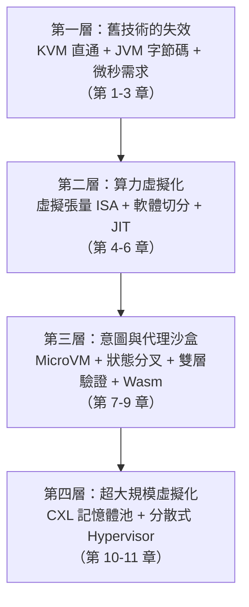
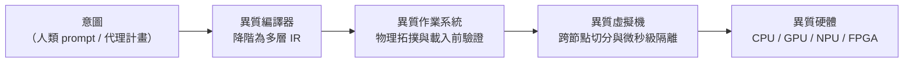

# 序章 0.3　通用可攜性與微秒級隔離與全書命題

> 本節導論：把前面兩節的診斷收束成一句話——AI 時代的虛擬機，是「向上提供硬體無關的計算圖介面，向下切分異質算力池的動態中介層」。這一節給出全書的技術地圖。

## 0.3.1 命題的正式表述

我們可以把全書的核心命題寫成一條「介面契約」：

> **異質虛擬機是一層動態中介層：向上，它提供與硬體無關的計算圖／IR 抽象執行環境；向下，它把異質算力池切分、隔離並即時編譯。**

這條契約有兩個關鍵詞，各自對應一個技術側面：

* **通用可攜性（Portability）**：同一份「虛擬執行檔」（計算圖 IR）要能無縫跑在 NVIDIA、AMD、TPU、自研 NPU 上。這要求一個 **虛擬 ISA** 與一個 **多後端執行期**。
* **微秒級隔離（Isolation）**：不可信的 AI 生成程式要被安全地執行、快照、分叉、回滾。這要求 **輕量沙盒** 與 **狀態管理**。

用一個公式表達，一台異質虛擬機要同時最小化兩個成本：

* 可攜成本 $ C_{\text{port}} $：把一份計算從硬體 A 搬到硬體 B 所需的重寫與調校。
* 隔離成本 $ C_{\text{iso}} $：啟動、切換、快照一個隔離執行環境的時間與記憶體。

傳統虛擬機各自把其中一個成本壓到很低，卻讓另一個很高：KVM 的可攜成本低（模擬 CPU）、隔離成本高（秒級啟動）；計算圖執行期隔離成本高（幾乎沒有多租戶隔離）、可攜成本低。異質虛擬機的目標是 **兩者同時低**。

## 0.3.2 四個技術層次

為了同時壓低這兩個成本，異質虛擬機可以拆成四個技術層次，對應本書的四部：

* **第一層（診斷）**：為什麼 KVM 的整卡直通、JVM 的字節碼模型撐不起 AI 時代。
* **第二層（可攜性）**：用虛擬張量指令集、軟體定義切分、執行期 JIT，讓計算無痛跨晶片。
* **第三層（隔離）**：用 MicroVM、狀態分叉、雙層驗證、Wasm，為 AI 程式打造微秒級沙盒。
* **第四層（規模）**：用 CXL 與分散式 Hypervisor，把整座機櫃虛擬成一台巨型單機。

## 0.3.3 兩個貫穿全書的技術錨點

在四層之上，有兩個技術錨點反覆出現，讀者可以把整本書理解為它們的展開：

**錨點一：虛擬張量指令集（Virtual Tensor ISA）。**
它不是真正的硬體指令集，而是以計算圖 IR（StableHLO / MLIR）表達的一組「張量運算原語」。就像 JVM 字節碼是「虛擬的 CPU 指令」，虛擬張量 ISA 是「虛擬的加速器指令」。它是通用可攜性的錨點——只要計算被表達成這組原語，就能被不同後端降階。

**錨點二：狀態快照分叉（Snapshot & Fork）。**
它不是真正的硬體分頁，而是以 Copy-on-Write 在微秒內複製整個執行狀態的機制。它是微秒級隔離的錨點——代理的多路徑推理、失敗回滾、確定性重放，都建立在它之上。

## 0.3.4 三個必須回答的反問

任何「異質虛擬機」方案，都會被三個尖銳的問題檢驗，本書會在對應章節逐一回答：

1. **「你怎麼可能同時虛擬四種執行模型完全不同的硬體？」**
   答案在第二部：不模擬硬體，而是虛擬 **計算圖**。硬體差異被多後端降階吸收，就像 JVM 不模擬 CPU、只虛擬字節碼語意。

2. **「微秒級隔離聽起來很酷，但安全性怎麼保證？」**
   答案在第三部：雙層驗證——載入前用 IR Verifier 做靜態不變式檢查，執行期用 TEE 做硬體記憶體隔離。

3. **「跨節點的單機幻覺，延遲與一致性怎麼可能？」**
   答案在第四部：CXL 提供記憶體池化的硬體基礎，分散式 Hypervisor 用頁面遷移與故障透明容錯來維持幻覺。

## 0.3.5 與三部曲另外兩本的關係

三部曲的分工可以用一次「AI 生成程式從意圖到執行」的旅程來理解：

* **異質編譯器**負責「翻譯」：把意圖降階成帶證明的多層 IR。
* **異質作業系統**負責「落地」：管理物理拓撲、做載入前驗證。
* **異質虛擬機（本書）** 負責「中介」：把 IR 抽象成可攜的虛擬執行環境，並把 AI 生成的不可信程式隔離在微秒級沙盒中，跨節點彈性切分算力。

## 0.3.6 本節小結

* 全書命題：異質虛擬機是「向上提供硬體無關的計算圖介面，向下切分異質算力池」的動態中介層。
* 兩個核心成本：可攜成本 $ C_{\text{port}} $ 與隔離成本 $ C_{\text{iso}} $，異質虛擬機要同時壓低。
* 四個技術層次對應本書四部：診斷、可攜性、隔離、規模。
* 兩個錨點：虛擬張量 ISA（可攜）與狀態快照分叉（隔離）。
* 三部曲分工：編譯器翻譯、作業系統落地、虛擬機中介。

接下來進入第一部。第 1 章先從最具體的地方開始：**為什麼過去二十年雲端虛擬化的主力——PCIe 直通——在 GPU/NPU 面前只是一個昂貴的妥協。**