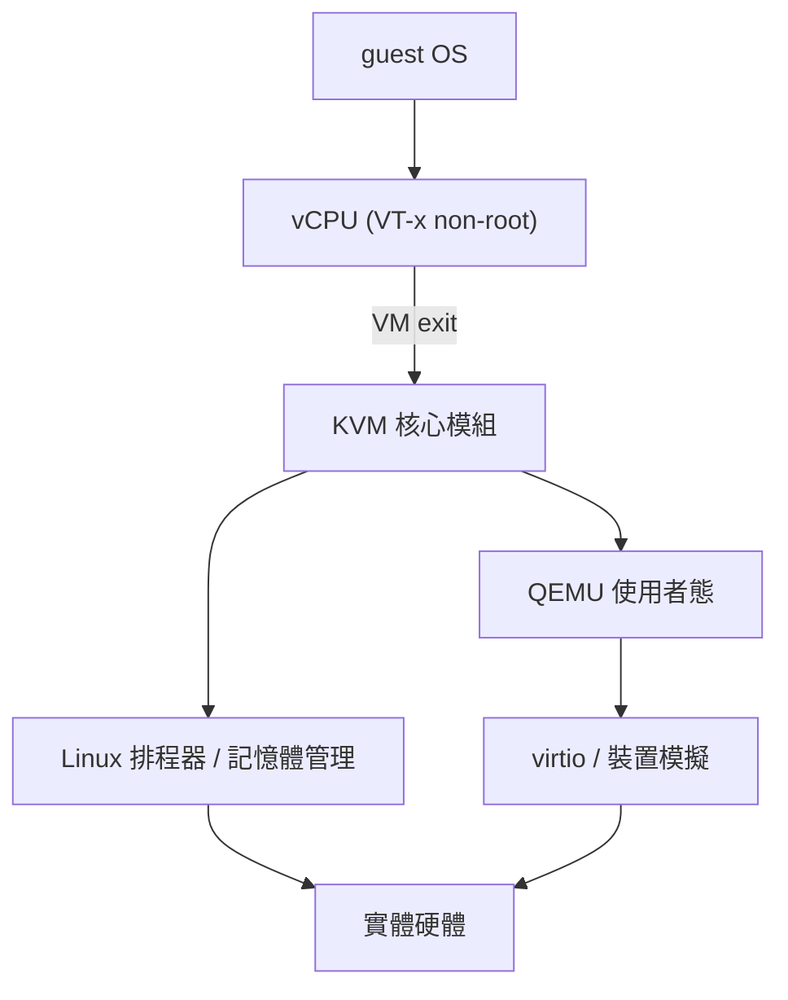

# 1.1　1999 年 VMware 與 2007 年 KVM 的硬體虛擬化遺產

> 本節導論：要理解為什麼舊虛擬化撐不起 AI 時代，得先理解它「為什麼曾經如此成功」。KVM 與 VMware 的成功不是偶然，而是一組非常特定的硬體假設被完美滿足。

## 1.1.1 虛擬化的四個古典機制

硬體虛擬化要讓「一台物理機跑多台虛擬機」，本質上要解決四個問題，而這四個問題的解法，定義了今天所有 hypervisor 的骨架：

1. **CPU 虛擬化**：讓 guest OS 的特權指令不會真的影響宿主。解法是「陷入再模擬（trap-and-emulate）」或硬體輔助（VT-x 的 VMX root / non-root 模式）。
2. **記憶體虛擬化**：讓 guest 的實體位址（GPA）映射到宿主實體位址（HPA）。古典解法是 **影子頁表（shadow page table）**，硬體輔助則是 **EPT / NPT**（二維頁表，GPA → HPA 由硬體走訪）。
3. **中斷與計時器虛擬化**：guest 看到的時鐘與中斷要與宿主隔離。解法是虛擬中斷控制器（virtual APIC）與時間偏移。
4. **裝置虛擬化**：guest 看到的是「虛擬裝置」，例如 virtio 網卡、virtio 磁碟，由宿主代理真實 I/O。

這四個機制有一個共同前提：**被虛擬化的對象是「一顆有明確架構的 CPU + 一組被動外設」**。Popek–Goldberg 條件講的正是這個前提下的可行性：只要「敏感指令都是會 trap 的特權指令」，就能有效率地虛擬化。

## 1.1.2 VMware 的賭注：硬體不配合，就用軟體翻譯

1999 年 VMware Workstation 問世時，x86 並不滿足 Popek–Goldberg 條件。有些敏感指令在 ring 3 執行時不會 trap，只是默默失敗（例如 `popf` 會忽略特權旗標、`sgdt` 會讀到真實的 GDT 位址）。這在虛擬化語意上是致命的：guest 以為自己設定了中斷，其實沒有。

VMware 的解法是 **二進位翻譯（binary translation）**：在 guest 程式碼執行前，掃描並改寫那些「不 trap 的敏感指令」，把它們換成會主動呼叫 VMM 的版本。這是一個極其精巧的工程：它讓 x86 在被虛擬化時仍然「行為一致」，代價是翻譯與快取的管理成本。

2005–2006 年，Intel VT-x 與 AMD-V 把「root / non-root 模式」做進硬體，讓特權指令自然 trap，二進位翻譯的需求大幅降低。VMware 的賭注從「用軟體補硬體的洞」變成「用硬體加速」，但它在這之前累積的虛擬裝置（如虛擬 SCSI、虛擬網卡）與管理平面，成為 ESX / vSphere 帝國的基礎。

## 1.1.3 KVM：把 Linux 核心本身變成 hypervisor

2007 年，KVM（Kernel-based Virtual Machine）被合併進 Linux 2.6.20。它的設計哲學與 VMware 完全不同：

* **不自己造 hypervisor**：KVM 只是一個核心模組，把 Linux 核心變成「能執行 guest 的宿主」。它重用 Linux 既有的排程器、記憶體管理、驅動模型。
* **/dev/kvm 一個字元裝置**：使用者態的 QEMU 透過 `ioctl` 控制 vCPU 的建立、執行、暫停。真正執行 guest 的是硬體 VT-x/AMD-V，KVM 只做「陷入的轉發」。
* **裝置交給 QEMU**：KVM 不處理裝置模擬，virtio、磁碟、網路由 QEMU 在使用者態模擬或半虛擬化。

這個設計的優雅之處在於：**它不重新發明輪子，而是把 Linux 已有的能力（排程、記憶體、驅動）直接當作 hypervisor 的底座**。這讓 KVM 在雲端時代幾乎免費地搭上 Linux 生態的順風車。

## 1.1.4 成功的代價：一個被固化的世界觀

VMware 與 KVM 的成功，把「虛擬機」這個概念固化成一種特定的世界觀：

* **虛擬機 = 一台完整的虛擬電腦**：有 BIOS、有開機流程、有 guest OS、有 virtio 裝置。
* **隔離單位 = 位址空間 + 特權級**：靠 MMU 與 ring 隔離。
* **啟動成本 = 秒級**：因為要模擬開機、載入 guest OS。
* **裝置模型 = 被動外設**：裝置由宿主代理，guest 只能透過 virtio 或直通存取。

在「雲端 IaaS 賣虛擬機」的時代，這個世界觀完美契合：客戶要的就是一台「像真電腦的電腦」，秒級啟動可接受，整卡直通 GPU 也能接受（反正一張 GPU 租給一個客戶）。

但 AI 時代的需求完全不同：客戶要的不是「一台電腦」，而是「一片可切分的算力」；程式不是「開機後長期執行的服務」，而是「毫秒內生成、執行、銷毀的片段」。於是被固化的世界觀，開始與需求錯位。

## 1.1.5 遺產的兩面性

我們不該低估這份遺產。今天所有的 MicroVM（Firecracker、Cloud Hypervisor）、所有的機密容器（Kata、gVisor），都仍在借用 KVM 的 CPU/記憶體虛擬化機制。KVM 的 `/dev/kvm` 介面甚至成為「硬體虛擬化」的事實標準。

但這份遺產也帶來了包袱：

* **裝置模型的慣性**：virtio 是為「被動外設」設計的，套到 GPU/NPU 上就成了直通或半虛擬化的噩夢。
* **啟動路徑的慣性**：BIOS、開機流程、裝置探測，這些對「微秒級沙盒」而言全是純粹的延遲。
* **隔離單位的慣性**：以「整台虛擬機」為隔離單位，對「每秒上千個 AI 程式片段」而言粒度太粗。

換句話說，KVM 解決了 **CPU 與記憶體的虛擬化**，卻沒有、也不打算解決 **加速器的虛擬化**。這正是下一節要談的：當你把 GPU 插進這套世界觀，會發生什麼事。

## 1.1.6 本節小結

* 硬體虛擬化的四個古典機制：CPU、記憶體、中斷、裝置。
* VMware 用二進位翻譯補足 x86 的虛擬化缺口，VT-x/AMD-V 之後轉向硬體輔助。
* KVM 把 Linux 核心變成 hypervisor，重用排程、記憶體、驅動，優雅但固化了世界觀。
* 這份遺產的包袱：裝置模型、啟動路徑、隔離單位，都是為「整台虛擬電腦」設計的。

下一節，我們把 GPU 插進這套世界觀，看 PCIe 直通這個「妥協」如何成為 AI 時代的第一個瓶頸。
