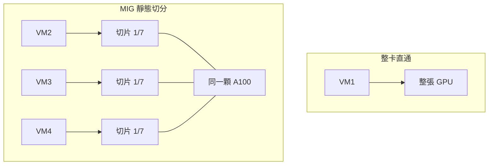

# 1.2　只要直通就好的 GPU 與 SR-IOV 與 MIG 侷限

> 本節導論：當 GPU 進入資料中心，虛擬化社群的第一反應不是「怎麼切分它」，而是「怎麼把它整張卡塞給一台虛擬機」。這個妥協延續了十幾年，也埋下了算力碎片化的根。

## 1.2.1 PCIe 直通：把整張卡「借」給 guest

在 KVM 的世界裡，讓 guest 用 GPU 最直接的方法是 **PCIe 直通（PCI Passthrough）**，透過 VFIO（Virtual Function I/O）框架把整張 GPU 的 PCIe 裝置直接綁給某台虛擬機：

* 宿主把該裝置從自己的驅動解綁（unbind）。
* 透過 IOMMU，把該裝置的 DMA 位址空間映射到 guest 的實體位址。
* guest 安裝原生 GPU 驅動，以為自己獨占整張卡。

這個方案的好處是 **效能幾乎無損**：guest 直接和硬體對話，沒有virtio 的模擬開銷。代價是 **獨占**：一張 GPU 只能給一台虛擬機，無法切分。

在 2010 年代的雲端 GPU 市場，這其實是可接受的：客戶租的是「一台帶 GPU 的虛擬機」，一張卡對一台機器，天經地義。但當 AI 訓練與推論成為主流，需求變成「我要一張卡的一小部分」時，整卡直通就成了災難。

## 1.2.2 為什麼 GPU 難以像 CPU 那樣分時複用

CPU 能輕鬆分時複用，是因為它有幾個特性：上下文狀態小（幾十個暫存器）、有硬體支援的快速上下文切換、有 MMU 做位址隔離、中斷可以虛擬化。

GPU 幾乎每一項都不成立：

* **上下文狀態龐大**：一顆 GPU 有數千個執行緒、每個執行緒有自己的暫存器檔案，加上 shared memory、L1/L2 cache、常數記憶體。完整保存與恢復一次上下文，成本遠高於 CPU。
* **缺乏硬體級頁表隔離**：早期 GPU 沒有像 CPU MMU 那樣精細的位址隔離，記憶體保護靠驅動層的檢查，難以在硬體層切出多個租戶的獨立位址空間。
* **缺乏統一的中斷模型**：GPU 的中斷語意與 CPU 不同，虛擬化中斷需要額外的硬體支援。
* **執行模型是「大量執行緒同步」**：一個 kernel 啟動成千上萬個執行緒，切成時間片會破壞 warp 的同步假設。

因此「像 CPU 一樣 time-slicing GPU」在工程上極難，且效能損失巨大。這逼出了兩條替代路線：**硬體切分** 與 **軟體切分**。

## 1.2.3 SR-IOV：硬體切分的第一次嘗試

**SR-IOV（Single Root I/O Virtualization）** 是 PCI-SIG 在 2007 年前後推動的標準，讓一個 PCIe 裝置在硬體層暴露多個「虛擬功能（Virtual Function, VF）」，每個 VF 可以獨立綁給一台虛擬機。

對網卡而言，SR-IOV 非常成功：一張 25G 網卡可以切成幾十個 VF，每個 VF 給一台 VM，效能接近直通。

但對 GPU 而言，SR-IOV 有一個根本限制：**它切分的是「PCIe 功能」，不是「算力」**。一個 VF 能分到獨立的 DMA 通道與中斷，卻未必能分到獨立的「SM（串流多處理器）陣列」或「顯存區塊」。換句話說，SR-IOV 解決了「裝置的虛擬化」，卻沒有真正解決「算力的切分」。

## 1.2.4 MIG：NVIDIA 的硬體分區

2020 年，NVIDIA 在 A100 上推出 **MIG（Multi-Instance GPU）**，這是目前最成熟的硬體級 GPU 切分方案。MIG 把一顆 A100 切成最多 7 個「執行個體」，每個執行個體有：

* 獨立的 SM 切片（算力）。
* 獨立的記憶體切片（顯存）。
* 獨立的 L2 cache 切片與記憶體頻寬。
* 硬體級的故障隔離與 QoS。

MIG 的關鍵突破是：**它切的是晶片內部的實體資源，而不只是 PCIe 功能**。這讓多個租戶可以真正共享一顆 GPU 而不互相干擾。

但 MIG 也有明顯侷限：

* **靜態切分**：切分組態必須在建立時決定，執行期難以動態調整。一個租戶用不滿自己的切片，剩下的算力無法借給別人。
* **粒度固定**：A100 最多 7 個切片，每個切片的算力是固定的 1/7 或組合，無法切成「1.3 個切片」。
* **硬體綁定**：MIG 是特定 GPU 世代的功能，不是通用標準，跨廠商、跨世代無法移植。

## 1.2.5 靜態切分的經濟學：碎片化與低利用率

MIG 與 SR-IOV 的共同問題是 **靜態切分造成的碎片化**。設想一個資料中心有 100 顆 GPU，切成 7 個切片共 700 個單位：

* 有些任務需要 2 個單位，有些需要 3 個，有些只需要 0.5 個。
* 靜態切片無法表達 0.5，也無法在任務結束後把空出的切片重新組合。
* 結果是：熱門切片供不應求，冷門切片閒置，整體利用率可能掉到 40% 以下。

這正是雲端經濟學最痛的地方：**GPU 是最貴的資源，卻常常有一半在閒置**。要解決這個問題，不能靠硬體靜態切分，而必須靠 **軟體定義的動態切分**——這正是第 5 章的主題。

## 1.2.6 直通與切分的兩難

整理一下這條演化線：

| 方案 | 切分粒度 | 隔離強度 | 動態性 | 主要限制 |
|---|---|---|---|---|
| 整卡直通 | 整卡 | 強（硬體） | 無 | 獨占、利用率低 |
| SR-IOV | PCIe 功能 | 中 | 靜態 | 不切算力 |
| MIG | 硬體切片 | 強（硬體） | 靜態 | 粒度固定、廠商綁定 |

三者都有一個共同的盲點：**它們都在「硬體」這一層想辦法切分，而沒有在「虛擬機」這一層攔截與排程算力**。而 AI 時代真正需要的，是一個能在 **API 與指令流層** 動態切分算力的虛擬化層。

## 1.2.7 本節小結

* PCIe 直通效能好但獨占，是雲端 GPU 的早期妥協。
* GPU 難以分時複用，因為上下文龐大、缺乏硬體頁表隔離、執行模型是大量執行緒同步。
* SR-IOV 切的是 PCIe 功能而非算力；MIG 切的是硬體資源但靜態且廠商綁定。
* 靜態切分造成碎片化與低利用率，逼出「軟體定義算力切分」的需求。

下一節，我們從更根本的層次回答：**為什麼 CPU 可以分時複用，而加速器不行？** 這個問題的答案，決定了異質虛擬機的整個設計方向。
