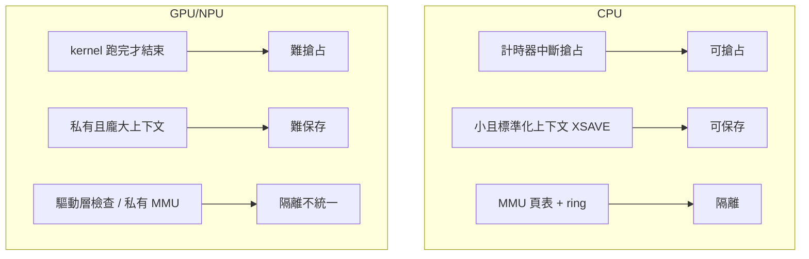

# 1.3　為什麼 CPU 能分時複用而加速器不能

> 本節導論：CPU 的分時複用看起來理所當然，其實是硬體、OS 與 ABI 三方合作的結果。加速器缺少的正是這三方合作——理解這一點，才不會誤以為「寫個排程器」就能解決問題。

## 1.3.1 分時複用的三個必要條件

「分時複用（time-slicing）」的意思是：多個任務輪流使用同一個硬體，每個任務都以為自己獨占它。這件事能成立，需要三個條件同時滿足：

1. **可搶占（Preemptible）**：系統能在任務不知情的情況下，把它從硬體上「換下來」。
2. **狀態可保存（Context-saveable）**：換下來時，能把該任務的完整狀態存起來，之後原樣恢復。
3. **隔離（Isolated）**：換下來後，任務不能繼續影響硬體或讀到別人的資料。

CPU 三者俱全，而且有硬體與 OS 的雙重支援。加速器則三者皆缺，或缺其中關鍵的一環。

## 1.3.2 CPU 如何做到三者俱全

**可搶占**：CPU 有一個由計時器驅動的中斷。時間到了，硬體強制把控制權交回核心，核心決定是否換人。這是「非合作式搶占（involuntary preemption）」，任務無權拒絕。

**狀態可保存**：CPU 的上下文是「暫存器檔案 + 程式計數器 + 頁表基底 + 少量特殊暫存器」，幾百 bytes 到幾 KB，存到記憶體極快。x86 甚至提供 `XSAVE` 指令，一次把 FPU/SSE/AVX 狀態全部存下。

**隔離**：MMU 提供頁表隔離，每個行程有自己的位址空間；特權級（ring）確保使用者程式不能碰核心資源。

這三者的組合，讓 OS 能用一個計時器中斷 + 一次上下文切換，就完成「分時複用」。整個機制之所以廉價，是因為 **上下文小、切換有硬體加速、隔離有 MMU 背書**。

## 1.3.3 加速器缺了哪幾塊

把同樣的三條件套到 GPU/NPU/TPU 上，就會看到裂縫：

**可搶占：缺乏統一的搶占機制。**
GPU 的 kernel 一旦啟動，通常會跑到完成，中途難以搶占。部分 GPU 支援「指令級搶占（instruction-level preemption）」或「mid-kernel preemption」，但成本高、支援不完整。NPU 的靜態排程更是「一旦編排好就整批執行」，本質上不可搶占。

**狀態可保存：上下文太大且不透明。**
CPU 的上下文是「公開的、有標準格式的」。GPU 的上下文包含數千執行緒的暫存器、shared memory、cache、排程器狀態，而且 **格式是廠商私有的**。虛擬機想保存它，得靠廠商提供的 API，無法像 `XSAVE` 那樣通用。

**隔離：頁表與記憶體保護不完整。**
早期 GPU 的記憶體管理是「驅動層軟體檢查」，不是硬體 MMU 強制。即使後來有了 GPU MMU（如 NVIDIA 的 unified memory、AMD 的 HMM），其隔離粒度與 CPU 的 ring/頁表仍不同，且跨廠商不統一。

## 1.3.4 這不是「寫個排程器」能解決的

一個常見的誤解是：既然 GPU 不能分時，那就寫一個「GPU 排程器」，把多個任務排隊輪流跑。問題是，排程器只能解決「誰先跑」，解決不了上述三個條件的缺失：

* 如果 kernel 不可搶占，排程器只能在 kernel **之間** 切換，無法在 kernel **之中** 切換。一個長 kernel 會卡住所有人。
* 如果上下文不可保存，排程器無法「暫停 A、跑 B、再恢復 A」，只能「等 A 跑完再跑 B」。
* 如果隔離不完整，共享同一顆 GPU 的租戶可能讀到彼此的顯存。

這解釋了為什麼過去十幾年，多租戶 GPU 的主流方案一直是「整卡直通」或「硬體靜態切分（MIG）」——因為軟體排程器無法彌補硬體條件的缺失。

## 1.3.5 異質虛擬機的突破口：換一個切分層次

既然在「硬體執行層」難以分時，異質虛擬機就必須 **換一個層次來切分**。答案是：**在 API 與指令流層切分**，而不是在硬體執行層切分。

具體來說：

* **API Remoting**：攔截 CUDA / ROCm / OpenCL 的 API 呼叫，把「kernel 啟動」變成「提交到佇列」，由虛擬機層排程決定何時、在哪個裝置上執行。
* **指令流攔截**：在計算圖 IR 層攔截，把大 kernel 切成小塊，讓排程器能在「塊與塊之間」切換租戶。
* **軟體定義的虛擬裝置**：對 guest 暴露一個「虛擬 GPU」，由宿主把它映射到真實 GPU 的某個時間片或某個切片。

這樣做的關鍵洞見是：**你不需要搶占硬體，只需要搶占「提交給硬體的計算圖」**。把計算圖切得夠細，就能在圖的節點之間做排程與切換，達到「準分時」的效果。這正是第 5 章「軟體定義算力切分」的核心思想。

## 1.3.6 成本模型：為什麼切分粒度是關鍵

把計算圖切得越細，排程越靈活，但切分本身也有成本。可以用一個簡單模型描述：

* 排程彈性 $ F $ 隨切分塊數 $ n $ 增加而增加，大致 $ F \propto \log n $。
* 切分與同步成本 $ C $ 也隨 $ n $ 增加，大致 $ C \propto n \cdot c_{\text{sync}} $，其中 $ c_{\text{sync}} $ 是每次塊間同步的成本。

總效益 $ U = F - C $，存在一個最佳切分粒度 $ n^{*} $。這解釋了為什麼「切得太粗」與「切得太細」都不好：太粗則排程僵化、利用率低；太細則同步成本吃掉收益。異質虛擬機的工作，很大一部分就是在找這個 $ n^{*} $。

## 1.3.7 本節小結

* 分時複用需要三條件：可搶占、狀態可保存、隔離。
* CPU 三者俱全（計時器中斷、XSAVE、MMU），加速器三者皆缺。
* 這不是「寫個排程器」能解決的，因為排程器無法彌補硬體條件的缺失。
* 突破口是換切分層次：在 API 與計算圖層切分，而非硬體執行層。
* 切分粒度存在最佳值 $ n^{*} $，太粗太細都不好。

第一部的前三章到此把「舊世界為什麼失效」講清楚了。下一章我們轉向另一條失效線：**語言虛擬機的字節碼模型，為什麼在海量張量面前也崩了。**
