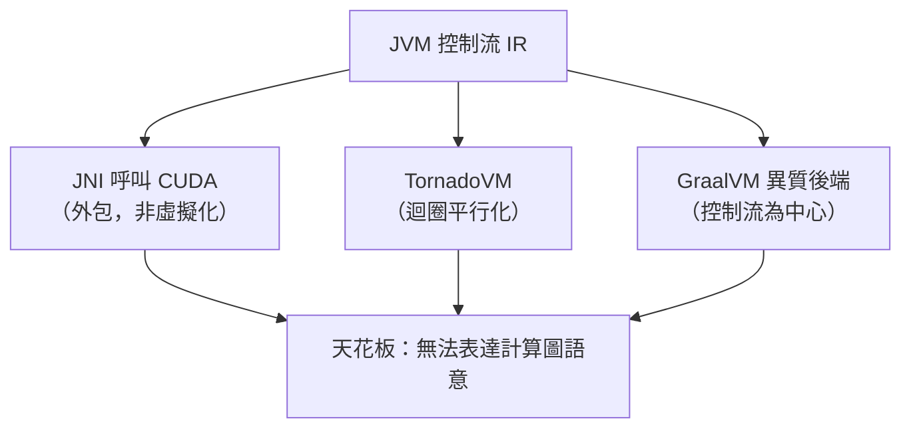

# 2.1　1995 年 JVM 的單執行緒控制流與 GC 假設

> 本節導論：JVM 是一台設計得極其優雅的抽象機器，但它的優雅建立在「程式是控制流 + 物件」這個假設上。當程式的主體變成「大量張量運算」，這台機器的骨架就開始格格不入。

## 2.1.1 JVM 的抽象機器模型

1995 年發布的 JVM，定義了一台與硬體無關的抽象機器，其核心要素是：

* **堆疊式指令集**：運算元放在 operand stack 上，指令如 `iload`、`iadd`、`invokevirtual`。
* **物件導向堆積**：所有物件都在一個可垃圾回收的堆積（heap）上，物件有型別、有方法表。
* **單一執行緒控制流**：每個執行緒有一條指令流，透過 `monitorenter` / `monitorexit` 做同步。
* **類別載入與驗證**：`.class` 檔在載入時被驗證器檢查型別安全與堆疊平衡。

這套模型的目標是「可攜性 + 安全」：字節碼與硬體無關，驗證器確保程式不會越界、不會型別混淆。在 1990 年代的企業軟體世界，這是完美的設計——企業應用就是「大量物件 + 控制流 + 資料庫 I/O」。

## 2.1.2 假設一：程式的主體是控制流

JVM 的指令集是為「控制流」設計的：分支、迴圈、方法呼叫、例外處理。它的效能模型也圍繞控制流：JIT 透過內聯快取（inline cache）加速虛擬呼叫、透過逃逸分析消除物件配置、透過迴圈展開加速熱點迴圈。

但 AI 計算的主體不是控制流，而是 **資料流**：一個神經網路是一張計算圖，節點是張量運算（矩陣乘、卷積、softmax），邊是張量流動。這張圖的「控制」極少——幾乎沒有分支，只有「把這層的輸出餵給下一層」。

用 JVM 跑一張計算圖，就像用「事件驅動的 GUI 框架」去跑「大批量資料處理」：語意上做得到，但每一個張量運算都是一次方法呼叫，每一次呼叫都有堆疊操作、型別檢查、邊界檢查的開銷。這些開銷在控制流程式裡可以忽略，在張量運算裡卻是致命的——因為張量運算的每一次呼叫都對應 **百萬次純量運算**，而 JVM 的抽象是「一次只處理一個純量」。

## 2.1.3 假設二：物件在可回收的堆積上

JVM 的另一個核心假設是：**記憶體是「物件」，由 GC 管理**。

這個假設在企業軟體裡很合理：物件有生命週期，GC 自動回收，程式設計師不用管記憶體。但在張量運算裡，問題來了：

* **張量是巨大的連續緩衝區**：一個 $ 4096 \times 4096 $ 的 float32 矩陣是 64 MB，不是「一堆小物件」。把它拆成物件，GC 的物件圖會爆炸。
* **張量需要釘在特定記憶體**：GPU 的張量必須在 HBM 上，且位址要穩定（kernel 直接讀指標）。GC 會移動物件（compacting GC），這對 GPU kernel 是災難。
* **張量的生命週期由計算圖決定**：一張計算圖的中間張量，生命週期就是「被下游節點消費為止」，這是靜態可分析的，不需要動態 GC。用 GC 管理它，等於用「動態推測」取代「靜態已知」，白白付出成本。

換句話說，GC 是為「生命週期不可預測的物件」設計的；張量的生命週期恰恰是 **可預測的**（由計算圖的資料依賴決定）。用 GC 管張量，是殺雞用牛刀，而且牛刀還會移動雞。

## 2.1.4 假設三：一次一條指令流

JVM 的執行模型是「一條指令流、一個程式計數器」。多執行緒是「多條獨立的指令流，透過共享記憶體與鎖同步」。

但 GPU 的執行模型是 **SIMT**：數千個執行緒執行同一條指令，但作用在不同資料上（warp 內 32 個 lane 同步）。這不是「多條獨立指令流」，而是「一條指令、多份資料」的向量化模型。

JVM 沒有表達 SIMT 的原語。要在 JVM 上模擬 SIMT，只能在每個 lane 上跑一個 Java 執行緒，然後用 barrier 同步——這會產生數千個執行緒與海量的同步開銷，完全喪失 GPU 的平行優勢。

## 2.1.5 「JVM 上跑 GPU」的三種努力與它們的天花板

歷史上有人嘗試讓 JVM 支援 GPU：

1. **JNI 呼叫 CUDA**：Java 程式透過 JNI 呼叫 native CUDA 函式。這可行，但等於「把 GPU 運算外包給 native」，JVM 只當膠水，沒有真正虛擬化 GPU。
2. **Aparapi / TornadoVM**：把 Java 的 lambda 或迴圈編譯成 GPU kernel。TornadoVM 是這條路線最認真的嘗試，它能自動把 `@Parallel` 迴圈降階成 OpenCL / PTX。但它的抽象仍是「迴圈平行化」，無法表達複雜的計算圖融合、分塊、佈局。
3. **GraalVM + 異質後端**：把 Truffle 語言或 Java 位元組碼編譯到 GPU。這條路線在學術上有進展，但工程複雜度極高，且仍受限於「以控制流為中心」的 IR。

這些努力的共同天花板是：**它們都在「控制流 IR」的框架內想辦法擠出平行性**，而 AI 計算需要的是一開始就以「計算圖 / 張量」為中心的 IR。這就是為什麼後來的主流不是「讓 JVM 支援 GPU」，而是「另起爐灶做計算圖執行期」（第 4 章）。

## 2.1.6 本節小結

* JVM 的三大假設：控制流為主體、物件在可回收堆積、單一指令流。
* 三個假設在張量運算面前全部錯位：資料流 vs 控制流、巨大連續緩衝 vs 小物件、SIMT vs 單指令流。
* JVM 上跑 GPU 的三種努力（JNI、TornadoVM、GraalVM）都受困於「以控制流為中心的 IR」。
* 這解釋了為什麼 AI 時代的主流是「計算圖執行期」而非「擴充 JVM」。

下一節，我們看另一條語言虛擬機路線——V8 與 WebAssembly——它們雖然更輕量、更安全，卻也面臨同樣的「缺乏張量原語」的天花板。
