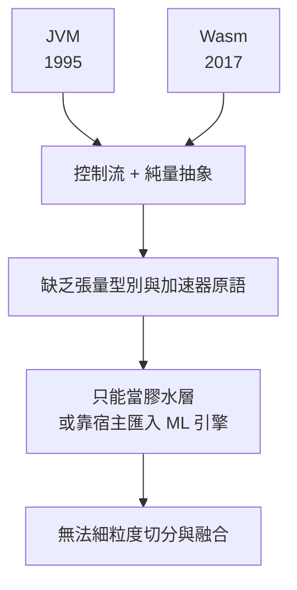

# 2.2　2008 年 V8 與 2017 年 WebAssembly 的安全沙盒

> 本節導論：V8 證明了「用 JIT 把動態語言跑得夠快」是可能的，Wasm 證明了「用可驗證的字節碼做安全沙盒」是可能的。但兩者都停在「控制流 + 純量」的世界，無法直接承接張量。

## 2.2.1 V8：用 JIT 把 JavaScript 推進到系統級速度

2008 年 Google 開源 V8，它的目標是讓 JavaScript——一個原本被認為「慢」的腳本語言——跑得夠快，足以支撐 Gmail、Google Docs 這類複雜應用。V8 的關鍵技術是分層 JIT：

* **Ignition**：字節碼解釋器，負責快速啟動與收集型別回饋。
* **Sparkplug / Maglev**：中階編譯器，快速把熱點字節碼編成機器碼。
* **TurboFan**：最佳化編譯器，用型別回饋做激進最佳化（內聯、逃逸分析、隱藏類別）。
* **隱藏類別（hidden class）與內聯快取（inline cache）**：讓動態屬性存取接近靜態語言的效能。

V8 的成就，是證明了 **「動態語言 + 分層 JIT + 型別回饋」** 可以是高效能的。這套思想後來影響了所有現代語言執行期（包括 PyTorch 的 TorchScript、Julia、以及各種 ML 執行期的 JIT）。

## 2.2.2 WebAssembly：把「可驗證字節碼」變成通用目標

2017 年，四大瀏覽器引擎（V8、SpiderMonkey、JavaScriptCore、Chakra）共同推出 **WebAssembly（Wasm）** 的 MVP，2019 年成為 W3C 正式標準。

Wasm 的設計與 JVM 有本質差異：

* **靜態型別、結構化控制流**：Wasm 沒有 `goto`，控制流是結構化的（block / loop / if），這讓驗證器可以在 **線性時間** 內驗證型別安全與堆疊平衡。
* **線性記憶體（linear memory）**：Wasm 模組只能存取一段連續的線性記憶體，所有記憶體存取都做邊界檢查。這是它的沙盒基礎。
* **與語言無關**：C/C++、Rust、Go、Kotlin 都能編譯到 Wasm，它是一個通用的編譯目標，不只是「瀏覽器裡的 JS 替代品」。

Wasm 的兩大價值是 **可攜性**（同一份 `.wasm` 到處跑）與 **安全沙盒**（載入前驗證 + 線性記憶體隔離）。這讓它從瀏覽器走向伺服器端（WASI）、邊緣運算、甚至區塊鏈智慧合約。

## 2.2.3 Wasm 的沙盒機制：為什麼它比 JVM 更輕

Wasm 的沙盒比 JVM 輕，原因有三：

* **驗證更簡單**：結構化控制流 + 靜態型別，讓驗證器不需要做複雜的資料流分析，可以單遍掃描完成。
* **記憶體模型更簡單**：線性記憶體是一段連續位址，邊界檢查就是「位址 + 長度 ≤ 記憶體大小」，不需要物件圖與 GC。
* **沒有隱性狀態**：Wasm 模組沒有全域可變狀態（除了明確宣告的 global），沒有執行緒（早期版本），沒有檔案系統（要靠 WASI 明確匯入）。這些「沒有」讓隔離邊界更清楚。

這正是為什麼 Wasm 被視為「微秒級沙盒」的候選：它的啟動成本可以壓到極低，因為它沒有 JVM 那樣的類別載入、GC 初始化、執行緒池。

## 2.2.4 但 Wasm 缺少張量與加速器原語

Wasm 的設計目標是「通用計算」，它的指令集是純量與向量（SIMD proposal 加了 128-bit 向量）。它 **沒有** 張量型別、沒有矩陣乘原語、沒有 GPU kernel 的概念。

這帶來一個根本問題：**AI 計算的核心是張量運算，而 Wasm 的抽象層次太低**。你可以在 Wasm 裡用純量迴圈模擬矩陣乘，但效能會比原生 CUDA 差一到兩個數量級，因為：

* 沒有張量佈局（layout）的概念，無法做分塊（tiling）與融合（fusion）。
* 沒有硬體加速器原語，無法呼叫 Tensor Core、脈動陣列。
* 沒有非同步執行模型，無法表達「提交 kernel、等待完成」的 GPU 執行模式。

## 2.2.5 WASI-NN：把 ML 推理「匯入」Wasm 的嘗試

為了讓 Wasm 能跑 ML，W3C 推動了 **WASI-NN** 提案（2021 起）。它的做法不是把張量原語加進 Wasm 指令集，而是定義一組 **宿主匯入（host import）介面**：

* `load`：載入一個模型（例如 ONNX）。
* `init_execution_context`：建立推理上下文。
* `set_input` / `compute` / `get_output`：設定輸入、執行推理、取回輸出。

換句話說，WASI-NN 把「推理」當成一個 **外部服務**，由宿主（例如 Wasm runtime）代理給真實的 ML 引擎（TensorFlow Lite、OpenVINO 等）。Wasm 模組只負責「控制流」——決定何時載入哪個模型、餵什麼輸入。

這個設計務實，但也暴露了天花板：**Wasm 只是「膠水層」，真正的張量計算在宿主外面**。這意味著：

* 無法做跨運算子的融合（fusion），因為每個 `compute` 都是一次獨立的宿主呼叫。
* 無法做細粒度的算力切分，因為排程粒度是「整個模型」。
* 無法表達「在同一個 Wasm 模組內混合純量控制流與張量運算」的最佳化。

## 2.2.6 兩條路線的共同天花板

把 JVM 與 Wasm 放在一起看，會發現它們共享同一個天花板：

兩者都是「控制流 + 純量」的抽象機器，都能做到可攜與安全，卻都無法 **原生表達張量計算**。這不是實作不夠好，而是 **抽象層次選錯了**：它們虛擬化的是「指令流」，而 AI 需要虛擬化的是「計算圖」。

## 2.2.7 本節小結

* V8 證明分層 JIT + 型別回饋能讓動態語言高效能，影響了後續所有 ML 執行期。
* Wasm 用結構化控制流 + 線性記憶體，做出比 JVM 更輕的可驗證沙盒。
* 但 Wasm 缺乏張量型別與加速器原語，只能靠 WASI-NN 把推理「匯入」宿主。
* JVM 與 Wasm 共享同一個天花板：虛擬化「指令流」而非「計算圖」。

下一節，我們把這個天花板講透：**為什麼張量運算會從根本上壓垮傳統語言虛擬機的每一個假設。**
