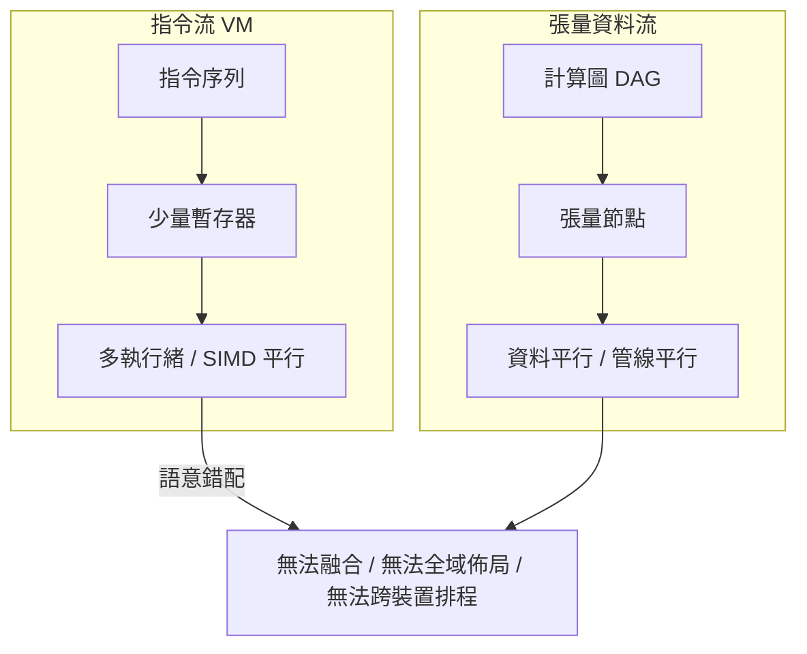

# 2.3　張量運算為何壓垮傳統語言虛擬機

> 本節導論：前面兩節講了 JVM 與 Wasm 的個別瓶頸。這一節把問題提升到本質層次：張量運算的數學結構，與「指令流虛擬機」的執行模型，是兩種不相容的世界觀。

## 2.3.1 兩種計算的世界觀

傳統語言虛擬機（JVM、Wasm、CLR）建立在 **「指令流（instruction stream）」** 的世界觀上：

* 程式是一連串指令，依序執行。
* 每條指令作用在少量暫存器或記憶體上。
* 平行性是「多條指令流」（執行緒）或「向量化」（SIMD）。
* 效能來自「減少指令數」與「縮短關鍵路徑」。

張量運算建立在 **「資料流（dataflow）」** 的世界觀上：

* 程式是一張有向無環圖（DAG），節點是張量運算，邊是張量。
* 每個節點是一次「大規模規則運算」，例如 $ C = A \times B $。
* 平行性是「資料平行」（同一運算作用在大量元素上）與「管線平行」（不同節點重疊執行）。
* 效能來自「提高算術強度（arithmetic intensity）」與「減少記憶體搬運」。

這兩種世界觀的差異，不是「哪個比較快」，而是 **「什麼是程式的基本單位」** 的差異。指令流的基本單位是「指令」，資料流的基本單位是「張量運算節點」。

## 2.3.2 為什麼「指令流」抽象會漏掉關鍵最佳化

用指令流虛擬機跑張量運算，會漏掉三類關鍵最佳化：

**第一，算子融合（operator fusion）。**
在資料流世界裡，`matmul → bias_add → relu` 可以被融合成一個 kernel，避免中間張量寫回記憶體。這是 AI 編譯器最重要的最佳化之一。但在指令流世界裡，這三個運算分別是三個方法呼叫 / 三個匯入函式，虛擬機看不到「它們是一個整體」，無法融合。

**第二，佈局與分塊（layout & tiling）。**
張量運算的效能極度依賴記憶體佈局（row-major vs column-major、NCHW vs NHWC）與分塊策略（把大矩陣切成適合 cache / shared memory 的小塊）。這些決策需要「看到整個計算圖」才能做全域最佳化。指令流虛擬機每次只看一個指令，無法做全域佈局決策。

**第三，跨裝置排程。**
一個計算圖可以切成子圖，分派到 GPU、NPU、CPU。這需要「圖級」的視野：哪些節點適合哪個裝置、哪些資料要搬。指令流虛擬機沒有「圖」的概念，無法做這種排程。

## 2.3.3 算術強度：為什麼「純量抽象」是致命的

用一個簡單的數字說明問題。考慮一次 $ 4096 \times 4096 $ 的矩陣乘：

* 運算量約 $ 2 \times 4096^{3} \approx 1.37 \times 10^{11} $ 次浮點運算。
* 如果用「純量指令」表達，每條指令做一次乘加，需要約 $ 1.37 \times 10^{11} $ 條指令。
* 如果用「張量指令」表達，就是一條 `matmul` 指令。

算術強度（arithmetic intensity）定義為「每搬運一個 byte 能做多少次運算」：

$$
I = \frac{\text{FLOPs}}{\text{Bytes moved}}
$$

張量運算之所以快，是因為它把大量運算壓進一次記憶體搬運（高算術強度）。而純量抽象被迫「每個元素都搬一次」，算術強度趨近於 1，直接被記憶體頻寬綁死。**這不是最佳化能解決的，而是抽象層次本身就丟掉了「運算可以批次化」的資訊。**

## 2.3.4 垃圾回收與張量生命週期的錯配

再談 GC。傳統虛擬機的 GC 假設「物件生命週期不可預測，需要動態回收」。但張量的生命週期是 **靜態可分析的**：

* 一個中間張量在計算圖中的生命週期 = 「從被產生，到最後一個消費者讀取為止」。
* 這個區間可以由圖的資料依賴 **靜態計算** 出來（liveness analysis）。
* 因此張量記憶體可以用「靜態配置 + 重用（memory pooling）」管理，完全不需要 GC。

用 GC 管張量，等於用「動態推測」取代「靜態已知」，付出的代價是：

* GC 的暫停（stop-the-world）會打斷長時間的訓練。
* 移動物件（compaction）會讓 GPU 指標失效。
* 物件頭（header）與指標追蹤的額外記憶體開銷。

這就是為什麼 PyTorch 的張量是「原生連續緩衝 + 引用計數」，而不是「GC 管理的物件」；為什麼 MLIR 的 bufferization 是「靜態分析張量生命週期，插入 dealloc」，而不是「交給 GC」。

## 2.3.5 SIMT 與「一條指令流」的根本衝突

最後是平行模型。GPU 的 SIMT 是「一條指令、多個 lane 同步執行」。這在指令流虛擬機裡無法原生表達：

* JVM 的執行緒是「獨立的程式計數器」，要模擬 SIMT 就得開數千個執行緒。
* Wasm 早期根本沒有執行緒（threads proposal 後來才加），更別提 SIMT。
* 即使有 SIMD，Wasm 的 SIMD 是 128-bit 固定寬度，無法表達 GPU 的「32 lane warp + 可變暫存器壓力」。

換句話說，指令流虛擬機的平行模型（多執行緒 + SIMD）與 GPU 的平行模型（SIMT + 大量 warp）是 **不同的平行語意**，無法用同一套抽象表達。

## 2.3.6 這是否意味著語言虛擬機一無是處？

不是。語言虛擬機在「控制流 + 純量」的世界仍然是王者，而且在 AI 時代仍有其位置：

* **膠水層**：協調多個張量運算、處理 I/O、控制流程，這些用 Wasm / JS 很合適。
* **安全沙盒的基礎**：Wasm 的驗證與隔離機制，是 AI 代理沙盒的重要元件（第 9 章）。
* **JIT 技術的遺產**：V8 的分層 JIT、型別回饋，被 ML 執行期大量借用。

真正的結論不是「語言虛擬機被淘汰」，而是 **「語言虛擬機不足以單獨承擔異質虛擬機的角色」**。異質虛擬機需要一個新的抽象層——計算圖 / 虛擬張量 ISA——來承接張量運算，而語言虛擬機退居為「控制面」與「沙盒」的角色。

## 2.3.7 本節小結

* 指令流與資料流是兩種不相容的世界觀，基本單位分別是「指令」與「張量節點」。
* 指令流抽象漏掉三類關鍵最佳化：算子融合、佈局分塊、跨裝置排程。
* 純量抽象的算術強度趨近 1，被記憶體頻寬綁死。
* GC 與張量生命週期錯配，張量應該用靜態配置 + 記憶體池。
* SIMT 與多執行緒是不同平行語意，無法用同一套抽象表達。
* 語言虛擬機不會被淘汰，但退居「控制面」與「沙盒」角色。

下一章，我們把焦點轉向「執行主體」的改變：**當 AI 代理每秒生成上千段不可信程式，虛擬機的度量衡要從「秒級」換成「微秒級」。**
