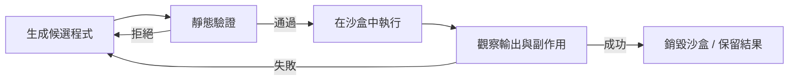
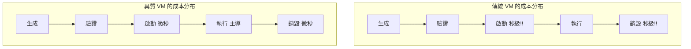

# 3.2　不可信程式碼的生成執行銷毀循環

> 本節導論：AI 代理產出的程式碼，是「不可信但必須執行」的矛盾體。這一節把「生成 → 驗證 → 執行 → 觀察 → 銷毀」的循環拆開，指出每個階段對虛擬機的要求。

## 3.2.1 一個典型的代理迴圈

設想一個 AI 代理在解決一個資料處理任務。它的工作循環大致是：

這個循環與傳統軟體開發的根本差異在於 **頻率與信任**：人類寫的程式一天部署幾次、經過 code review；AI 生成的程式每秒生成幾百個、從未被人看過。因此虛擬機必須承擔「即時驗證 + 安全隔離 + 快速重置」的三重責任。

## 3.2.2 生成階段：程式碼是不可信的輸入

AI 生成的程式碼，等同於「從網路上下載的陌生二進位檔」。它可能包含：

* **資源濫用**：無窮迴圈、遞迴爆炸、配置超大記憶體。
* **越權存取**：讀寫宿主檔案、呼叫不該呼叫的 API。
* **惡意行為**：即使 AI 沒有惡意，模型也可能生成有漏洞的程式碼，被攻擊者利用。
* **非確定性**：同樣的 prompt 可能生成不同程式，行為難以預測。

虛擬機的第一個要求：**把生成物當成敵意輸入（adversarial input）對待**，在執行前做嚴格驗證。

## 3.2.3 驗證階段：靜態檢查必須快且嚴

傳統的「編譯 + 測試」流程對 AI 代理太慢。代理需要的是 **載入前驗證（load-time verification）**：在程式進入執行前，用靜態分析確認它滿足安全不變式。

這正是 eBPF 驗證器的哲學（第 8 章詳談）：

* 檢查所有記憶體存取都在合法範圍。
* 檢查迴圈有界（不會無窮執行）。
* 檢查呼叫的函式在白名單內。
* 檢查資源使用在預算內。

關鍵是：**驗證必須能在毫秒甚至微秒內完成**，否則它本身就成了瓶頸。這要求驗證的目標語言有良好的結構（如 Wasm 的結構化控制流、eBPF 的有界迴圈），讓驗證可以單遍完成。

## 3.2.4 執行階段：隔離要「夠強」且「夠便宜」

驗證通過不代表安全——驗證器可能有漏洞，或程式可能利用合法的 API 做壞事。因此執行階段需要 **隔離** 作為第二道防線。

隔離的層次有多種：

* **硬體隔離**（VM、TEE）：最強，但最貴。
* **核心隔離**（容器、namespace）：中等，但共享核心有風險。
* **語言層隔離**（Wasm、eBPF）：輕量，靠驗證器 + 記憶體模型。
* **程序內隔離**（MPK、記憶體標籤）：最快，但依賴硬體。

AI 代理的執行，通常需要「多層疊加」：外層用 MicroVM 做粗粒度隔離，內層用 Wasm 做細粒度隔離。這就是第 8 章「雙層驗證架構」的由來。

## 3.2.5 觀察階段：副作用必須可觀測且可回滾

代理執行一段程式後，需要觀察結果：輸出是什麼？花了多少資源？有沒有副作用（寫了檔案、發了網路請求）？

這對虛擬機提出兩個要求：

* **可觀測性（observability）**：能追蹤程式做了哪些系統呼叫、讀寫了哪些記憶體、花了多少算力。
* **可回滾性（rollback）**：如果程式失敗或有破壞性副作用，要能把整個狀態還原到執行前。

可回滾性正是「狀態快照分叉」的用武之地（第 7 章）：在執行前拍一張快照，失敗就回滾，成功就合併。這讓代理可以「大膽試錯」，不用擔心把環境弄壞。

## 3.2.6 銷毀階段：重置必須是 O(1)

傳統虛擬機的銷毀是「關機 + 釋放資源」，成本隨資源量增加。但 AI 代理需要的是 **常數時間的重置**：無論沙盒裡跑了什麼，銷毀都應該在微秒內完成。

這可以透過幾種方式實現：

* **記憶體池（memory pool）**：預先配置大塊記憶體，沙盒從池中分配，銷毀時整塊歸還，不做逐物件清理。
* **世代式回收（generation-based）**：把沙盒標記為「已死」，延遲清理，用背景執行緒批次回收。
* **Copy-on-Write 基底**：沙盒從一個唯讀基底映像分叉，寫入的頁是私有的，銷毀時只需丟棄私有頁。

這些機制的共同思想是：**把「銷毀」從「清理每個資源」變成「丟棄一個指標」**，讓重置成本與沙盒大小無關。

## 3.2.7 循環的整體成本模型

把五個階段串起來，一次代理迴圈的總成本是：

$$
T_{\text{cycle}} = T_{\text{gen}} + T_{\text{verify}} + T_{\text{cold}} + T_{\text{exec}} + T_{\text{observe}} + T_{\text{destroy}}
$$

在傳統虛擬機下，$ T_{\text{cold}} $ 與 $ T_{\text{destroy}} $ 是主導項（秒級）。在理想的異質虛擬機下，$ T_{\text{cold}} $ 與 $ T_{\text{destroy}} $ 被壓到微秒級，$ T_{\text{exec}} $ 成為主導項——也就是說，**時間終於花在「真正有用的計算」上，而不是隔離的開銷上**。

## 3.2.8 本節小結

* 代理迴圈的五階段：生成、驗證、執行、觀察、銷毀，每階段都對虛擬機有要求。
* 生成物是不可信輸入，必須當敵意輸入對待。
* 驗證必須快（載入前、單遍可完成），執行必須隔離（多層疊加）。
* 觀察需要可觀測性與可回滾性，銷毀必須是常數時間。
* 理想異質虛擬機讓時間花在「執行」而非「隔離開銷」。

下一節，我們深入「狀態分叉」與「確定性重放」這兩個支撐代理試錯的關鍵機制。
