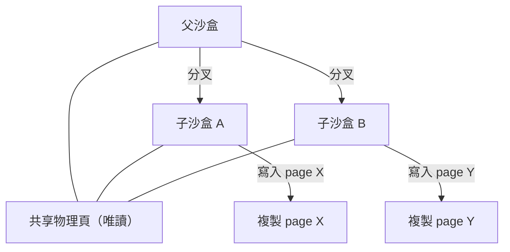
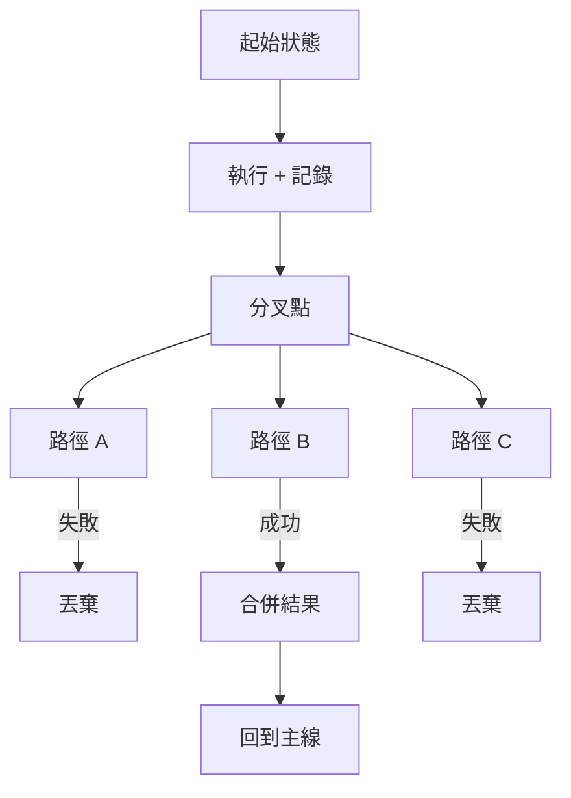

# 3.3　狀態分叉與確定性重放

> 本節導論：AI 代理的「思考」本質上是「多次嘗試、淘汰、保留」。要讓這件事在微秒級完成，虛擬機必須能瞬間複製狀態、原樣重播歷史。這是第三部沙盒機制的理論核心。

## 3.3.1 什麼是狀態分叉

**狀態分叉（State Fork）** 指的是：把一個正在執行的環境的完整狀態，複製成兩份，讓兩份各自繼續執行而互不影響。

在作業系統裡，這有古典對應：`fork()` 系統呼叫。`fork()` 建立一個子行程，共享父行程的記憶體（Copy-on-Write），各自有獨立的位址空間。子行程可以在共享的基礎上做修改，不影響父行程。

AI 代理需要的是同一件事，但層級更高、粒度更細：

* **不只是行程，而是整個虛擬機 / 沙盒**（含 GPU 狀態、檔案系統、網路連線）。
* **不只是 CPU 記憶體，而是異質執行狀態**（顯存、kernel 佇列、裝置暫存器）。
* **速度要求是微秒級**，而不是 `fork()` 的毫秒級。

## 3.3.2 Copy-on-Write：分叉的核心機制

Copy-on-Write（CoW）是讓分叉變便宜的關鍵。它的思路是：

* 分叉時，不實際複製記憶體，而是讓父子的頁表指向同一批物理頁，並把這些頁標記為「唯讀」。
* 當任一方寫入某頁時，觸發頁錯誤，核心才複製該頁，並更新寫入方的頁表。
* 結果是：只有被修改的頁才會被複製，未修改的頁永遠共享。

分叉的成本因此與「寫入量」成正比，而非「記憶體總量」成正比。對於「分叉後只改一點點狀態」的 AI 代理，這極其便宜。

## 3.3.3 異質狀態的難題：GPU 顯存怎麼分叉

CPU 的 CoW 有 MMU 支援，成熟且高效。但 GPU 的顯存分叉困難得多：

* **GPU 沒有與 CPU 相同的頁錯誤機制**：GPU 的記憶體管理（如 NVIDIA 的 UVM）雖然支援 page fault，但語意與成本與 CPU 不同。
* **顯存不可任意共享**：兩個沙盒的 GPU 狀態如果共享同一塊顯存，一個寫入就可能污染另一個。
* **kernel 佇列是隱性狀態**：GPU 上可能還有未完成的 kernel，分叉時要決定「這些 kernel 算誰的」。

目前的解法有幾種：

* **暫停後複製**：分叉前把 GPU 上的 kernel 全部排空（drain），再複製顯存。簡單但慢。
* **顯存快照 + CoW**：對顯存做類似 CPU 的 CoW（部分 GPU 支援）。
* **重算代替複製**：不複製顯存，而是記錄「產生這塊顯存的計算圖」，分叉時重算（checkpointing 的變體）。

這些解法都還在演進中，是異質虛擬機最有挑戰的技術前沿之一。

## 3.3.4 確定性重放：把歷史原樣播一次

**確定性重放（Deterministic Replay）** 指的是：記錄一次執行的所有「非確定性來源」，之後能原樣重播這次執行。

為什麼需要它？

* **除錯**：AI 生成的程式若偶發失敗，重播能重現問題。
* **多路徑推理**：代理可以先跑一次，觀察結果，再從某個中間點重播並修改決策。
* **稽核**：記錄代理做了什麼，之後能驗證。

重放的難點在於「非確定性來源」很多：

* **時間**：`clock_gettime` 每次回傳不同值。
* **執行緒排程**：多執行緒的執行順序不確定。
* **亂數**：`rand()` 的種子與序列。
* **外部輸入**：網路、檔案、使用者輸入。
* **硬體非確定性**：GPU 的浮點運算順序、原子操作順序。

確定性重放的標準做法是 **記錄 + 重播（record & replay）**：執行時記錄所有非確定性輸入（時間戳、排程決策、亂數種子、I/O 結果），重播時把這些輸入「餵」回去，讓程式走同一條路徑。

## 3.3.5 分叉與重放的組合：時間旅行除錯

把分叉與重放組合起來，就得到一個強大的能力：**時間旅行（time travel）**。

* 執行一段程式，同時記錄所有非確定性輸入。
* 在某個時間點分叉出多個分支。
* 每個分支可以「往後重播」到任意時間點，也可以「往前分叉」出新分支。
* 失敗的分支直接丟棄，成功的分支合併結果。

這讓 AI 代理可以「大膽探索」：同時嘗試多條推理路徑，不用擔心污染主狀態；失敗就回滾，成功就保留。這正是第 7 章「多路徑推理」的基礎。

## 3.3.6 成本與取捨

分叉與重放不是免費的：

* **記錄成本**：記錄所有非確定性輸入需要額外的儲存與頻寬。
* **重播成本**：重播要重跑計算，可能很貴。
* **一致性成本**：確保重播時的環境與原執行一致（例如檔案系統狀態）。

因此實務上會做取捨：

* **只記錄關鍵輸入**：不是所有東西都記，只記影響控制流的。
* **用快照代替重播**：與其從頭重播，不如定期拍快照，從最近的快照恢復。
* **接受部分非確定性**：對於不影響正確性的非確定性（如浮點誤差），可以容忍。

## 3.3.7 本節小結

* 狀態分叉是「複製整個執行狀態」，AI 代理靠它做多路徑試錯。
* Copy-on-Write 讓分叉成本與寫入量成正比，而非記憶體總量。
* 異質狀態（GPU 顯存、kernel 佇列）的分叉是技術前沿，尚無統一解法。
* 確定性重放記錄非確定性來源，讓執行可原樣重播，支撐除錯與稽核。
* 分叉 + 重放 = 時間旅行，是代理「大膽探索」的基礎。

第一部的診斷到此結束。接下來進入第二部：**如何真正把異質算力虛擬化**。第 4 章從最底層的抽象開始——虛擬張量指令集。
