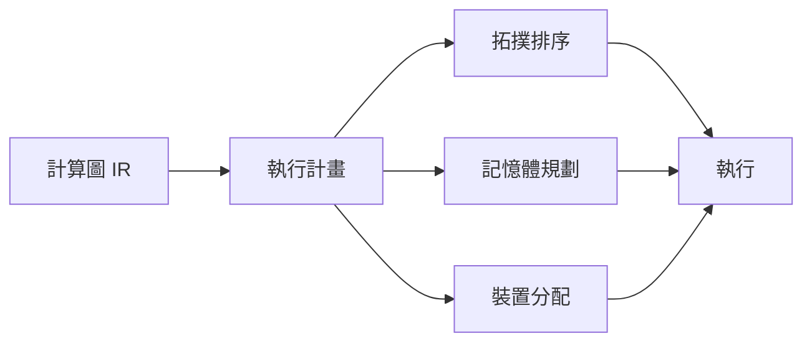

# 4.1　從計算圖 IR 到虛擬執行檔

> 本節導論：如果說 JVM 的錨點是「字節碼」，那麼異質虛擬機的錨點就是「計算圖」。這一節說明計算圖如何成為一種新的虛擬執行檔，以及它必須滿足哪些條件。

## 4.1.1 一個思想實驗：如果 GPU 有字節碼

回想 JVM 的成功：它讓同一份 `.class` 跑在任何有 JVM 的平台上，靠的是「字節碼 + 各平台的 JIT」。如果把這個模式搬到異質算力，我們會問：

> 有沒有一種「通用字節碼」，可以表達神經網路計算，並被編譯到任何加速器？

答案幾乎是肯定的，但形式不是「一連串指令」，而是「一張計算圖」。原因很簡單：神經網路的計算本質上是一張 DAG（有向無環圖），節點是張量運算，邊是張量流動。用「指令序列」表達它，反而丟掉了圖結構的資訊。

所以異質虛擬機的「虛擬執行檔」，不是線性字節碼，而是 **計算圖 IR**。

## 4.1.2 計算圖的組成

一個計算圖 IR 通常包含：

* **運算節點（operations）**：如 `matmul`、`conv2d`、`softmax`、`add`、`relu`。
* **張量（tensors）**：節點的輸入輸出，有 shape、dtype、layout。
* **邊（edges）**：表示資料依賴，決定執行順序。
* **屬性（attributes）**：如卷積的 stride、padding，矩陣乘的轉置旗標。
* **函式邊界（function boundaries）**：把圖切成可重用的子圖。

以 StableHLO 為例，一個簡單的「矩陣乘 + 加 bias + ReLU」會表達成：

```mlir
func.func @mlp(%a: tensor<128x256xf32>, %b: tensor<256x512xf32>, %bias: tensor<512xf32>) -> tensor<128x512xf32> {
  %mm = "stablehlo.dot"(%a, %b) : (tensor<128x256xf32>, tensor<256x512xf32>) -> tensor<128x512xf32>
  %bias_b = "stablehlo.broadcast_in_dim"(%bias) {broadcast_dimensions = array<i64: 1>} : (tensor<512xf32>) -> tensor<128x512xf32>
  %add = "stablehlo.add"(%mm, %bias_b) : (tensor<128x512xf32>, tensor<128x512xf32>) -> tensor<128x512xf32>
  %relu = "stablehlo.maximum"(%add, %zero) : ...
  return %relu : tensor<128x512xf32>
}
```

這段 IR 是可攜的：它不指定「在哪個裝置上跑」，只描述「要算什麼」。這就是它作為「虛擬執行檔」的基礎。

## 4.1.3 虛擬執行檔的三個必要條件

一份計算圖 IR 要成為「虛擬執行檔」，需要滿足三個條件，對應 JVM 字節碼的三個特性：

1. **硬體無關（device-agnostic）**：不綁定特定 GPU/NPU 的指令集或記憶體佈局。這對應字節碼的「平台無關」。
2. **語意完備（semantically complete）**：能表達所有 AI 計算需要的運算，包括張量運算、控制流（條件、迴圈）、以及不規則運算（如 scatter/gather）。這對應字節碼的「圖靈完備」。
3. **可驗證（verifiable）**：能在載入前靜態檢查型別、shape、資源使用，確保安全。這對應字節碼驗證器。

三者缺一不可。少了硬體無關，就無法跨晶片；少了語意完備，就無法表達真實模型；少了可驗證，就無法安全執行 AI 生成的程式。

## 4.1.4 為什麼是「圖」而不是「指令」

有人會問：為什麼不乾脆設計一套「張量字節碼」，用線性指令序列表達計算？畢竟 JVM 就是這樣做的。

答案是：**圖結構本身就是最佳化的載體**。許多 AI 編譯的最佳化，只有在圖層才能做：

* **算子融合**：把 `matmul → bias_add → relu` 合成一個 kernel，需要看到「這三個節點相連」。
* **佈局傳播**：決定每個張量的記憶體佈局，需要在整張圖上做約束求解。
* **常量折疊**：把圖中「輸入固定的子圖」提前算好，需要圖的可達性分析。
* **跨裝置切分**：把圖切成子圖分派到不同裝置，需要圖的分割演算法。

如果一開始就用線性指令，這些「圖級」資訊就被抹掉了。所以計算圖 IR 選擇「保留圖結構」，把「線性化」延後到降階的最後階段。

## 4.1.5 從圖到「執行計畫」

計算圖 IR 要真正執行，還需要一個「執行計畫（execution plan）」：

* **拓撲排序**：決定節點的執行順序。
* **記憶體規劃**：為每個中間張量分配緩衝區（buffer），並在生命週期結束後重用。
* **裝置分配**：決定每個節點跑在哪個裝置上。
* **串流排程**：決定哪些節點可以平行、哪些要同步。

這一步類似 JVM 的「類別載入 + 連結」，但它不是把 IR 變成機器碼，而是把 IR 變成 **一份可執行的排程**。真正把節點變成機器碼的，是後端編譯器（第 6 章的 JIT）。



## 4.1.6 虛擬 ISA 的邊界：什麼該放進去

設計虛擬張量 ISA 時，最難的問題是「邊界」：哪些運算該成為 ISA 的一部分，哪些該留給後端？

* **太細**：如果 ISA 只包含 `add`、`mul` 這種純量運算，那就退化成「指令流」，失去圖的優勢。
* **太粗**：如果 ISA 包含「整個 ResNet」這種高階運算，那就無法跨模型重用，也無法做細粒度最佳化。

實務上的原則是：**ISA 的粒度應該對應「硬體上不可再分的基本運算」**，例如矩陣乘、卷積、激活函數、歸約（reduction）、廣播（broadcast）。這些運算在不同硬體上都有對應的加速單元，但在高階語意上又足夠通用。

StableHLO 就是這種粒度的代表：它的運算集（HLO ops）涵蓋了稠密計算的主要原語，卻不綁定任何特定硬體。

## 4.1.7 本節小結

* 異質虛擬機的「虛擬執行檔」是計算圖 IR，而非線性字節碼。
* 計算圖包含運算節點、張量、邊、屬性，保留圖結構以便最佳化。
* 虛擬執行檔需滿足三條件：硬體無關、語意完備、可驗證。
* 圖結構是最佳化的載體：融合、佈局、常量折疊、跨裝置切分都需要它。
* 虛擬 ISA 的粒度應對應「硬體上不可再分的基本運算」，StableHLO 是代表。

下一節，我們深入 StableHLO 與 MLIR，看它們如何成為這套虛擬 ISA 的具體實現。
