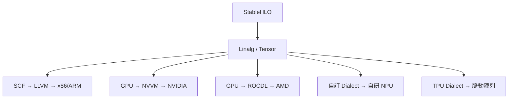

# 4.2　StableHLO 與 MLIR 作為虛擬 ISA

> 本節導論：如果計算圖是異質虛擬機的「字節碼」，那 StableHLO 就是這套字節碼的事實標準，而 MLIR 是讓它能被降階到各硬體的「組合語言框架」。

## 4.2.1 為什麼需要一個「穩定」的 HLO

HLO（High-Level Operations）最早來自 Google 的 XLA 編譯器。XLA 把 TensorFlow / JAX 的計算圖轉成 HLO，再降階到 CPU/GPU/TPU。問題是：HLO 的定義隨著 XLA 內部演進而變動，不同的框架、不同的版本之間無法保證相容。

2022 年，Google 推出 **StableHLO**，把 HLO 的運算集 **規格化、版本化**，作為一個獨立的、穩定的 IR。它的定位非常明確：

> StableHLO 是「框架與編譯器之間的穩定介面」，也是「可攜式的高階運算集」。

這正是虛擬 ISA 需要的：一個 **不隨某個編譯器內部實作而變動** 的運算集。當 PyTorch、JAX、TensorFlow 都輸出 StableHLO，不同硬體的後端只需要支援 StableHLO，就能接收所有框架的模型。

## 4.2.2 StableHLO 的運算集

StableHLO 的運算大致分為幾類：

* **元素級運算（elementwise）**：`add`、`multiply`、`maximum`、`exponential`、`tanh` 等。
* **張量運算**：`dot`（矩陣乘）、`convolution`、`reduce`、`transpose`、`reshape`、`broadcast_in_dim`。
* **索引運算**：`gather`、`scatter`、`slice`、`dynamic_slice`。
* **控制流**：`while`、`if`、`case`（以 region 表達）。
* **通訊運算**：`all_reduce`、`all_gather`（分散式訓練用）。

這個運算集的設計原則是：**足夠表達真實模型，但不綁定硬體實作**。例如 `dot` 不規定用 Tensor Core 還是脈動陣列，只規定「做矩陣乘」。

## 4.2.3 MLIR：讓 StableHLO 能被降階的框架

StableHLO 本身只是一個「方言（dialect）」，它需要一個框架來做「降階」。這個框架就是 **MLIR（Multi-Level Intermediate Representation）**。

MLIR 的核心思想是「**方言 + 漸進式降階**」：

* 每個抽象層次是一個「方言」（dialect），例如 `stablehlo`、`linalg`、`tensor`、`scf`、`gpu`、`llvm`。
* 降階是「從高階方言逐步轉換到低階方言」，每一步只做該層最擅長的事。
* 每個轉換是一個「Pass」，可以組合、可以重複使用。

對異質虛擬機而言，MLIR 的價值在於：**它把「跨硬體」變成「多條降階路徑」**。同一份 StableHLO，可以走：

* `stablehlo → linalg → scf → llvm`（CPU）
* `stablehlo → linalg → gpu → nvvm`（NVIDIA GPU）
* `stablehlo → linalg → gpu → rocdl`（AMD GPU）
* `stablehlo → linalg → 自訂 dialect → 自研 NPU`（專用硬體）

這正是「一份虛擬執行檔，多個後端」的具體實現。虛擬 ISA 是 StableHLO，後端是各條 MLIR 降階路徑。

## 4.2.4 StableHLO 作為「可攜性契約」

把 StableHLO 當成虛擬 ISA，會帶來一個重要的架構後果：**框架與硬體解耦**。

在過去，PyTorch 支援一個新硬體，需要在 PyTorch 裡寫一套新的後端；TensorFlow 也要寫一套。同一個硬體，每個框架都要重複整合。有了 StableHLO，硬體廠商只需要提供「StableHLO → 我的硬體」的 MLIR 後端，所有輸出 StableHLO 的框架就自動支援。

這就像 JVM：硬體廠商提供 JVM 的 JIT 後端，所有 JVM 語言就自動支援。StableHLO 之於異質算力，正如字節碼之於 CPU。

## 4.2.5 可驗證性：StableHLO 的靜態檢查

虛擬 ISA 要能安全執行 AI 生成的程式，必須可驗證。StableHLO 提供了幾層驗證：

* **型別與 shape 檢查**：每個運算的輸入輸出型別、shape 必須匹配。
* **語意驗證**：例如 `broadcast_in_dim` 的維度必須合法。
* **不變式檢查**：MLIR 的 verifier 框架可以掛自訂檢查。

但要注意：StableHLO 的驗證只保證「IR 結構合法」，不保證「執行安全」（例如不會無窮迴圈、不會記憶體爆炸）。後者需要額外的「預算驗證」（第 8 章）。

## 4.2.6 侷限與演進

StableHLO 不是萬靈丹，它有幾個已知侷限：

* **動態 shape 支援有限**：雖然有 `dynamic` 維度，但許多後端對動態 shape 的支援仍不完整。
* **不規則運算表達笨拙**：圖神經網路、稀疏張量等不規則計算，用稠密張量原語表達效率低。
* **控制流較弱**：`while` / `if` 能表達，但不像高階語言那樣靈活。

這些侷限正是 MLIR 生態持續演進的方向：新的方言（如稀疏張量 dialect、動態 shape 支援）不斷加入，讓虛擬 ISA 的語意完備性逐步提升。

## 4.2.7 本節小結

* StableHLO 把 HLO 規格化、版本化，成為框架與編譯器之間的穩定介面。
* 它的運算集涵蓋元素級、張量、索引、控制流、通訊，粒度對應硬體基本運算。
* MLIR 用「方言 + 漸進式降階」把 StableHLO 降階到多種硬體，實現「一份虛擬執行檔、多後端」。
* StableHLO 之於異質算力，正如字節碼之於 CPU：框架與硬體解耦。
* 侷限在動態 shape、不規則運算、控制流，但生態持續演進。

下一節，我們看把這套虛擬 ISA 真正跑起來的執行期：IREE 與 OpenXLA。
