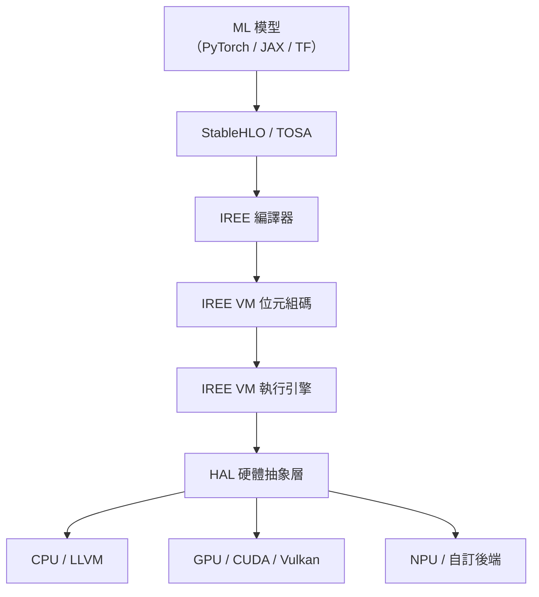

# 4.3　IREE 與 OpenXLA 的統一執行期

> 本節導論：虛擬 ISA 需要一台「執行期」才能落地。OpenXLA 是編譯器的統一前端，IREE 是跨硬體的執行期代表。兩者合起來，構成異質虛擬機的「運行時骨架」。

## 4.3.1 OpenXLA：把 XLA 拆成可組合的元件

**OpenXLA**（2022 年成立）是 Google 主導的開源專案，目標是把原本封閉在 XLA 裡的編譯能力拆解、標準化、開放出來。它的核心元件包括：

* **StableHLO**：穩定的高階運算集（上一節）。
* **XLA 編譯器**：把 StableHLO 降階到 CPU/GPU/TPU 的核心。
* **PJRT（Pretty Much Just Another Runtime）**：一個統一的裝置執行期介面，管理裝置、緩衝區、編譯快取、非同步執行。

OpenXLA 的架構意義是：**它把「編譯」與「執行」分開**。編譯器只負責把 StableHLO 變成可執行的「執行檔（executable）」，執行期（PJRT）負責把執行檔載入裝置、管理記憶體、排程執行。

這正是虛擬機的典型結構：編譯器 = 「產生虛擬執行檔」，執行期 = 「虛擬機的執行引擎」。

## 4.3.2 PJRT：虛擬機的裝置抽象層

PJRT 是 OpenXLA 裡最像「虛擬機」的部分。它定義了一組抽象介面：

* **Client**：代表一個執行期實例，管理多個裝置。
* **Device**：代表一個可執行的硬體單元（CPU、GPU、TPU）。
* **Buffer**：代表一塊裝置記憶體，有 shape、dtype、生命週期。
* **Executable**：代表一個已編譯的計算圖，可以在裝置上執行。
* **LoadedExecutable**：Executable 載入裝置後的實例。

這組抽象讓上層框架不需要知道底下是 CUDA、ROCm 還是 TPU runtime，只需要呼叫 PJRT 的介面。例如：

```cpp
// 概念示意：PJRT 的執行流程
PjRtClient* client = GetClient("cuda");
PjRtDevice* device = client->devices()[0];
PjRtBuffer* input = client->BufferFromHostBuffer(data, shape);
PjRtLoadedExecutable* exec = client->Compile(program, {device});
PjRtBuffer* output = exec->Execute({input})[0];
```

這段程式碼對「底下是什麼硬體」完全無感——這就是虛擬化的價值。

## 4.3.3 IREE：為「部署」而生的執行期

如果說 OpenXLA/PJRT 偏向「訓練與研究」，那 **IREE（Intermediate Representation Execution Environment）** 就更偏向「部署與邊緣」。

IREE 的設計目標是：**把 ML 模型編譯成一個可攜的、可在多種硬體上執行的「VM 位元組碼（VMFB）」**。它的架構有幾個特點：

* **IREE VM**：一個輕量的虛擬機，執行 IREE 編譯出的位元組碼。這是一個真正的「虛擬機」——有指令集、有記憶體模型、有執行引擎。
* **HAL（Hardware Abstraction Layer）**：硬體抽象層，把 CPU、GPU、NPU 的差異封裝起來，類似 Vulkan 的角色。
* **多後端**：支援 LLVM（CPU）、CUDA、ROCm、Vulkan、Metal，以及自訂硬體。
* **靜態排程**：IREE 傾向在編譯期決定排程，減少執行期開銷，適合邊緣裝置。

IREE 的「VM 位元組碼」是異質虛擬機概念最直接的體現：它就是一台「張量虛擬機」，執行計算圖編譯出的位元組碼。



## 4.3.4 兩種執行期哲學的對照

OpenXLA 與 IREE 代表兩種不同的執行期哲學：

| | OpenXLA / PJRT | IREE |
|---|---|---|
| 主要場景 | 訓練、研究、資料中心 | 部署、邊緣、嵌入式 |
| 編譯策略 | JIT 為主（可 AOT） | AOT 為主（可 JIT） |
| 執行模型 | 執行檔載入裝置 | VM 位元組碼解釋 / 編譯 |
| 記憶體管理 | 執行期動態配置 | 編譯期靜態規劃 |
| 可攜性 | 多後端 | 多後端 + VM 抽象 |

兩者其實互補：OpenXLA 適合「大規模、動態」的訓練；IREE 適合「小體積、確定性」的部署。異質虛擬機可以同時借鏡兩者——用 PJRT 的裝置抽象，用 IREE 的 VM 位元組碼做可攜執行檔。

## 4.3.5 執行期如何處理「多裝置」

真正困難的是「一個計算圖跨多個裝置」。執行期要回答：

* **裝置分配**：哪些節點跑在哪個裝置？
* **資料傳輸**：裝置之間怎麼搬張量？
* **同步**：怎麼確保資料依賴正確？
* **容錯**：某個裝置失敗怎麼辦？

PJRT 的做法是用「裝置網格（device mesh）」與「分片（sharding）」描述資料分布，編譯器（GSPMD）負責把計算切分到網格上。IREE 則傾向在編譯期決定裝置分配，執行期只負責執行。

這一步是「跨晶片可攜」與「跨節點規模」的交會點。第 10 章會把這個問題擴展到整個資料中心。

## 4.3.6 執行期作為「虛擬機」的本質

回到本書的核心命題：虛擬機是「向上提供抽象、向下管理資源」的中介層。OpenXLA 與 IREE 正是這層中介的具體實現：

* **向上**：提供 StableHLO / TOSA 等抽象，讓框架無感於硬體。
* **向下**：透過 PJRT / HAL 管理裝置、記憶體、排程。

它們與傳統虛擬機的差別，只在於「虛擬化的對象」是「計算圖與張量」，而不是「CPU 指令與位址空間」。但架構位置完全對應：**編譯器產生虛擬執行檔，執行期把它跑起來**。

## 4.3.7 本節小結

* OpenXLA 把 XLA 拆成 StableHLO、XLA 編譯器、PJRT 三個可組合元件。
* PJRT 提供裝置抽象（Client / Device / Buffer / Executable），是虛擬機的裝置層。
* IREE 把模型編譯成 VM 位元組碼，用 HAL 抽象硬體，是「張量虛擬機」的直接體現。
* 兩者哲學互補：OpenXLA 偏訓練/動態，IREE 偏部署/靜態。
* 多裝置執行需要裝置分配、資料傳輸、同步、容錯，是跨晶片可攜的難點。

下一章，我們從「可攜性」轉向「切分」：**如何把同一池異質算力，公平且動態地分給多個租戶。**
