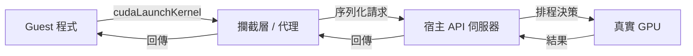
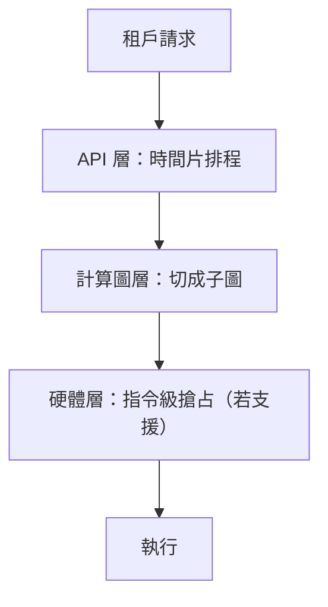

# 5.1　API Remoting 與指令級排程

> 本節導論：既然 GPU 難以在硬體層分時，那就在「API 呼叫」與「指令流」這兩層攔截。這一節說明軟體定義算力切分的兩種基本手法，以及它們的取捨。

## 5.1.1 為什麼要在 API 層攔截

回顧第 1 章：GPU 難以像 CPU 那樣分時複用，因為上下文大、缺乏搶占、隔離不完整。但這不代表無法切分——只是切分的層次要換。

**API Remoting** 的思路是：不讓 guest 直接和 GPU 驅動對話，而是在中間放一層「API 代理」。guest 呼叫 CUDA/ROCm/OpenCL API 時，請求被攔截，轉發給宿主的一個「伺服器」，由伺服器決定何時、在哪個真實 GPU 上執行。

這就像遠端程序呼叫（RPC）：guest 以為自己在呼叫本地的 `cudaLaunchKernel`，其實是透過共享記憶體或網路，把請求送到另一個行程。

## 5.1.2 API Remoting 的實現方式

API Remoting 有幾種常見實現：

* **函式庫攔截（library interposition）**：用 `LD_PRELOAD` 或自訂的 `libcuda.so` 替換原生函式庫，把 API 呼叫導向代理。這是 rCUDA、GVirtuS 等學術方案的做法。
* **驅動層攔截**：在核心驅動與使用者態函式庫之間攔截，例如 vGPU 廠商的 mediator。
* **虛擬裝置**：對 guest 暴露一個「虛擬 GPU」PCIe 裝置，由宿主模擬它的 MMIO 與 DMA，把命令轉發給真實 GPU。

目前商用最成熟的是 NVIDIA 的 vGPU（GRID）與 AMD 的 MxGPU。它們都是在 API/驅動層做「時間片輪轉」：多個 guest 共用一張 GPU，由 mediator 決定誰先用。

## 5.1.3 API Remoting 的優點與代價

**優點**：

* **不需要硬體支援**：只要有 API 就能攔截，適用於任何 GPU。
* **可做時間片排程**：mediator 可以在 kernel 之間切換租戶，實現「準分時」。
* **可做資源配額**：限制每個租戶的顯存、算力、API 呼叫頻率。

**代價**：

* **序列化開銷**：每次 API 呼叫都要序列化參數、傳輸、反序列化。對於頻繁的小呼叫（如每次 kernel launch），開銷可觀。
* **無法切分單一 kernel**：mediator 只能在 kernel **之間** 切換，一個長 kernel 仍會卡住其他租戶。
* **語意落差**：有些 API 有隱性狀態（如 CUDA 的 context、stream），代理要小心維護。

## 5.1.4 指令級排程：切到 kernel 內部

要突破「無法切分單一 kernel」的限制，就需要 **指令級排程（instruction-level scheduling）**：把一個大 kernel 切成多個小塊，在塊與塊之間插入排程點。

這在異質虛擬機裡有兩種做法：

* **計算圖層切分**：在編譯期或執行期，把計算圖的節點切成更小的子圖（例如把一個大矩陣乘切成多個小矩陣乘），讓排程器能在子圖之間切換。
* **硬體指令級搶占**：部分 GPU 支援「mid-kernel preemption」，硬體可以在指令邊界暫停 kernel，保存狀態，切換到另一個 kernel。這需要硬體支援（如 NVIDIA 的 compute preemption）。

前者是軟體手法，通用但有效粒度受限於「子圖」；後者是硬體手法，粒度細但依賴硬體。

## 5.1.5 兩者的組合：分層切分

實務上會把兩者組合：

* **API 層**負責「租戶之間」的公平性：每個租戶獲得一個時間片，時間到就切換。
* **計算圖層**負責「租戶內部」的細化：把大計算切成小塊，讓切換點更多、更均勻。
* **硬體層**負責「極細粒度」的搶占：若有硬體支援，可在指令邊界切換。

這種分層切分，讓「軟體定義算力切分」能在不同硬體上達到不同的粒度：沒有硬體支援時，至少能到「子圖」粒度；有硬體支援時，能到「指令」粒度。

## 5.1.6 排程策略：公平 vs 效率

切分出來之後，下一個問題是「怎麼排」。常見策略有：

* **輪轉（round-robin）**：每個租戶輪流跑一個時間片。公平但可能犧牲吞吐。
* **優先級（priority）**：高優先級租戶優先。適合延遲敏感的推理。
* **工作竊取（work stealing）**：空閒的裝置去偷別人的工作。提高利用率但增加複雜度。
* **SLO 導向**：根據每個租戶的服務水準目標（SLO）分配算力。

在 AI 推論場景，延遲是關鍵，所以常採用「優先級 + 保留頻寬」的混合策略：保證每個租戶的最低算力（避免吵鬧鄰居），剩下的算力再依優先級分配。

## 5.1.7 本節小結

* API Remoting 在 API/驅動層攔截，實現時間片排程與資源配額，不需硬體支援。
* 代價是序列化開銷、無法切分單一 kernel、隱性狀態維護。
* 指令級排程把 kernel 切成小塊，在塊間切換，突破單 kernel 限制。
* 分層切分組合 API 層、計算圖層、硬體層，達到不同粒度。
* 排程策略需在公平與效率間取捨，常用 SLO 導向的混合策略。

下一節，我們談「超賣」：如何在切分的基礎上，進一步提高資源利用率。
