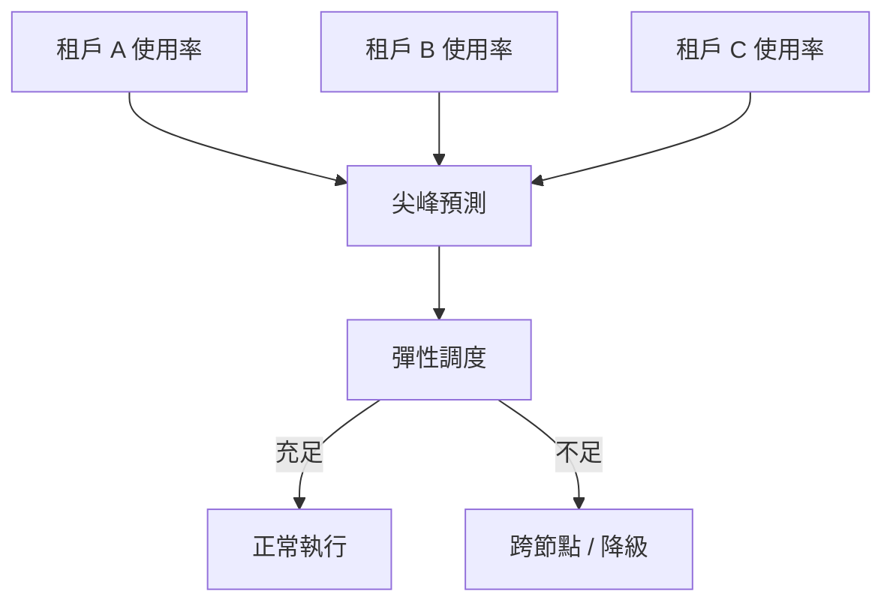

# 5.2　算力與顯存的動態超賣

> 本節導論：靜態切分的最大浪費，是「每個租戶都保留尖峰資源，但大部分時間用不到」。超賣（overcommitment）是雲端提高利用率的經典手法，但在異質算力上，它有全新的難度。

## 5.2.1 什麼是超賣

**超賣（overcommitment）** 指的是：承諾給租戶的資源總量，超過實際擁有的資源總量。背後的賭注是「租戶不會同時用滿」。

CPU 與記憶體早已超賣多年：

* 記憶體超賣：作業系統用 swap、頁面回收，讓多個行程的虛擬記憶體總和超過實體記憶體。
* CPU 超賣：排程器把多個 vCPU 映射到少數實體核心，靠時間片輪轉。

超賣讓雲端業者能用同樣的硬體服務更多客戶，大幅提高利用率。但它有一個前提：**資源可以被「暫時借出」，且能在需要時「要回來」**。

## 5.2.2 顯存超賣：為什麼難

顯存（GPU 記憶體）的超賣比 CPU 記憶體難得多：

* **沒有 swap**：GPU 沒有像 CPU 那樣的「把頁面換到磁碟」機制。顯存不夠就是 OOM。
* **不可壓縮**：張量是稠密資料，壓縮率有限。
* **遷移成本高**：把顯存頁搬到主機記憶體再搬回來，頻寬成本高。
* **沒有統一的頁錯誤**：部分 GPU 支援 page fault，但語意與成本不一。

目前的顯存超賣主要靠幾種手法：

* **記憶體池化（memory pooling）**：多個租戶共享一個大顯存池，按需分配、及時回收。
* **張量卸載（tensor offloading）**：把不活躍的張量搬到主機記憶體或 CXL 記憶體，需要時再搬回。
* **記憶體壓縮**：對某些張量做量化（如 FP16 → INT8），減少佔用。
* **統一虛擬記憶體（UVM）**：用 GPU 的虛擬位址空間，把主機記憶體當作「延伸顯存」。

## 5.2.3 算力超賣：時間片的統計多工

算力超賣比較直接：把多個租戶的計算排到同一個裝置上，靠時間片輪轉。超賣比例可以是 2x、4x，取決於租戶的平均使用率。

但這裡有一個關鍵風險：**尖峰碰撞（peak collision）**。如果多個租戶同時進入尖峰，超賣的算力就不夠分配，導致延遲暴增。

因此算力超賣需要「尖峰預測」與「彈性調度」：

* **預測**：根據歷史資料預測租戶的尖峰時間。
* **彈性**：尖峰時臨時調用其他裝置的算力（跨節點排程）。
* **降級**：真的不夠時，對非關鍵任務降級（如降低 batch size）。

## 5.2.4 超賣的經濟學：利用率 vs 延遲

超賣的核心取捨是「利用率」與「延遲」：

* 超賣比例越高，利用率越高，成本越低。
* 但超賣比例越高，尖峰碰撞的機率越大，延遲越不穩定。

可以用一個簡單模型描述。設租戶數量為 $ n $，每個租戶在隨機時刻以機率 $ p $ 使用資源，則同時使用資源的租戶數 $ X $ 服從二項分布：

$$
P(X = k) = \binom{n}{k} p^{k} (1-p)^{n-k}
$$

若要保證「尖峰碰撞」的機率低於某個閾值 $ \epsilon $，需要保留的資源量約為 $ \mu + z_{\epsilon} \sigma $，其中 $ \mu = np $、$ \sigma = \sqrt{np(1-p)} $。這解釋了為什麼超賣比例不能無限提高：**保留量必須覆蓋統計波動**。

## 5.2.5 動態超賣：隨時間調整

靜態超賣是「一開始就設定超賣比例」，動態超賣則是「隨負載調整」。後者更難，但更有效率：

* **監控**：即時監控每個租戶的資源使用。
* **預測**：用機器學習模型預測短期負載。
* **調整**：動態調整分配，例如把空閒租戶的資源暫時借給尖峰租戶。

這本質上是一個「控制迴路（control loop）」，與作業系統的記憶體回收、CPU 排程類似，只是對象換成了異質算力。

## 5.2.6 超賣與隔離的衝突

超賣本質上與「強隔離」有衝突：如果每個租戶都嚴格隔離在自己的資源裡，就無法超賣；如果要超賣，就必須允許租戶「借用」別人的資源，隔離邊界會變模糊。

解決之道是「**分層隔離**」：

* **硬隔離層**：保證最低資源（如 MIG 切片），確保租戶不會被完全餓死。
* **軟超賣層**：在硬隔離之上，把閒置資源借給其他租戶，但隨時可收回。

這就像作業系統的「保證記憶體 + 可回收快取」：核心保證的部分不可搶，快取部分可隨時回收。

## 5.2.7 本節小結

* 超賣承諾的資源超過實體，靠「租戶不會同時用滿」的統計假設。
* 顯存超賣難：無 swap、不可壓縮、遷移成本高、頁錯誤不統一。
* 算力超賣靠時間片，但需處理尖峰碰撞，用預測 + 彈性 + 降級。
* 超賣比例受統計波動限制，保留量約 $ \mu + z_{\epsilon}\sigma $。
* 超賣與隔離衝突，解法是「硬隔離保證最低 + 軟超賣借用閒置」。

下一節，我們談超賣下最頭痛的問題：吵鬧鄰居（noisy neighbor）。
