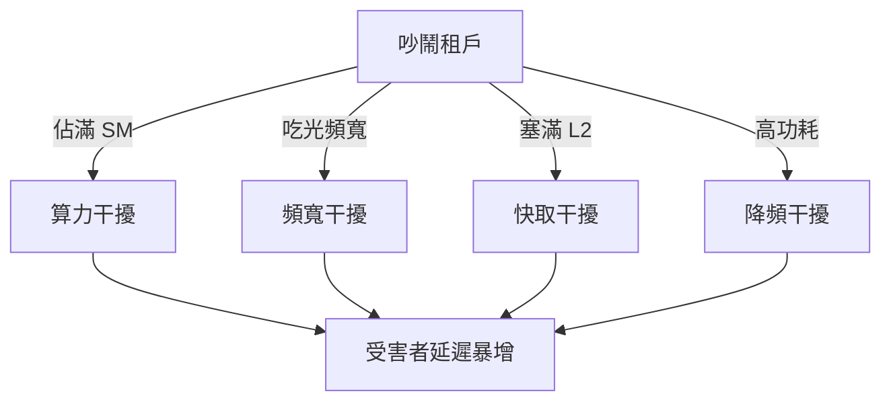
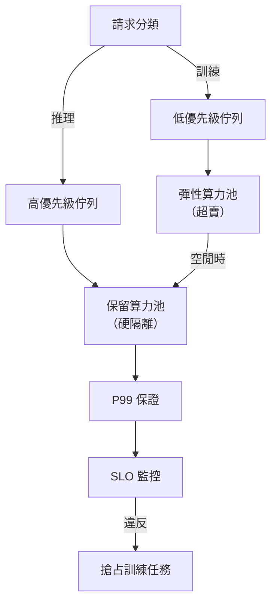

# 5.3　多租戶 QoS 與吵鬧鄰居

> 本節導論：共享算力池裡最惡名昭彰的問題，是一個租戶的突發負載拖垮其他人。這一節說明「吵鬧鄰居」的成因，以及在異質虛擬機裡如何用 QoS 機制壓制它。

## 5.3.1 什麼是吵鬧鄰居

**吵鬧鄰居（Noisy Neighbor）** 指的是：在共享資源的環境裡，某個租戶的過度使用，導致其他租戶的效能下降。

在 CPU 世界，這個問題早已有解法（cgroup、CPU pinning、cache 隔離）。但在 GPU/NPU 上，問題嚴重得多，因為：

* **共享的資源更多**：除了算力，還有記憶體頻寬、L2 cache、匯流排頻寬、電源與散熱預算。
* **干擾更難隔離**：一個租戶的 kernel 可能佔滿 L2 cache，讓另一個租戶的 kernel 大量 cache miss。
* **觀測更難**：GPU 的效能計數器不像 CPU 那樣標準化，難以精確歸因。

## 5.3.2 干擾的來源

吵鬧鄰居的干擾，可以分成幾類：

* **算力干擾**：一個租戶的 kernel 佔滿串流多處理器（SM），其他 kernel 排不進去。
* **頻寬干擾**：一個租戶大量讀寫顯存，吃光記憶體頻寬，其他租戶的 kernel 被拖慢。
* **快取干擾**：一個租戶的工作集塞滿 L2 cache，其他租戶的資料被擠出。
* **電源/散熱干擾**：一個租戶讓 GPU 跑到高功耗，觸發降頻，所有租戶一起變慢。

## 5.3.3 QoS 的三個層次

要壓制吵鬧鄰居，需要三個層次的 QoS（服務品質）機制：

1. **准入控制（admission control）**：在任務進入前，檢查它是否會超出資源預算，超出的拒絕或排隊。
2. **執行隔離（runtime isolation）**：在執行時，用硬體或軟體機制限制每個租戶的資源使用。
3. **公平排程（fair scheduling）**：在多個租戶競爭時，按權重分配資源，避免飢餓。

三者缺一不可：只有准入控制，無法處理執行期的突發；只有執行隔離，無法處理超額請求；只有公平排程，無法處理惡意佔用。

## 5.3.4 硬體輔助的 QoS

最有效的 QoS 是硬體輔助的。幾個代表：

* **MIG（Multi-Instance GPU）**：把 GPU 切成獨立的切片，每個切片有專屬的 SM、顯存、L2、頻寬。這是目前最強的隔離，但靜態。
* **SR-IOV + 品質通道**：部分網卡/加速器支援為每個 VF 分配頻寬配額。
* **GPU 的硬體排程器**：部分 GPU 支援「多行程服務（MPS）」或多租戶排程，能在硬體層分配時間片。
* **Intel RDT / AMD QoS**：CPU 的 cache 與記憶體頻寬分配技術，可類比到 GPU。

硬體輔助的優點是「干擾被物理隔離」，缺點是「不靈活、跨廠商不統一」。

## 5.3.5 軟體輔助的 QoS

沒有硬體支援時，只能靠軟體：

* **配額（quota）**：限制每個租戶的 API 呼叫頻率、顯存用量、kernel 時間。
* **優先級（priority）**：高優先級任務插隊，低優先級任務讓路。
* **節流（throttling）**：偵測到某租戶超額時，降低它的執行頻率。
* **效能計數器監控**：即時監控每個租戶的資源使用，動態調整。

軟體 QoS 的優點是「靈活、通用」，缺點是「有延遲、可能誤判」。

## 5.3.6 延遲敏感的推理：SLO 導向排程

AI 推理場景對延遲極度敏感。一個推薦系統的推論可能要求 P99 延遲低於 10 ms，一旦吵鬧鄰居讓延遲超過 SLO，就會影響使用者體驗。

因此推論場景常採用 **SLO 導向排程**：

* 為每個租戶定義 SLO（如 P99 < 10 ms）。
* 排程器優先滿足 SLO 最緊張的租戶。
* 當資源不足時，對「非 SLO 任務」降級或延後。

這需要精確的延遲預測：排程器要能估算「如果把這個任務排進去，會不會讓某個 SLO 被違反」。這就是為什麼現代推理服務（如 NVIDIA Triton、vLLM）都內建了複雜的排程與批次策略。

## 5.3.7 一個具體的干擾緩解設計

設想一個異質虛擬機要同時服務「延遲敏感的推理」與「吞吐導向的訓練」。一個可行的設計是：

* **推理** 進入高優先級佇列，使用保留算力池，保證 SLO。
* **訓練** 進入低優先級佇列，使用彈性算力池（超賣）。
* 當推理的 SLO 快被違反時，搶占訓練任務的資源。

這種「分池 + 搶占」的設計，是異質虛擬機在 QoS 上的典型取捨：**用硬隔離保證關鍵任務，用超賣提高整體利用率**。

## 5.3.8 本節小結

* 吵鬧鄰居在 GPU/NPU 上更嚴重，因為共享資源更多、干擾更難隔離。
* 干擾來源：算力、頻寬、快取、電源/散熱。
* QoS 三層次：准入控制、執行隔離、公平排程。
* 硬體輔助（MIG、MPS、RDT）隔離強但不靈活；軟體輔助（配額、優先級、節流）靈活但有延遲。
* 推理場景用 SLO 導向排程，搭配「分池 + 搶占」的設計。

切分與超賣解決了「怎麼分」，但還有一個問題沒答：**切出來的每一塊，怎麼在執行期被編譯成該硬體最高效的程式？** 下一章我們談即時編譯（JIT）與動態特化，這是異質虛擬機把「可攜的計算圖」變成「硬體特化的執行」的最後一哩路。
