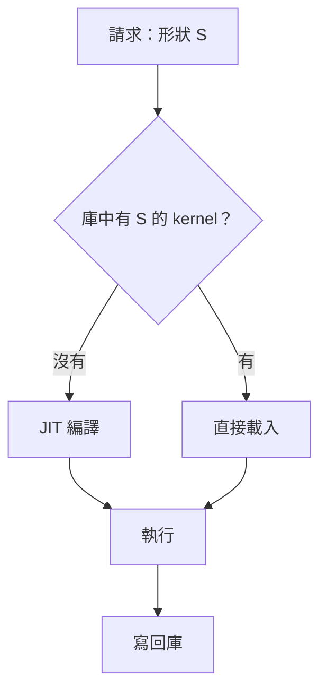

# 6.1　1990 年代 JIT 的起源與 AOT 的極限

> 本節導論：JIT 不是新技術，它在 1990 年代就被 Smalltalk 與 Java 用來加速動態語言。但 AI 時代的 JIT 面對的挑戰不同：它要編譯的不是控制流，而是形狀多變的計算圖。

## 6.1.1 JIT 的古典起源

**即時編譯（Just-in-Time Compilation）** 的思想最早可追溯到 1960 年代的 Lisp 實作，但真正普及是在 1990 年代：

* **Self**（1980s–1990s）：Sun 的實驗性語言，用「型別回饋 + 特化」做出極高的動態語言效能，是 JIT 研究的經典。
* **HotSpot**（1999）：Java 的 JIT，用「熱點偵測 + 分層編譯」把字節碼編成機器碼。
* **V8**（2008）：JavaScript 的分層 JIT，把 JIT 技術推向工業級。

JIT 的核心洞見是：**執行期有靜態編譯看不到的資訊**——實際的型別、實際的資料分布、實際的熱點路徑。用這些資訊做特化，能產生比 AOT 更快的程式。

## 6.1.2 AOT 的極限：靜態編譯看不到什麼

**AOT（Ahead-of-Time）** 編譯在執行前把程式編成機器碼。它的優點是啟動快、可預測，但它的極限在於「靜態資訊不足」：

* **型別**：動態語言在 AOT 時不知道變數的實際型別，無法做型別特化。
* **資料分布**：AOT 不知道實際資料的值分布，無法做分支預測最佳化、無法決定迴圈展開次數。
* **執行路徑**：AOT 不知道程式的熱點路徑，無法做針對性的最佳化。
* **硬體狀態**：AOT 不知道執行時硬體的負載、快取狀態、可用核心數。

對 AI 計算而言，最關鍵的是 **張量的形狀（shape）與 batch size**。同一個模型，batch size = 1 與 batch size = 32，最佳的 kernel 實作完全不同（前者是 latency-bound，後者是 throughput-bound）。AOT 只能針對「一組固定的形狀」編譯，遇到新形狀就要重新編譯或退回通用（較慢的）kernel。

## 6.1.3 JIT 在 AI 執行期的三種角色

在 AI 執行期裡，JIT 扮演三種角色：

1. **形狀特化（shape specialization）**：針對實際的張量形狀，編譯專用 kernel。例如 batch size = 1 時，用「低延遲」的 kernel；batch size = 32 時，用「高吞吐」的 kernel。
2. **算子融合（operator fusion）**：在執行期看到整個計算圖後，把多個算子融合成一個 kernel，減少記憶體往返。
3. **硬體特化（hardware specialization）**：根據實際硬體的型號、可用資源，選擇最佳的降階路徑與排程。

這三種角色，分別對應「資料」、「圖」、「硬體」三個層次的執行期資訊。

## 6.1.4 為什麼 AI 的 JIT 比語言的 JIT 更難

語言的 JIT（如 JVM、V8）主要處理「控制流 + 型別」。AI 的 JIT 要處理「計算圖 + 張量 + 硬體」，難度更高：

* **編譯單元更大**：語言 JIT 編譯一個方法，AI JIT 編譯一整張計算圖（可能數百個節點）。
* **最佳化空間更大**：AI 的最佳化包括融合、分塊、佈局、排程，每一項都是組合爆炸。
* **硬體差異更大**：語言 JIT 只需針對 CPU 架構，AI JIT 要針對 GPU、NPU、TPU、FPGA，每種都有不同的最佳化策略。
* **編譯延遲更敏感**：AI 推論的 JIT 若花太久，會直接影響延遲 SLO。

因此 AI 的 JIT 不能照搬語言 JIT 的架構，而需要「多層快取 + 增量編譯 + 預編譯庫」的組合。

## 6.1.5 編譯延遲與效能的取捨

JIT 的兩難是：**編譯越久，產生的程式越快，但啟動延遲越高**。對 AI 推論，這個取捨尤其尖銳：

* 如果 JIT 花 500 ms 編譯，而推論只花 10 ms，那編譯就是災難。
* 如果 JIT 只花 1 ms 做最基本的最佳化，那效能可能比 AOT 還差。

解法是「分層 JIT」：

* **第一層（快速編譯）**：立即產生「夠用」的 kernel，先跑起來。
* **第二層（背景編譯）**：在背景用更長的時間編譯「最佳」的 kernel，完成後替換。
* **快取**：把編譯結果快取起來，下次遇到相同形狀直接重用。

這與 V8 的分層 JIT（Ignition → Sparkplug → TurboFan）思想一致，只是對象從「方法」變成「計算圖」。

## 6.1.6 AOT 與 JIT 的混合：AOT 打底、JIT 特化

實務上的最佳解，往往是「AOT + JIT」的混合：

* **AOT 打底**：預先編譯常見形狀的 kernel（如 batch size = 1, 8, 32），放進「kernel 庫」。
* **JIT 特化**：遇到庫裡沒有的形狀，才用 JIT 編譯。
* **快取**：把 JIT 的結果寫回庫，下次重用。

這正是 TensorRT、TVM、XLA 等框架的做法：它們都有一個「預編譯 kernel 庫」，再用 JIT 處理長尾形狀。

## 6.1.7 本節小結

* JIT 起源於 1990 年代的 Self / HotSpot，核心是「用執行期資訊做特化」。
* AOT 的極限是靜態資訊不足：型別、資料分布、熱點路徑、張量形狀。
* AI 的 JIT 有三種角色：形狀特化、算子融合、硬體特化。
* AI 的 JIT 比語言 JIT 更難：編譯單元大、最佳化空間大、硬體差異大、延遲敏感。
* 解法是分層 JIT + 快取 + AOT/JIT 混合。

下一節，我們深入最棘手的問題：**當張量形狀在執行期才確定，JIT 要怎麼應對？**
