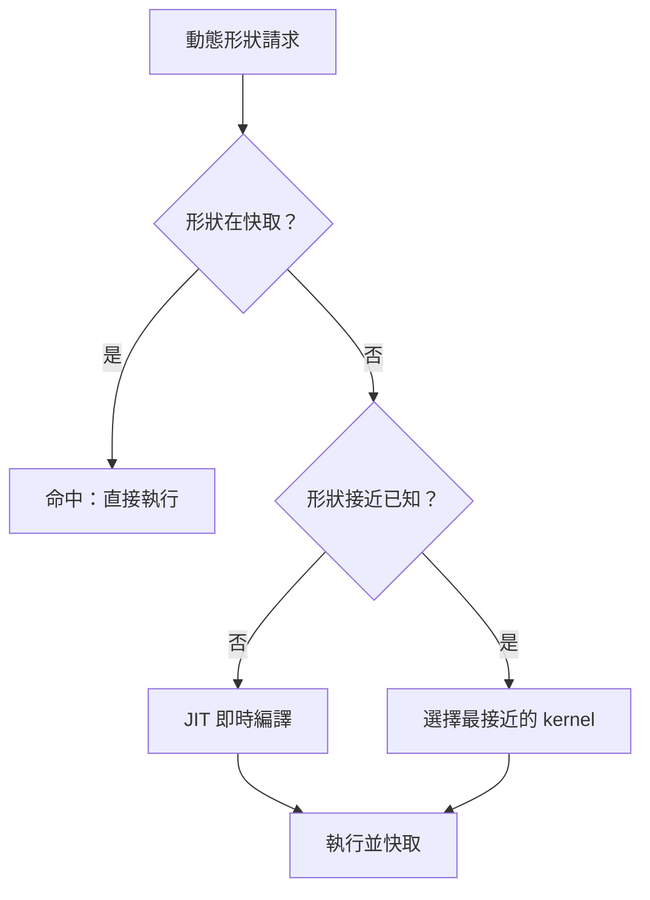

# 6.2　動態 Shape 與即時生成計算圖

> 本節導論：AI 計算的形狀不是靜態的——batch size 隨負載變、序列長度隨輸入變、動態圖隨控制流變。傳統「編譯一次、固定形狀」的模型，在這些變動面前破功。

## 6.2.1 靜態圖與動態圖的歷史

AI 框架的計算圖有兩種形態：

* **靜態圖（static graph）**：先定義整張圖，再編譯執行。TensorFlow 1.x 是代表。優點是編譯期能做全域最佳化，缺點是除錯難、無法處理動態控制流。
* **動態圖（dynamic graph）**：邊執行邊建圖，PyTorch 的 eager mode 是代表。優點是靈活、好除錯，缺點是每次執行都要重建圖，最佳化機會少。

近年來的趨勢是「**動態圖的易用性 + 靜態圖的效能**」：PyTorch 2.0 的 `torch.compile` 就是先以 eager 模式追蹤（trace）出圖，再編譯最佳化。這本質上是一種「執行期 JIT」。

## 6.2.2 動態 Shape 的三個來源

「形狀在執行期才確定」是 AI JIT 最大的挑戰。來源有三：

* **批次大小（batch size）**：負載高時 batch 大、負載低時 batch 小。
* **序列長度（sequence length）**：NLP 的輸入長度可變，從幾個 token 到數千個。
* **動態控制流**：如 MoE（Mixture of Experts）根據輸入選擇不同的專家網路，圖的結構隨輸入而變。

對編譯器而言，這些變動意味著「同一份 IR 要對應多種執行形態」，而每種形態的最佳 kernel 可能不同。

## 6.2.3 應對動態 Shape 的四種策略

實務上有四種策略，各有取捨：

**策略一：固定形狀編譯（static shape）。**
把形狀固定成幾個常見值（如 batch = 1, 8, 32），編譯多個版本，執行期選擇最接近的。簡單有效，但形狀不在清單裡時要退回通用 kernel。

**策略二：動態形狀編譯（dynamic shape）。**
編譯器產生「形狀無關」的 kernel，用執行期參數處理任意形狀。靈活但效能通常較差，因為無法做形狀特化的最佳化（如固定大小的迴圈展開）。

**策略三：符號形狀（symbolic shape）。**
用符號變數表達形狀（如 `[B, 128]`，B 是符號），編譯器產生「參數化」的 kernel。這是 StableHLO / XLA 常用的做法，介於前兩者之間。

**策略四：即時特化（runtime specialization）。**
遇到新形狀時，用 JIT 即時編譯專用 kernel。效能最好，但有編譯延遲。

## 6.2.4 即時生成計算圖：代理的特殊需求

AI 代理帶來一個更極端的情況：**計算圖本身是執行期生成的**。

代理可能根據任務動態組裝計算圖：先分類輸入、再選擇模型、再動態拼接。這時計算圖不是「事先定義好、形狀可變」，而是「結構都可變」。

這對虛擬機提出新要求：

* **圖的增量編譯**：不能等整張圖建好才編譯，要能「邊建邊編譯」。
* **子圖快取**：把常見的子圖（如 attention block）快取成可重用的編譯單元。
* **圖的版本管理**：代理可能修改圖，要能追蹤版本、回滾。

這本質上是把「編譯器」變成「執行期的一部分」，也就是 JIT 的極致形態。

## 6.2.5 形狀推導與約束求解

動態 shape 的編譯，需要「形狀推導（shape inference）」：給定輸入形狀與每個運算的形狀規則，推導出所有中間張量的形狀。

這聽起來簡單，但實際很複雜：

* **廣播（broadcast）**：不同形狀的張量相加，需要推導廣播後的形狀。
* **動態維度**：某些維度是符號，需要解約束。
* **不規則運算**：gather / scatter 的輸出形狀依賴索引值，可能需要執行期才知道。

MLIR 提供了 shape dialect 來表達與推導形狀，StableHLO 也有 shape 推導規則。但「動態維度的約束求解」仍是活躍的研究領域。

## 6.2.6 記憶體規劃的動態化

形狀可變，意味著記憶體需求也可變。傳統的「靜態記憶體規劃」在動態 shape 下失效，需要「動態記憶體規劃」：

* **記憶體池（memory pool）**：預先配置大塊記憶體，按需分配，避免頻繁的 `cudaMalloc`。
* **分段配置（segmented allocation）**：把記憶體分成不同大小的段，減少碎片。
* **即時重規劃**：當形狀變化大時，重新計算記憶體佈局。

PyTorch 的 caching allocator 就是這個思路：它快取已分配的顯存塊，避免每次都要向驅動要記憶體。

## 6.2.7 本節小結

* 靜態圖 vs 動態圖各有取捨，現代框架傾向「eager 追蹤 + 編譯」。
* 動態 shape 的三個來源：batch size、序列長度、動態控制流。
* 四種策略：固定形狀、動態形狀、符號形狀、即時特化。
* 代理帶來「圖本身即時生成」的極端情況，要求增量編譯、子圖快取、版本管理。
* 動態 shape 需要形狀推導、約束求解、動態記憶體規劃。

下一節，我們把 JIT 與執行期觀測結合：**如何用真實的資料分布與硬體負載，驅動 MLIR 的動態特化。**
