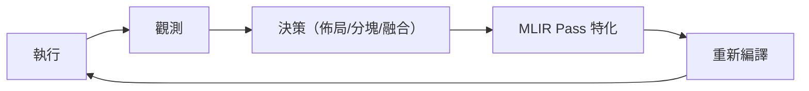

# 6.3　執行期觀測驅動的 MLIR 特化

> 本節導論：最好的編譯器不是「靜態分析最強」的，而是「最會觀察」的。這一節說明如何用執行期的真實資料，驅動 MLIR 的動態特化，讓虛擬機在跑起來之後越跑越快。

## 6.3.1 從「編譯一次」到「持續編譯」

傳統編譯是「一次性的」：程式碼進去，機器碼出來，之後不再改變。但 AI 執行期可以是「持續編譯的」：

* 第一次執行時，用通用 kernel 跑起來。
* 同時收集執行期資訊：形狀分布、熱點路徑、硬體負載、快取命中率。
* 根據這些資訊，重新編譯更特化的 kernel。
* 用新 kernel 替換舊 kernel，下次執行更快。

這是一種「**回饋驅動的最佳化（profile-guided optimization, PGO）**」，只是從「離線」變成「線上」。

## 6.3.2 要觀測什麼

執行期觀測的對象，可以分成三層：

**資料層**：
* 張量的實際形狀分布（哪些形狀最常見）。
* 張量的數值分布（是否稀疏、是否有大量零）。
* 資料的對齊與佈局。

**圖層**：
* 哪些子圖最常被執行（熱點子圖）。
* 哪些運算可以融合（相鄰且無分支）。
* 哪些分支最常走（控制流的熱路徑）。

**硬體層**：
* 每個 kernel 的執行時間、記憶體頻寬使用、SM 利用率。
* 快取命中率、匯流排飽和度。
* 裝置的負載與溫度。

這三層資訊，分別對應「編譯什麼」、「怎麼融合」、「用哪個硬體」三個決策。

## 6.3.3 觀測驅動的 MLIR Pass

觀測到資訊後，如何用它驅動 MLIR 的降階？答案是「**帶資訊的 Pass**」：

* **動態佈局選擇**：根據形狀分布，選擇最佳的記憶體佈局（NCHW vs NHWC）。
* **動態分塊大小**：根據快取大小與形狀，選擇最佳的 tile size。
* **動態融合決策**：根據熱點子圖，決定哪些算子融合。
* **動態降階路徑**：根據硬體型號與負載，選擇不同的降階路徑。

這些 Pass 與傳統 Pass 的差別，在於它們的「決策參數」來自執行期觀測，而非靜態啟發式。

## 6.3.4 觀測的成本與取樣

觀測不是免費的：插樁（instrumentation）會增加執行開銷，收集資料會佔用頻寬。因此需要「取樣」：

* **時間取樣**：每隔 N 毫秒收集一次，而不是每次都收集。
* **事件取樣**：只在特定事件（如形狀變化、延遲超標）時收集。
* **比例取樣**：只對一部分請求收集，用統計推斷整體。

取樣的關鍵是「**用最少的開銷，得到最有用的資訊**」。這與效能剖析（profiling）的藝術相同。

## 6.3.5 重新編譯的時機

什麼時候該觸發重新編譯？太頻繁會浪費資源，太少則無法及時最佳化。常見的觸發條件：

* **形狀變化超過閾值**：例如 batch size 從 1 變成 32。
* **熱點轉移**：某個原本冷門的子圖變成熱點。
* **效能退化**：偵測到某個 kernel 的延遲突然上升（可能是硬體負載變化）。
* **資源變化**：裝置數量、可用記憶體變化。

觸發後，重新編譯應該在「背景」進行，不阻塞當前執行。編譯完成後，用「熱替換（hot swap）」把新 kernel 換上。

## 6.3.6 特化的極限：過度特化的風險

特化不是越多越好。過度特化有幾個風險：

* **編譯爆炸**：為每個形狀都編譯一個 kernel，會耗盡記憶體與編譯時間。
* **快取miss**：形狀變化太頻繁，快取命中率低，特化反而變成負擔。
* **硬體漂移**：特化是針對「當前硬體狀態」的，硬體負載一變，特化就失效。

因此需要「**特化的收斂策略**」：

* 只對「高頻形狀」特化，低頻形狀用通用 kernel。
* 設定特化預算（如最多 N 個編譯版本）。
* 用「遺忘機制」淘汰長期不用的特化版本。

## 6.3.7 與 MLIR 生態的結合

要把這套觀測驅動的特化落地，需要 MLIR 生態的支援：

* **可參數化的 Pass**：Pass 的決策參數可以由外部注入（如 tile size）。
* **編譯快取**：MLIR 的編譯結果可以持久化，避免重複編譯。
* **執行期鉤子（runtime hooks）**：在執行期插入觀測與重編譯的鉤子。
* **多版本執行檔**：同一個計算圖可以有多個編譯版本，執行期動態選擇。

IREE 與 XLA 都在往這個方向演進：把「編譯」從「一次性的離線步驟」變成「執行期持續進行的過程」。

## 6.3.8 本節小結

* 執行期可以是「持續編譯的」：觀測 → 特化 → 重新編譯 → 替換。
* 觀測三層：資料（形狀分布）、圖（熱點子圖）、硬體（負載與頻寬）。
* 觀測驅動的 MLIR Pass 用執行期資訊做佈局、分塊、融合、降階決策。
* 觀測需取樣以控制成本；重編譯應在背景進行並熱替換。
* 特化需收斂策略，避免編譯爆炸與快取miss。
* MLIR 生態需要可參數化 Pass、編譯快取、執行期鉤子、多版本執行檔。

第二部到此結束。我們已經把「如何虛擬化異質算力」講完：用計算圖 IR 做可攜、用軟體切分做多租戶、用 JIT 做特化。下一部轉向「執行主體」：**如何為 AI 生成的不信程式，打造微秒級隔離沙盒。**
