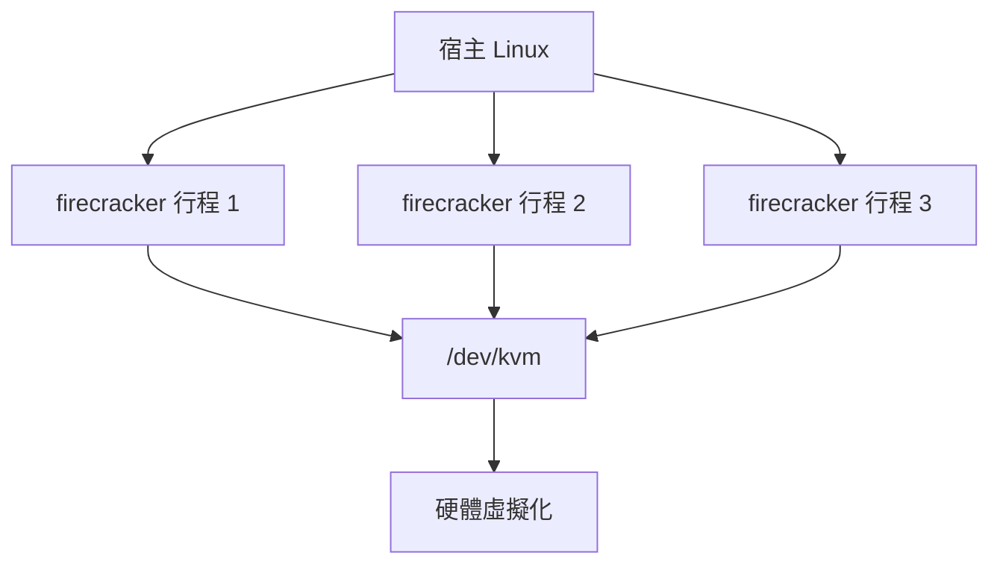

# 7.1　2018 年 Firecracker 與極簡 VMM

> 本節導論：AWS 在 2018 年開源的 Firecracker，用一個激進的減法證明：虛擬機可以又快又輕。它的設計，是「為 AI 代理沙盒」鋪路的第一塊磚。

## 7.1.1 Firecracker 的誕生背景

2018 年，AWS 開源 **Firecracker**，用來支撐 AWS Lambda 與 Fargate。它的目標極端明確：

* **啟動要快**：冷啟動時間壓到 125 ms（甚至更低）以內。
* **記憶體要省**：每個 MicroVM 的記憶體開銷小於 5 MB。
* **密度要高**：一台伺服器要能跑數千個 MicroVM。
* **安全要強**：每個 MicroVM 有硬體級隔離（KVM）。

這四個目標，正好對應第 3 章講的「微秒級沙盒」需求。Firecracker 不是為「雲端虛擬機」設計，而是為「大量短命的無伺服器函式」設計。

## 7.1.2 減法一：剝離所有非必要裝置

傳統 QEMU 模擬一整套 PC：BIOS、IDE、VGA、USB、音效卡、網路卡……這些對「跑一個函式」毫無用處，卻是啟動延遲與攻擊面的大來源。

Firecracker 的減法極徹底：

* **沒有 BIOS**：直接載入 Linux 核心（用 `PVH` 或 `bzImage` 直接開機）。
* **沒有 VGA / USB / 音效**：只保留 virtio 網卡、virtio 磁碟、virtio 序列埠。
* **沒有 PCI 匯流排枚舉**：virtio 裝置透過 MMIO 直接暴露，跳過 PCI 探測。
* **極簡裝置模型**：每個 virtio 裝置只有最基本的功能。

結果是：啟動時不需要「枚舉裝置、載入 BIOS、跑 POST」，直接進入核心。

## 7.1.3 減法二：一個行程一個 MicroVM

Firecracker 的架構是「**一個 MicroVM = 一個使用者態行程**」：

* 每個 MicroVM 由一個 `firecracker` 行程管理。
* 該行程透過 `/dev/kvm` 建立 vCPU，透過 `ioctl` 控制執行。
* 記憶體由 `mmap` 配置，virtio 裝置在使用者態模擬。
* 沒有中央的 hypervisor 守護行程，減少一層上下文切換。

這個設計的好處是「隔離清楚 + 除錯簡單」：一個 MicroVM 出問題，只影響它自己的行程。

## 7.1.4 減法三：用 Rust 換取記憶體安全

Firecracker 用 **Rust** 撰寫，這在 hypervisor 領域是罕見的選擇（多數用 C）。理由很實際：

* **記憶體安全**：Rust 的所有權模型在編譯期消除 use-after-free、buffer overflow 等漏洞。
* **執行緒安全**：Rust 的型別系統防止資料競爭。
* **無 GC**：Rust 沒有垃圾回收，啟動與執行延遲可預測。

對一個「每秒啟動數千次」的元件，記憶體安全與可預測延遲至關重要。

## 7.1.5 Firecracker 的隔離模型

Firecracker 的隔離是「**以 MicroVM 為單位**」：

* **CPU 隔離**：每個 MicroVM 有獨立的 vCPU，由 KVM 排程。
* **記憶體隔離**：每個 MicroVM 有獨立的位址空間，由 EPT 隔離。
* **裝置隔離**：virtio 裝置由 Firecracker 行程模擬，guest 無法直接存取宿主裝置。
* **Jailer**：一個額外的安全層，用 namespace、seccomp、cgroup 把 Firecracker 行程本身也隔離起來。

Jailer 是 Firecracker 安全模型的關鍵：即使 Firecracker 本身有漏洞，攻擊者也被困在 jailer 建立的沙盒裡。

## 7.1.6 啟動延遲的組成

Firecracker 的 125 ms 冷啟動，可以拆解成：

* **核心載入與解壓**：約 20–40 ms。
* **核心初始化**：約 30–50 ms。
* **使用者態 init**：約 20–40 ms。
* **裝置初始化**：約 10–20 ms。

要進一步降低，有幾條路：

* **跳過核心初始化**：用 unikernel 或 snapshot 恢復（下一節）。
* **預熱（pre-warming）**：預先啟動一批 MicroVM，需要時直接「認領」。
* **快照恢復**：把已啟動的 MicroVM 快照存起來，需要時恢復（比冷啟動快得多）。

## 7.1.7 Firecracker 的遺產與侷限

Firecracker 證明了「MicroVM 可以又快又輕」，並催生了一整個生態：

* **Cloud Hypervisor**：另一個 Rust 寫的 VMM，偏向雲端虛擬機。
* **Kata Containers**：用 MicroVM 包裝容器，結合容器的易用性與 VM 的隔離。
* **gVisor**：不用 VM，而是用使用者態核心做隔離，另一條路線。

但 Firecracker 也有侷限：

* **仍是「整機」隔離**：一個 MicroVM 是一個完整的 Linux，啟動仍有核心初始化的成本。
* **不支援 GPU 直通**：Firecracker 刻意不支援 PCI 直通，所以無法直接跑 GPU 工作負載。
* **不支援狀態分叉**：Firecracker 支援快照，但不支援「微秒級分叉」。

這些侷限，正是後續技術（狀態快照、GPU 虛擬化）要補的洞。

## 7.1.8 本節小結

* Firecracker 為無伺服器函式設計，目標是快啟動、省記憶體、高密度、強隔離。
* 三個減法：剝離非必要裝置、一 MicroVM 一行程、用 Rust 換記憶體安全。
* 隔離以 MicroVM 為單位，外加 Jailer 隔離 Firecracker 本身。
* 冷啟動 125 ms 可拆解，進一步降低靠 unikernel、預熱、快照。
* 侷限：仍是整機隔離、不支援 GPU 直通、不支援微秒級分叉。

下一節，我們談填補最後一個侷限的技術：**狀態快照與時間旅行**。
