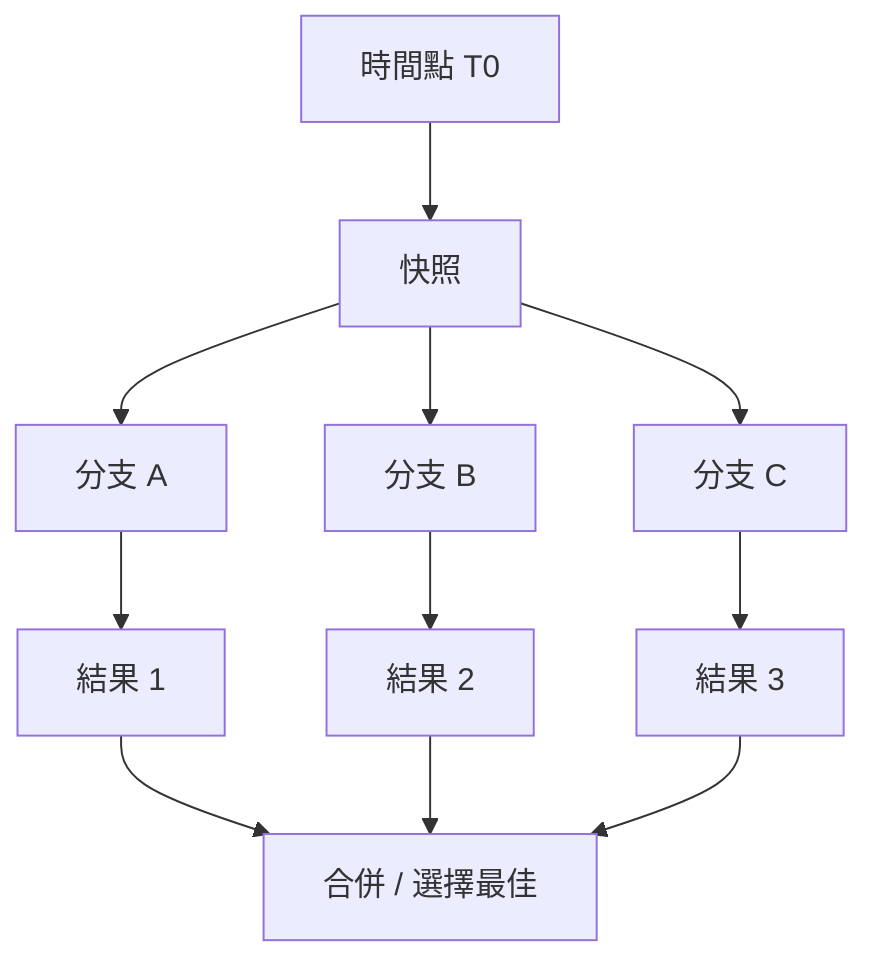

# 7.2　狀態快照與時間旅行

> 本節導論：如果一個沙盒能在微秒內被複製、暫停、回滾，AI 代理就能「大膽試錯」。這一節說明快照的技術層次，以及「時間旅行」如何從科幻走進系統設計。

## 7.2.1 快照的三個層次

「快照（snapshot）」聽起來簡單，但在虛擬機裡有三個截然不同的層次：

**層次一：磁碟快照。**
只保存磁碟狀態（如 qcow2 的 snapshot）。啟動時從快照恢復磁碟，但仍要重新開機。速度慢，主要用於備份。

**層次二：記憶體快照。**
保存整個記憶體狀態（CPU 暫存器、RAM、裝置狀態）。恢復時直接跳回某個時間點，不需要重新開機。這是「時間旅行」的基礎。

**層次三：增量快照（incremental snapshot）。**
只保存「自上次快照以來的差異」。恢復時需要基底快照 + 增量。節省空間與時間，但恢復較複雜。

AI 代理沙盒需要的是「層次二 + 層次三」：完整的執行狀態 + 增量保存，才能在微秒內分叉與回滾。

## 7.2.2 記憶體快照的機制

記憶體快照要保存什麼？

* **CPU 狀態**：所有暫存器、程式計數器、旗標。
* **記憶體**：所有 RAM 頁面。
* **裝置狀態**：virtio 佇列、中斷控制器、計時器。
* **外部狀態**：開啟的檔案、網路連線（這最難）。

保存的方式有幾種：

* **暫停後複製（stop-and-copy）**：暫停 VM，複製所有記憶體，再恢復。簡單但停頓時間與記憶體大小成正比。
* **寫時複製（Copy-on-Write）**：暫停 VM，把記憶體頁標記為唯讀，之後寫入時才複製。停頓時間短，但後續寫入有開銷。
* **預拷貝（pre-copy）**：先複製大部分記憶體，再暫停複製剩下的「髒頁」。停頓時間短，適合遷移。
* **後拷貝（post-copy）**：先暫停，只複製 CPU 狀態，記憶體按需從源端拉取。停頓最短，但依賴網路。

對「微秒級分叉」，最合適的是 **CoW**：停頓極短，後續成本按寫入量分攤。

## 7.2.3 快照與分叉的差別

「快照」與「分叉」常被混用，但語意不同：

* **快照**：保存某個時間點的狀態，之後可以恢復到這個點。它是「時間軸上的書籤」。
* **分叉**：從某個狀態複製出多個分支，各自獨立演化。它是「時間軸的分裂」。

分叉通常建立在快照之上：先快照，再從快照建立多個實例。但分叉要求「多個實例能同時存在」，這比單純的快照更難（需要 CoW 共享基底）。

## 7.2.4 異質狀態的快照：GPU 怎麼辦

CPU 的快照相對成熟，但 GPU 的快照極難：

* **顯存快照**：需要把 HBM 的內容複製出來，量大且頻寬成本高。
* **kernel 佇列**：GPU 上可能有未完成的 kernel，快照時要決定「排空」或「保存」。
* **裝置暫存器**：GPU 的暫存器狀態是廠商私有的，難以通用保存。
* **非確定性**：GPU 的浮點運算、原子操作順序可能不確定，快照恢復後的行為可能不同。

目前的解法是「**檢查點（checkpointing）**」：不是保存整個 GPU 狀態，而是保存「產生這個狀態的計算圖與輸入」，恢復時重算。這在某些場景可行（如訓練的 checkpoint），但不適合「微秒級分叉」。

更激進的做法是「**GPU 狀態虛擬化**」：把 GPU 的所有狀態都放在一個可快照的虛擬層裡，由虛擬機管理。這需要硬體與驅動的深度配合，目前仍在研究階段。

## 7.2.5 時間旅行：從除錯到代理推理

「時間旅行（time travel）」是快照 + 重放的組合：

* 執行時記錄所有非確定性輸入（時間、亂數、I/O）。
* 定期拍快照。
* 需要時，恢復到某個快照，再重放到任意時間點。

這個能力有兩個殺手級應用：

**除錯**：程式崩潰時，恢復到崩潰前的快照，單步重放，找出問題。這比「加 printf 重跑」高效得多。

**代理推理**：代理可以先跑一段，觀察結果，再「回到過去」修改決策。這讓代理能探索「如果我當時選了另一條路會怎樣」，而不必從頭重跑。

## 7.2.6 快照的儲存與傳輸

快照不只是記憶體裡的東西，還要能儲存與傳輸：

* **儲存**：快照可以寫到磁碟或物件儲存，供之後恢復。
* **傳輸**：快照可以從一台機器傳到另一台，實現「遷移」或「跨節點分叉」。
* **壓縮**：快照通常有大量重複或零頁，可以用壓縮或去重（deduplication）減少體積。

第 10 章的「跨節點虛擬機」就依賴快照傳輸：把一個執行中的沙盒從節點 A 搬到節點 B，本質上就是「快照 + 傳輸 + 恢復」。

## 7.2.7 一致性與原子性

快照最難保證的是「一致性」：

* **多執行緒一致性**：快照時，多個執行緒可能正在修改共享狀態，快照必須是「某個一致的瞬間」。
* **裝置一致性**：磁碟、網路、GPU 的狀態必須與 CPU 狀態一致。
* **原子性**：快照要嘛完全成功，要嘛完全失敗，不能有「半個快照」。

常見的做法是「**先冷卻再快照**」：暫停所有執行，等待 in-flight 的操作完成，再拍快照。這保證了一致性，但增加了停頓時間。對微秒級分叉，這是一個關鍵的取捨。

## 7.2.8 本節小結

* 快照三層次：磁碟、記憶體、增量；代理沙盒需要記憶體 + 增量。
* 記憶體快照機制：stop-and-copy、CoW、pre-copy、post-copy，CoW 最適合微秒級。
* 快照是「書籤」，分叉是「分裂」，分叉建立在快照之上。
* 異質狀態（GPU）的快照極難，目前靠檢查點重算或狀態虛擬化。
* 時間旅行 = 快照 + 重放，用於除錯與代理推理。
* 快照需處理儲存、傳輸、一致性、原子性。

下一節，我們把分叉應用到代理的核心場景：**多路徑推理與失敗回滾**。
