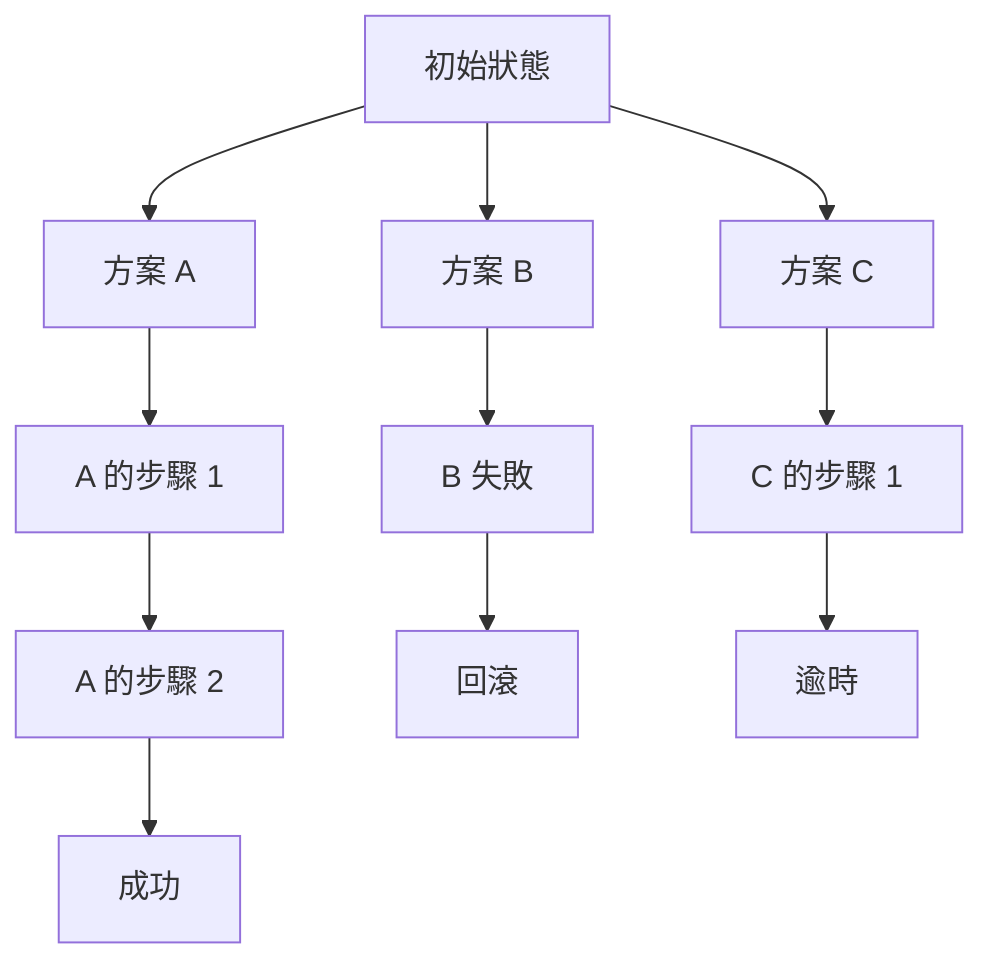
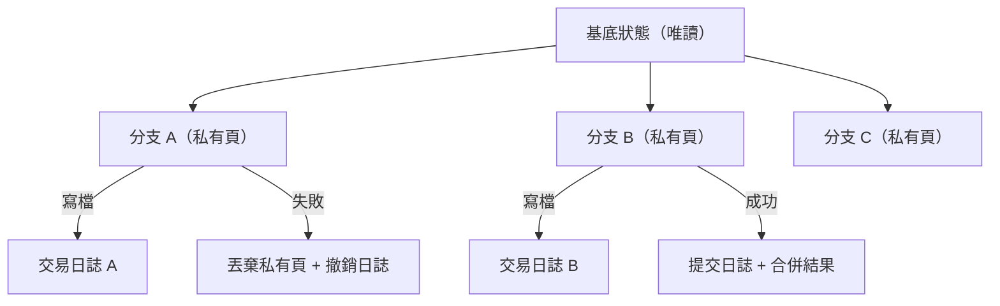
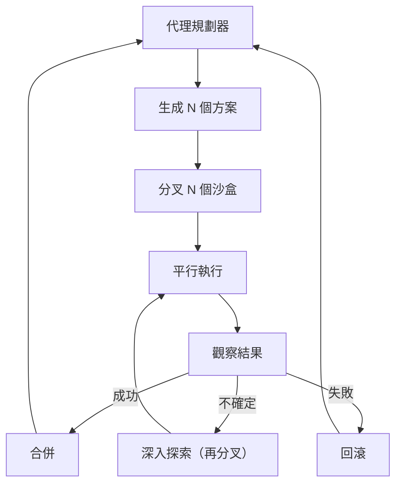

# 7.3　多路徑推理與失敗回滾

> 本節導論：AI 代理的「智慧」很大程度來自「平行探索多條路徑、淘汰失敗、保留成功」。這一節把第 3 章的分叉理論，落成一個可運作的代理執行架構。

## 7.3.1 為什麼代理需要多路徑

傳統程式是一條路徑：輸入 → 計算 → 輸出。一條路走不通，就報錯。AI 代理不同，它的工作方式是「**搜尋**」：

* 面對一個任務，生成多個候選方案。
* 並行（或交錯）執行每個方案。
* 觀察結果，淘汰失敗的，保留成功的。
* 如果全部失敗，回到起點重新生成。

這個過程本質上是一棵「**搜尋樹**」：每個節點是一個狀態，每條邊是一個動作。代理要在這棵樹上找到通往目標的路徑。

## 7.3.2 三種執行策略

代理執行多路徑，有三種策略：

**策略一：序列執行（sequential）。**
一次跑一條路徑，失敗再跑下一條。優點是資源省，缺點是慢。

**策略二：平行執行（parallel）。**
同時跑所有路徑。優點是快，缺點是資源消耗大。

**策略三：樹狀搜尋（tree search）。**
像 MCTS（Monte Carlo Tree Search），根據中間結果動態決定「往哪個分支深入」。優點是效率與品質兼顧，缺點是實作複雜。

異質虛擬機的沙盒機制，主要支撐「策略二」與「策略三」：因為它能在微秒內分叉，讓平行探索變得便宜。

## 7.3.3 分叉的成本模型

假設一個代理要探索 $ n $ 條路徑，每條路徑執行時間為 $ t $，分叉成本為 $ t_{f} $，則：

* **序列執行**總時間：$ n \cdot (t + t_{f}) $。
* **平行執行**總時間：$ t + n \cdot t_{f} $（假設資源足夠）。

當 $ t_{f} \ll t $ 時，平行執行的優勢巨大。這就是為什麼「微秒級分叉」對代理如此關鍵：它讓 $ t_{f} $ 趨近於 0，平行探索幾乎免費。

## 7.3.4 失敗回滾：把污染隔離在分支內

多路徑執行最大的風險是「**狀態污染**」：一條路徑執行時寫了檔案、改了資料庫、發了網路請求，失敗後這些副作用殘留下來，影響其他路徑。

回滾機制要解決的就是這個問題：

* **完全隔離**：每條路徑在獨立的沙盒裡執行，副作用不外洩。這是最乾淨的做法，靠 MicroVM 或 Wasm 實現。
* **CoW 隔離**：所有路徑共享一個基底，寫入時才複製。副作用被限制在各自的私有頁裡。
* **交易日誌（transaction log）**：記錄所有副作用，失敗時反向執行（undo）。適合有明確副作用的操作。

對 AI 代理，最實用的是「CoW 隔離 + 交易日誌」的組合：CoW 處理記憶體狀態，交易日誌處理外部副作用（檔案、網路）。

## 7.3.5 成功的合併：從分支回到主線

失敗的回滾相對簡單（丟棄分支），成功的合併則複雜得多：

* **結果合併**：把成功分支的輸出，合併回主線狀態。
* **副作用提交**：把成功分支的交易日誌，正式應用到外部系統。
* **狀態同步**：確保主線狀態與成功分支一致。

合併的難點在於「**衝突**」：如果兩條路徑都成功，且修改了同一個資源，就要處理衝突（類似 Git merge）。這時需要「衝突解決策略」：最後寫入者勝、優先級、或人工介入。

## 7.3.6 一個具體的代理執行架構

把上述機制組合起來，可以得到一個代理執行架構：

* **規劃器**負責生成候選方案。
* **分叉器**用 CoW 建立 N 個沙盒。
* **執行器**平行跑每個方案。
* **觀察器**收集結果。
* **決策器**判斷成功、失敗、或不確定（需要更深入探索）。

這個架構的關鍵是「**分叉要快、回滾要乾淨、合併要正確**」。三者都依賴第 7.2 節的快照機制。

## 7.3.7 與確定性重放的結合

多路徑執行若失敗，代理常常需要「重放」某條路徑來除錯。這時確定性重放就派上用場：

* 記錄失敗路徑的所有非確定性輸入。
* 在隔離的沙盒裡重放，重現失敗。
* 分析失敗原因，生成修正方案。

這形成一個閉環：**執行 → 失敗 → 重放 → 分析 → 修正 → 再執行**。這正是 AI 代理「從錯誤中學習」的工程實現。

## 7.3.8 本節小結

* 代理靠多路徑搜尋工作，本質是搜尋樹上的探索。
* 三種執行策略：序列、平行、樹狀搜尋；沙盒機制支撐平行與樹狀。
* 微秒級分叉讓平行探索的成本趨近於零。
* 失敗回滾靠完全隔離、CoW、交易日誌；成功合併要處理衝突。
* 代理執行架構：規劃 → 分叉 → 執行 → 觀察 → 合併/回滾/深入。
* 確定性重放支撐「從錯誤中學習」的閉環。

下一章，我們談沙盒的另一半：**如何用雙層驗證（IR Verifier + TEE）保證安全性**。
