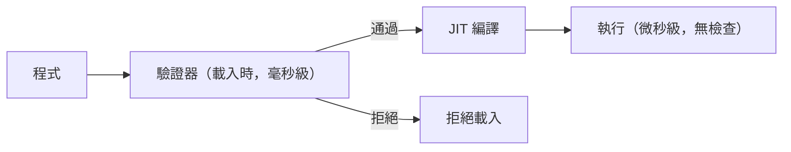

# 8.1　eBPF 驗證器哲學的擴張

> 本節導論：eBPF 證明了「在載入前用靜態分析證明程式安全」是可行的。這個哲學正在從核心擴張到異質虛擬機——成為 AI 生成程式的第一道防線。

## 8.1.1 eBPF 的革命性：不用權限隔離也能安全

傳統的安全模型是「權限隔離」：核心態與使用者態分離，程式要存取特權資源，必須透過系統呼叫，由核心檢查。

eBPF（extended Berkeley Packet Filter）打破了這個模型。它允許使用者把程式**載入核心執行**，但不靠「權限隔離」來保證安全，而是靠「**載入前驗證**」：

* 程式載入時，eBPF 驗證器靜態分析它的所有路徑。
* 確認它不會越界存取記憶體、不會無窮迴圈、不會呼叫非法函式。
* 驗證通過後，程式被 JIT 編譯成機器碼，直接在核心執行。

這個模型的革命性在於：**它讓「不可信程式」能在「特權環境」裡安全執行**，而不需要上下文切換的開銷。

## 8.1.2 驗證器的核心不變式

eBPF 驗證器要證明的不變式，大致有幾類：

* **記憶體安全**：所有記憶體存取都在合法範圍內（指標有界、型別正確）。
* **終止性**：程式一定會結束（迴圈有界、無無窮遞迴）。
* **控制流完整性**：只能跳到合法的指令邊界。
* **資源有界**：堆疊使用、暫存器使用在限制內。
* **函式白名單**：只能呼叫被允許的 helper 函式。

這些不變式，本質上是「**程式語言的型別系統 + 資源分析**」的組合。驗證器的目標是「在有限時間內，對所有可能路徑證明這些不變式」。

## 8.1.3 驗證與執行的分離

eBPF 的架構有一個關鍵設計：**驗證與執行分離**。

* **驗證**發生在載入時，只需一次。成本可以較高（毫秒級），因為它只做一次。
* **執行**發生在每次觸發時，必須極快（奈秒到微秒級）。因為驗證已保證安全，執行時不需要再檢查。

這個分離，正是「微秒級沙盒」的關鍵：把昂貴的檢查移到載入前，執行時只做「已驗證的程式」的直接執行。

## 8.1.4 把哲學搬到異質虛擬機

eBPF 的哲學可以搬到異質虛擬機，但對象從「核心程式」變成「AI 生成的計算圖」。這需要一套「**IR Verifier**」：

* **型別與形狀檢查**：每個張量運算的輸入輸出型別、形狀必須匹配（這部分 StableHLO 已提供）。
* **資源預算檢查**：計算圖的總運算量、記憶體需求必須在預算內（防止資源耗盡）。
* **控制流檢查**：`while` 迴圈必須有界（防止無窮執行）。
* **記憶體安全檢查**：所有張量存取必須在配置的範圍內。
* **副作用檢查**：只能呼叫白名單內的裝置 API（防止越權）。

這套檢查的目標，與 eBPF 驗證器一致：**在載入前證明「這個計算圖不會做壞事」**。

## 8.1.5 驗證的成本與完備性

驗證器面臨一個兩難：

* **要完備（sound）**：寧可誤判（拒絕安全程式），不可漏判（放過危險程式）。
* **要快**：驗證必須在載入前完成，不能拖太久。

完備性與速度常常衝突：越精確的分析越慢。eBPF 驗證器的取捨是「**保守但快**」：它不做複雜的定理證明，而是用「抽象解釋（abstract interpretation）」追蹤每個暫存器的可能值範圍。遇到無法確定的情況，直接拒絕（保守）。

對 AI 計算圖，同樣的策略適用：用「形狀推導 + 區間分析」追蹤張量的形狀與值範圍，遇到無法確定的（如動態索引），要求程式提供額外保證或拒絕。

## 8.1.6 驗證器的漏洞與第二道防線

沒有任何驗證器是完美的。歷史上 eBPF 驗證器出現過多個漏洞（CVE），讓惡意程式繞過檢查。這說明：**驗證器不能是唯一防線**。

因此需要「**縱深防禦（defense in depth）**」：

* **第一層：IR Verifier**：靜態檢查，阻擋大部分明顯的危險。
* **第二層：硬體隔離**：TEE 或 VM，即使驗證器被繞過，程式也被限制在隔離環境裡。
* **第三層：執行期監控**：偵測異常行為（如異常的記憶體存取模式），即時終止。

這正是第 8 章標題「雙層驗證架構」的由來：**IR Verifier + 硬體隔離**，兩層互補。

## 8.1.7 從核心到使用者態：eBPF 的擴張

eBPF 的影響已超出核心：

* **eBPF for Windows**：微軟把 eBPF 帶到 Windows。
* **使用者態 eBPF（uBPF）**：在使用者態執行 eBPF，用於網路、可觀測性。
* **Wasm 驗證器**：與 eBPF 驗證器共享「載入前驗證」的哲學。

這個擴張說明：「**驗證優先於隔離**」是一個通用的安全範式，適用於任何「不可信程式需要在高效環境執行」的場景。

## 8.1.8 本節小結

* eBPF 用「載入前驗證」取代「權限隔離」，讓不可信程式在特權環境安全執行。
* 驗證器證明的不變式：記憶體安全、終止性、控制流完整性、資源有界、函式白名單。
* 驗證與執行分離：驗證昂貴但只做一次，執行極快且無檢查。
* 搬到異質虛擬機，就是「IR Verifier」：檢查型別、資源、控制流、記憶體、副作用。
* 驗證器不完美，需要「IR Verifier + 硬體隔離 + 執行期監控」的縱深防禦。

下一節，我們談第二道防線：TEE 與機密計算。
