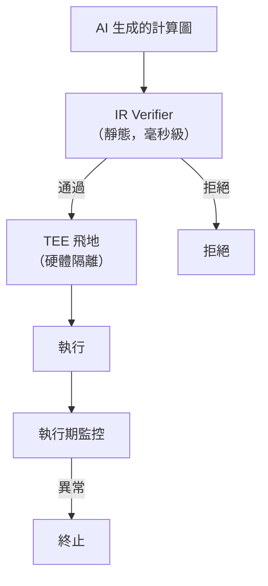

# 8.2　TEE 與機密計算的硬體隔離

> 本節導論：驗證器可能被繞過，軟體隔離可能有漏洞。最後一道防線是硬體：讓程式跑在一個「連作業系統都看不到」的加密飛地裡。這就是機密計算。

## 8.2.1 什麼是 TEE

**TEE（Trusted Execution Environment，可信執行環境）** 是處理器提供的硬體隔離機制。它讓程式在一個「**飛地（enclave）**」裡執行，其記憶體被硬體加密，連作業系統、hypervisor、甚至實體攻擊者都無法讀取或篡改。

代表性的 TEE 技術：

* **Intel SGX**（2015）：使用者態飛地，記憶體加密在 CPU 封裝內。
* **AMD SEV / SEV-ES / SEV-SNP**（2016 起）：整台虛擬機的記憶體加密，由 hypervisor 建立但看不到內容。
* **Intel TDX**（2023）：Trust Domain Extensions，虛擬機層級的機密計算。
* **ARM TrustZone / CCA**：行動裝置與伺服器的機密計算架構。

TEE 的核心價值是「**機密性 + 完整性**」：資料在記憶體裡是加密的，運算過程不被窺探，結果不被篡改。

## 8.2.2 SGX 與 VM 層級 TEE 的差別

兩種 TEE 的粒度不同：

* **SGX（使用者態飛地）**：隔離粒度是「一個行程的一部分」。程式設計師把敏感程式碼放進飛地，飛地外的程式碼看不到飛地內的記憶體。好處是粒度細，缺點是程式要改寫（分割飛地內外），且飛地大小受限。
* **SEV / TDX（VM 層級）**：隔離粒度是「整台虛擬機」。整個 guest 記憶體被加密，hypervisor 只能看到密文。好處是不用改程式（整個 VM 都在飛地裡），缺點是粒度粗、啟動開銷較大。

對異質虛擬機，VM 層級 TEE 更合適：因為 AI 代理的沙盒通常是一個完整的 VM，不需要細分飛地內外。

## 8.2.3 機密 GPU：最難的一塊

CPU 的 TEE 相對成熟，但 **GPU 的機密計算** 極難：

* **GPU 沒有獨立的 TEE**：GPU 的記憶體（HBM）與運算單元，不像 CPU 那樣有硬體加密飛地。
* **PCIe 傳輸是明文**：CPU 與 GPU 之間的資料傳輸（透過 PCIe）預設是明文，可能被攔截。
* **GPU 驅動在宿主**：GPU 驅動跑在宿主，能存取 GPU 狀態，破壞機密性。

目前的進展：

* **NVIDIA 的 Confidential Computing**（H100 起）：用「加密的 PCIe 通道 + GPU 內的保護模式」，讓 GPU 記憶體對宿主不可見。這是目前最成熟的機密 GPU 方案。
* **AMD 的 SEV + GPU**：把 GPU 也納入 SEV 的保護範圍，仍在演進。
* **學術方案**：用「CPU 做加解密 + GPU 做運算」的混合模式，但效能損失大。

機密 GPU 是「AI 時代虛擬機」的關鍵缺口：如果模型權重與推理資料在 GPU 上是明文，機密計算就只做了一半。

## 8.2.4 TEE 與虛擬機的結合

TEE 與虛擬機可以結合，形成「**機密虛擬機（Confidential VM）**」：

* **啟動時**：hypervisor 建立 VM，但 VM 的記憶體被硬體加密。
* **執行時**：VM 內的程式正常執行，但 hypervisor 只能看到密文。
* **驗證時**：VM 可以提供「遠端證明（remote attestation）」，證明它跑在真實的 TEE 裡、載入了正確的軟體。

這個模型對 AI 代理沙盒的價值是：**即使宿主被攻破，沙盒裡的程式與資料仍然安全**。這對「多租戶共享算力」的場景至關重要——租戶不用信任雲端業者。

## 8.2.5 遠端證明：如何相信一個遠端沙盒

**遠端證明（Remote Attestation）** 是 TEE 的配套機制：

* 沙盒啟動時，硬體產生一個「證明報告」，包含「硬體的簽章 + 載入的軟體度量（measurement）」。
* 報告可以被遠端驗證者檢查：硬體是否為真、軟體是否為預期版本。
* 驗證通過後，驗證者才把敏感資料傳給沙盒。

這解决了「我怎麼知道遠端的沙盒沒被篡改」的問題。對 AI 代理，這意味著「我可以把我的模型與資料，安全地送到一個我不信任的雲端沙盒裡執行」。

## 8.2.6 TEE 的效能成本

TEE 不是免費的：

* **記憶體加密開銷**：每次記憶體存取都要加解密，效能損失約 5–30%（取決於工作負載）。
* **飛地切換開銷**：SGX 的飛地進出（enclave entry/exit）成本高，頻繁切換會拖慢。
* **飛地大小限制**：SGX 的飛地記憶體有限（早期 128 MB），大型模型放不下。
* **GPU 機密計算開銷**：加密的 PCIe 傳輸與 GPU 保護模式，效能損失可達 10–20%。

這些成本，使得 TEE 通常只用於「真正敏感」的工作負載，而非所有計算。

## 8.2.7 與 IR Verifier 的協同

TEE 與 IR Verifier 是互補的：

* **IR Verifier**：在**軟體層**證明「程式不會做壞事」。它快、便宜，但可能被繞過。
* **TEE**：在**硬體層**保證「即使程式做壞事，也逃不出飛地」。它慢、貴，但幾乎無法繞過。

兩者結合，形成「**雙層驗證**」：

* 第一層擋掉「明顯危險」的程式，減少進入 TEE 的負載。
* 第二層保護「通過驗證但仍有風險」的程式。
* 第三層監控「執行期異常」，即時終止。

## 8.2.8 本節小結

* TEE 用硬體隔離 + 記憶體加密，讓程式在「連 OS 都看不到」的飛地裡執行。
* SGX 是使用者態飛地，SEV/TDX 是 VM 層級飛地；VM 層級更適合 AI 沙盒。
* 機密 GPU 是最難的一塊，NVIDIA H100 起的機密計算是最成熟方案。
* 機密虛擬機 + 遠端證明，讓租戶能安全地把資料送到不信任的雲端。
* TEE 有 5–30% 效能成本，通常只用於敏感工作負載。
* 與 IR Verifier 互補，形成「靜態驗證 + 硬體隔離 + 執行期監控」的縱深防禦。

下一節，我們談「預算」：如何防止 AI 生成的程式耗盡整個叢集的資源。
