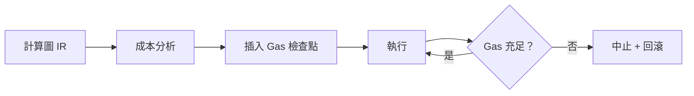

# 8.3　Gas 計量與預算受限執行

> 本節導論：安全不只是「不讓程式做壞事」，還包括「不讓程式耗盡資源」。區塊鏈的 Gas 機制提供了一個優雅的答案：把資源消耗變成可計量、可收費、可中斷的預算。

## 8.3.1 為什麼需要預算

一個通過驗證、被隔離的程式，仍可能造成災難：

* **無窮迴圈**：即使迴圈有界，界可能設得極大（如跑十年）。
* **記憶體爆炸**：合法地配置大量記憶體，耗盡整個叢集。
* **算力耗盡**：合法地啟動大量 kernel，讓所有租戶的延遲暴增。
* **頻寬耗盡**：合法地搬運大量資料，塞爆網路。

這些不是「安全漏洞」，而是「**資源濫用**」。傳統的安全模型（權限隔離）無法防範，因為程式做的事都是「合法的」，只是「太多了」。

## 8.3.2 Gas 機制：把資源變成可計量的貨幣

區塊鏈的 **Gas** 機制提供了一個範式：

* 每個操作（運算、記憶體、儲存）都有一個「Gas 成本」。
* 執行前，使用者必須支付一筆 Gas 預算。
* 執行時，每做一個操作就扣 Gas。
* Gas 耗盡，執行立即中止，狀態回滾。

這個機制的優雅之處在於：**它把「資源」變成「貨幣」，把「濫用」變成「付不起」**。攻擊者要耗盡資源，就得支付對應的成本，經濟上不划算。

## 8.3.3 異質算力的 Gas 設計

把 Gas 搬到異質算力，需要為不同資源定義成本：

* **運算 Gas**：每個張量運算的成本，依 FLOPs 計。
* **記憶體 Gas**：每個張量的記憶體佔用，依 bytes 計。
* **頻寬 Gas**：每次跨裝置/跨節點傳輸，依 bytes 計。
* **啟動 Gas**：每次沙盒啟動/分叉，依固定成本計。
* **時間 Gas**：執行的牆鐘時間，作為最後的保險。

總成本可以表達為：

$$
G_{\text{total}} = \sum_{i} c_{\text{op}} \cdot \text{FLOPs}_{i} + \sum_{j} c_{\text{mem}} \cdot \text{Bytes}_{j} + \sum_{k} c_{\text{net}} \cdot \text{Bytes}_{k} + c_{\text{start}} \cdot N_{\text{starts}}
$$

其中 $ c_{\text{op}} $、$ c_{\text{mem}} $、$ c_{\text{net}} $、$ c_{\text{start}} $ 是各資源的單價。

## 8.3.4 預算受限執行：在編譯期插入計量

Gas 計量可以在兩個層次實現：

* **執行期計量**：每次操作時檢查並扣除 Gas。簡單但每次操作都有額外開銷。
* **編譯期插入**：在編譯計算圖時，靜態計算每個節點的成本，插入「Gas 檢查點」。這樣執行時只需在檢查點檢查，開銷小。

編譯期插入的做法是：

* 分析計算圖，為每個節點標註成本。
* 在圖的「關鍵點」（如迴圈邊界、大運算前）插入 Gas 檢查。
* 執行時，檢查點確認 Gas 充足，才繼續。

這與 eBPF 驗證器的思路一致：把昂貴的檢查移到載入/編譯時，執行時只做輕量檢查。

## 8.3.5 靜態成本上界：驗證階段就拒絕

比「執行時耗盡才中止」更好的，是「**載入前就證明成本有界**」。

這需要靜態分析計算圖的成本上界：

* 對於無迴圈的圖（DAG），總成本可以直接加總，是靜態可算的。
* 對於有界迴圈，成本 = 迴圈次數上界 × 單次成本。
* 對於動態控制流，需要分析所有分支的最大成本。

如果某個程式的成本上界超過預算，驗證器直接拒絕，不讓它進入執行。這是「**預算受限驗證（budget-bounded verification）**」的核心。

## 8.3.6 Gas 與 QoS 的結合

Gas 不只防濫用，還能做 **QoS 分配**：

* 每個租戶有一個 Gas 預算，代表它的資源配額。
* 高優先級租戶有較高的 Gas 價格（能出更高價買資源）。
* 低優先級租戶在資源緊張時，Gas 價格上升，自然被擠出。

這本質上是「**市場化的資源分配**」：用價格機制取代固定配額，讓資源流向最有價值的地方。這在雲端算力市場（如 spot instance、GPU 拍賣）已有雛形。

## 8.3.7 Gas 的挑戰：定價與操縱

Gas 機制不是沒有問題：

* **定價難**：如何為不同的運算（矩陣乘 vs 卷積 vs 注意力）定出合理的價格？價格錯了，會扭曲資源分配。
* **操縱風險**：攻擊者可能用「低成本高耗時」的操作（如某些不規則運算）來繞過 Gas，造成實際資源耗盡。
* **跨硬體差異**：同一個運算在 GPU 與 NPU 上的成本不同，Gas 價格要如何統一？

這些挑戰說明：Gas 機制需要精細的設計，不能簡單套用。

## 8.3.8 本節小結

* 通過驗證與隔離的程式，仍可能「合法地」耗盡資源。
* Gas 機制把資源消耗變成可計量、可收費、可中斷的預算。
* 異質算力的 Gas 需涵蓋運算、記憶體、頻寬、啟動、時間。
* 計量可在執行期做（簡單但慢）或編譯期插入檢查點（快）。
* 更好的做法是「預算受限驗證」：載入前就證明成本有界，超出就拒絕。
* Gas 可與 QoS 結合做市場化分配，但定價與操縱是挑戰。

第三部的前兩章，分別談了「隔離容器」與「驗證防線」。但這兩者都還有一個共同的缺口：**它們都太重、太綁定特定硬體**。有沒有可能用一種既輕量、又可驗證、又能跨雲邊端遷移的格式，來承載代理的計算邏輯？

答案就是 WebAssembly。下一章我們看它如何從瀏覽器沙盒，進化成異質算力的通用底座。
