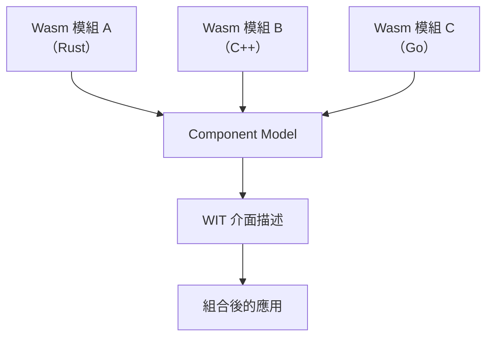

# 9.1　2017 年 Wasm 到 Component Model

> 本節導論：WebAssembly 從「瀏覽器裡的高效位元組碼」出發，正在演化成一個「跨語言、跨平台的元件模型」。這條演化路徑，恰好是異質虛擬機需要的通用底座。

## 9.1.1 從 MVP 到標準

2017 年，WebAssembly 以 MVP（最小可行產品）形式在四大瀏覽器引擎落地。MVP 的範圍很窄：

* 只有數值型別（i32、i64、f32、f64）。
* 只有線性記憶體，沒有 GC。
* 只有函式匯入/匯出，沒有複雜的介面描述。
* 只有單一執行緒（threads 是後來的提案）。

MVP 的目標是「讓 C/C++ 能編譯到瀏覽器」，所以它的設計刻意簡單：沒有物件、沒有字串型別、沒有介面描述。這種簡單性，正是它能快速標準化、快速普及的原因。

## 9.1.2 標準化與 WASI

2019 年，Wasm 成為 W3C 正式推薦標準。同年，**WASI（WebAssembly System Interface）** 出現，把 Wasm 從瀏覽器帶到伺服器端。

WASI 的核心思想是「**能力導向的安全（capability-based security）**」：

* Wasm 模組不能直接存取檔案、網路、時鐘。
* 它只能透過「匯入（import）」的 WASI 函式存取，而這些函式由宿主提供。
* 宿主可以精確控制「這個模組能存取哪些檔案、哪些網路端點」。

這個模型比傳統的「權限位元（permission bits）」更精細：不是「這個程式能不能讀檔案」，而是「這個程式能不能讀這個特定檔案」。

## 9.1.3 從模組到元件：Component Model

Wasm MVP 的一個限制是「**模組之間難以組合**」：每個模組有自己的線性記憶體，模組之間傳資料要手動序列化。這使得「用多個 Wasm 模組組裝一個應用」非常痛苦。

**Component Model**（2022 起持續演進）要解決這個問題：

* **介面描述（WIT, Wasm Interface Type）**：用一種 IDL 描述元件的介面，包括函式、型別、資源。
* **高階型別**：支援字串、列表、記錄、變體等，不再只有數值。
* **元件組合**：多個元件可以組合成更大的元件，介面自動適配。
* **跨語言互通**：不同語言編譯出的元件，可以透過 WIT 介面互相呼叫。

Component Model 的意義是：**Wasm 從「單一模組」變成「可組合的軟體元件」**。這讓它從「瀏覽器沙盒」升級為「通用的軟體組裝平台」。

## 9.1.4 為什麼 Component Model 對異質虛擬機重要

異質虛擬機需要「用同一份邏輯，安全地在雲、邊、端之間遷移」。Component Model 提供了三個關鍵能力：

* **可攜性**：元件是硬體無關的位元組碼，可以在任何有 Wasm runtime 的地方執行。
* **可組合性**：不同的計算邏輯（純量控制、張量運算、I/O）可以組成元件，各自用最適合的語言寫。
* **安全性**：每個元件都在沙盒裡，透過 WIT 介面互動，邊界清楚。

這正是「雲邊端通用算力底座」需要的：一份元件，在雲端訓練叢集、邊緣 NPU、終端設備上都能跑。

## 9.1.5 Wasm 的效能演進

Wasm 的效能一直是它被質疑的點。但近年來有顯著進展：

* **AOT 編譯**：用 `wasmtime`、`wasmer` 等 runtime 預編譯成機器碼，啟動快、執行快。
* **SIMD**：128-bit SIMD 提案已標準化，提升數值計算效能。
* **GC 提案**：加入垃圾回收型別，讓高階語言（如 Kotlin、Dart）能更自然編譯到 Wasm。
* **執行緒**：threads 提案支援共享記憶體與原子操作。

這些演進讓 Wasm 從「比原生慢 2–5 倍」進步到「接近原生」，在某些場景甚至更快（因為啟動快、記憶體佔用小）。

## 9.1.6 侷限：仍然缺少張量原語

儘管如此，Wasm 仍有一個根本侷限：**它沒有張量型別與加速器原語**。

Wasm 的數值型別是純量與 128-bit 向量，沒有「$ M \times N $ 矩陣」這種型別，也沒有「矩陣乘」這種指令。要跑 AI 計算，只能：

* 用純量迴圈模擬（慢）。
* 透過 WASI-NN 匯入宿主 ML 引擎（只能當膠水）。
* 用 SIMD 手寫 kernel（繁瑣且難最佳化）。

這個侷限，正是下一節要談的：**如何讓 Wasm 調用 MLIR 編譯的 GPU/NPU kernel**。

## 9.1.7 本節小結

* Wasm 從 2017 MVP 起步，2019 成為 W3C 標準，2020 年代持續擴充。
* WASI 用能力導向安全，把 Wasm 帶到伺服器端。
* Component Model 用 WIT 介面描述，讓 Wasm 從「單一模組」變成「可組合元件」。
* Component Model 的可攜、可組合、安全，正是異質虛擬機需要的通用底座。
* Wasm 效能演進（AOT、SIMD、GC、threads）讓它接近原生。
* 但仍缺少張量原語，需要與 MLIR kernel 結合。

下一節，我們看這個結合的具體機制：Wasm 如何安全地調用異質 kernel。
