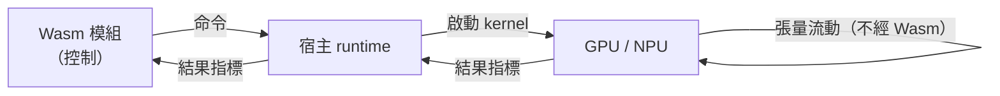
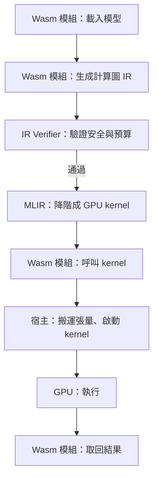

# 9.2　Wasm 調用 MLIR 編譯的 Kernel

> 本節導論：Wasm 擅長控制流與沙盒，MLIR 擅長把張量運算降階成高效 kernel。把兩者接起來，就得到「安全控制 + 高效計算」的組合。

## 9.2.1 分工：Wasm 管控制，MLIR 管計算

Wasm 與 MLIR 的結合，本質上是一種「**分工**」：

* **Wasm 負責控制面**：決定何時載入模型、何時呼叫 kernel、如何處理結果、如何做錯誤處理。
* **MLIR 負責資料面**：把張量運算降階成 GPU/NPU 的高效 kernel。

這個分工，對應第 1 章講的「控制面與資料面分離」。傳統的虛擬機把兩者綁在一起，導致控制面的開銷拖累資料面；分離之後，各自用最適合的技術。

## 9.2.2 接口設計：如何從 Wasm 呼叫 Kernel

從 Wasm 呼叫 MLIR kernel，需要一個「**邊界介面**」。設計這個介面，有幾個關鍵決策：

* **資料怎麼傳**：張量在 Wasm 的線性記憶體裡，kernel 需要的是裝置記憶體（HBM）。邊界要負責搬運（或共享）。
* **呼叫怎麼表達**：Wasm 透過匯入函式呼叫 kernel，參數包括張量的位址、形狀、dtype。
* **結果怎麼回**：kernel 的輸出要寫回 Wasm 的線性記憶體，或留在裝置上供後續 kernel 使用。

一個典型的介面可能長這樣（概念示意）：

```wit
// WIT 介面描述
interface tensor-runtime {
  record tensor-desc {
    offset: u64,      // 在線性記憶體中的偏移
    shape: list<u32>,
    dtype: string,
  }

  // 呼叫一個已編譯的 kernel
  execute: func(kernel-id: u32, inputs: list<tensor-desc>) -> list<tensor-desc>
}
```

Wasm 模組透過這個介面，把「張量描述」傳給宿主，宿主負責把張量搬到裝置、啟動 kernel、把結果搬回。

## 9.2.3 資料搬運的最佳化：零拷貝

「搬運」是這個架構的效能瓶頸。如果每次呼叫都要把張量從 Wasm 線性記憶體複製到裝置，開銷會很大。解法有幾種：

* **共享記憶體**：讓 Wasm 的線性記憶體直接映射到裝置可存取的記憶體（如 CXL 共享記憶體），實現零拷貝。
* **裝置常駐**：張量一開始就放在裝置上，Wasm 只傳「控制命令」，不傳資料。
* **非同步傳輸**：用 DMA 非同步搬運，與計算重疊。

其中「裝置常駐」是最有效的：Wasm 模組只負責「協調」，張量在裝置上流動，不經過 Wasm 的線性記憶體。這讓 Wasm 退化成「控制平面」，不碰資料平面。



## 9.2.4 安全邊界：Wasm 沙盒如何保護裝置

Wasm 的沙盒保護的是「宿主」，但呼叫 GPU kernel 時，邊界變得複雜：

* **Wasm 模組不能直接存取裝置記憶體**：它只能透過介面傳「張量描述」，由宿主驗證後才操作裝置。
* **Kernel 必須是預先編譯、驗證過的**：Wasm 模組不能「即時編譯任意 kernel」，只能呼叫白名單內的 kernel。
* **裝置資源要配額**：Wasm 模組的裝置記憶體、算力使用要有上限（Gas 機制）。

這保證了：即使 Wasm 模組是惡意的，它也無法「用 GPU 做壞事」——它只能呼叫被允許的 kernel，在配額內使用裝置。

## 9.2.5 動態 kernel 生成：代理的特殊需求

AI 代理可能需要「動態生成 kernel」：根據任務即時編譯新的計算。這與「只能呼叫白名單 kernel」的安全模型衝突。

解法是「**驗證後的動態編譯**」：

* 代理生成的是「計算圖 IR」（如 StableHLO），不是機器碼。
* IR 先經過驗證器（第 8 章），確認安全、成本有界。
* 驗證通過後，才用 MLIR 編譯成 kernel。
* 編譯出的 kernel 進入「本次執行專屬的白名單」。

這條路徑讓代理有「動態生成」的彈性，同時保持安全：因為生成的是高階 IR，不是任意機器碼，驗證器可以分析它。

## 9.2.6 一個端到端的例子

把上述機制串起來，一個「Wasm 控制 + MLIR 計算」的端到端流程是：



這個流程展示了異質虛擬機的核心：**Wasm 提供安全的控制面，MLIR 提供高效的資料面，兩者透過驗證過的介面結合**。

## 9.2.7 效能與安全的平衡

這個架構的關鍵取捨是「效能 vs 安全」：

* 如果要「零拷貝」，Wasm 與裝置要共享記憶體，但共享記憶體削弱了隔離。
* 如果要「強隔離」，每次都要複製，效能受損。
* 折衷方案是「裝置常駐 + 指標傳遞」：張量在裝置上，Wasm 只傳指標，既不複製也不共享資料內容。

這與第 7 章的「控制面/資料面分離」思想一致：把「控制」與「資料」分開，各自用最適合的隔離策略。

## 9.2.8 本節小結

* Wasm 管控制面，MLIR 管資料面，兩者分工。
* 邊界介面用 WIT 描述，傳「張量描述」而非資料本身。
* 零拷貝靠共享記憶體、裝置常駐、非同步傳輸；裝置常駐最有效。
* Wasm 沙盒透過「不能直接存取裝置、只能呼叫白名單 kernel、資源配額」保護裝置。
* 動態 kernel 生成靠「生成 IR → 驗證 → 編譯 → 專屬白名單」。
* 效能與安全的平衡，靠「控制面/資料面分離」。

下一節，我們看這個架構如何支撐「雲邊端一次編寫、到處遷移」。
