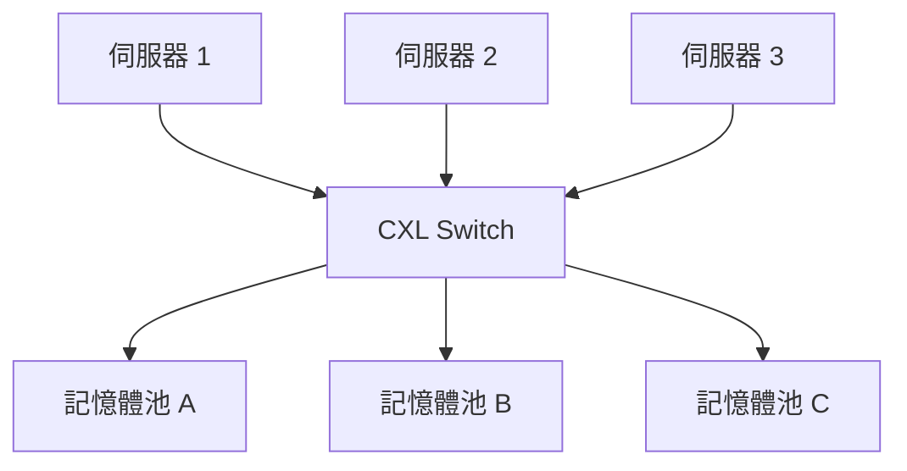

# 10.1　2019 年 CXL 與統一記憶體池

> 本節導論：單顆晶片的顯存裝不下萬億參數模型，而跨節點搬資料又太慢。CXL 的出現，讓「記憶體池化」從概念變成匯流排標準——這是機櫃級虛擬機的硬體基礎。

## 10.1.1 記憶體牆與模型膨脹

AI 模型的參數規模，過去十年膨脹了數個數量級：

* 2018 年 BERT-large：約 3.4 億參數。
* 2020 年 GPT-3：1750 億參數。
* 2023 年之後的模型：兆級（trillion）參數已不再是新聞。

一個 1 兆參數的模型，若用 FP16 儲存，需要約 2 TB 記憶體。而單顆 GPU 的 HBM 目前最多約 80–192 GB。這意味著：**模型裝不進單顆晶片，必須跨裝置、跨節點分布**。

傳統的解法是「模型平行（model parallelism）」：把模型切開，放在多顆 GPU 上，透過 NVLink / InfiniBand 交換中間結果。但這種解法有兩個問題：

* **通訊瓶頸**：每次前向傳播都要跨裝置交換大量資料，頻寬成為瓶頸。
* **記憶體碎片化**：每顆 GPU 的記憶體各自管理，無法共享空閒空間。

## 10.1.2 CXL 的誕生

**CXL（Compute Express Link）** 是 2019 年由 Intel 主導成立的聯盟所推動的開放標準，建立在 PCIe 實體層之上。它的目標是「**讓 CPU、GPU、加速器、記憶體之間有統一的、快取一致的互連**」。

CXL 有三個子協定：

* **CXL.io**：基於 PCIe 的 I/O 協定，用於裝置發現、配置。
* **CXL.cache**：讓裝置能快取主機記憶體，保持一致性。
* **CXL.mem**：讓主機能用 load/store 指令存取裝置上的記憶體（記憶體擴展）。

其中 CXL.mem 是「記憶體池化」的關鍵：它讓「記憶體」可以脫離「CPU 插槽」，變成一種可透過匯流排存取的資源。

## 10.1.3 記憶體池化：從「每台機器各自記憶體」到「共享記憶體池」

CXL 的願景是「**記憶體池（memory pool）**」：多台伺服器共享一個大的記憶體池，按需分配。

這個架構的好處是：

* **利用率提升**：記憶體不再被「綁定」在單一伺服器，空閒的記憶體可以借給別人。
* **彈性擴展**：需要更多記憶體時，從池裡分配，不用換機器。
* **故障隔離**：某台伺服器的記憶體故障，不影響其他伺服器。

對 AI 而言，這意味著「一個模型可以橫跨多台伺服器的記憶體，而不需要把資料切得太碎」。

## 10.1.4 CXL 的三種型態

CXL 裝置有三種型態，對應不同的使用場景：

* **CXL Type 1**：只有快取，沒有記憶體（如 SmartNIC）。
* **CXL Type 2**：有快取也有記憶體（如 GPU、加速器）。
* **CXL Type 3**：只有記憶體（記憶體擴展卡、記憶體池）。

對「機櫃級虛擬機」，最重要的是 Type 3：它讓記憶體成為一種「獨立的、可池化的資源」。

## 10.1.5 延遲與頻寬的現實

CXL 不是萬靈丹，它有明確的效能特性：

* **延遲**：CXL 記憶體的延遲比本地 DRAM 高（約 100–200 ns vs 80 ns），比跨節點網路低得多（約 1–10 μs）。
* **頻寬**：CXL 3.x 提供高頻寬（PCIe 5.0/6.0 的頻寬），但仍低於本地 HBM。
* **一致性**：CXL.cache 提供硬體快取一致性，但跨池的共享記憶體仍需軟體協調。

這意味著 CXL 記憶體適合「**容量大、存取頻率較低**」的資料（如模型權重），而不適合「頻繁存取」的資料（如熱點張量）。分層記憶體（HBM → CXL → 遠端）是必要的。

## 10.1.6 分層記憶體的排程問題

有了 CXL，記憶體變成一個「層級（tier）」：

* **Tier 0：HBM**：最快、最貴、容量最小。
* **Tier 1：本地 DRAM**：快、中等容量。
* **Tier 2：CXL 記憶體池**：較慢、大容量、可共享。
* **Tier 3：遠端節點記憶體**：最慢、最大、跨網路。

虛擬機的職責，是把「張量」放到對的層級：

* 熱點張量（正在計算的）放 HBM。
* 溫資料（即將用到）放 DRAM / CXL。
* 冷資料（模型權重、checkpoint）放 CXL / 遠端。

這是一個「**記憶體分層排程**」問題，與 CPU 的 cache 分層類似，但粒度更大、決策更複雜。

## 10.1.7 CXL 與虛擬化的交會

CXL 對虛擬機的意義，不只是「更多記憶體」，而是「**記憶體成為可虛擬化的資源**」：

* **記憶體超賣**：多個 VM 共享 CXL 池，按需分配（第 5 章的超賣，終於有了硬體基礎）。
* **記憶體遷移**：VM 的記憶體可以在池中遷移，實現「無停機遷移」。
* **記憶體快照**：CXL 池可以做「池級快照」，支撐第 7 章的狀態分叉。

這讓「機櫃級虛擬機」成為可能：整座機櫃的記憶體被虛擬化成一個「統一的位址空間」，VM 可以在上面自由分配、遷移、快照。

## 10.1.8 本節小結

* 模型膨脹到兆級參數，單顆晶片的 HBM 裝不下。
* CXL（2019）建立在 PCIe 上，提供 CXL.io / cache / mem 三個子協定。
* CXL.mem 讓記憶體脫離 CPU 插槽，成為可池化的資源。
* CXL Type 3 是記憶體池化的關鍵；延遲高於本地 DRAM，但遠低於網路。
* 分層記憶體（HBM / DRAM / CXL / 遠端）需要虛擬機做記憶體分層排程。
* CXL 讓記憶體成為可虛擬化、可超賣、可遷移、可快照的資源。

下一節，我們談「分布式 Hypervisor」：如何管理跨節點的頁面遷移與一致性。
