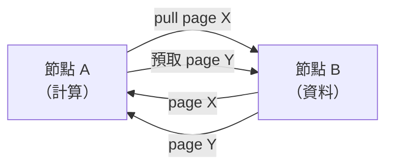
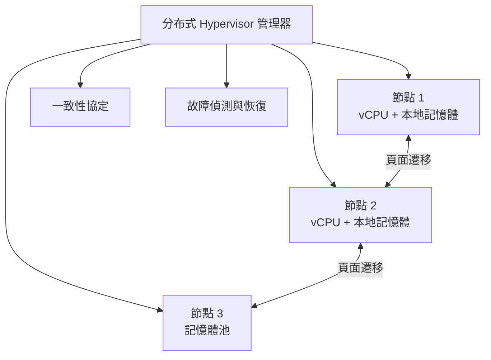

# 10.2　分布式 Hypervisor 的頁面遷移與一致性

> 本節導論：當一台「虛擬機」橫跨多個節點，管理它的 hypervisor 也必須分散式化。這一節談分散式 hypervisor 的三個核心難題：頁面遷移、一致性、故障容錯。

## 10.2.1 從單機 Hypervisor 到分布式 Hypervisor

傳統 hypervisor（如 KVM）假設「所有資源都在本地」：CPU、記憶體、裝置都在同一台機器。分布式 hypervisor 打破這個假設：

* **資源跨節點**：記憶體可能在 CXL 池，GPU 可能在另一個節點。
* **VM 跨節點**：一個 VM 的 vCPU 可能分布在不同節點。
* **狀態分散**：VM 的記憶體頁分散在多個節點的記憶體池。

這讓「VM 的邊界」不再是「一台實體機」，而是「一個邏輯上的執行環境，橫跨多個物理節點」。

## 10.2.2 頁面遷移：把記憶體搬到需要的地方

頁面遷移是分布式 hypervisor 的核心操作。它要解決「**資料在哪裡**」與「**計算在哪裡**」的匹配問題：

* 如果計算在節點 A，但資料在節點 B，就要把資料搬到 A（或把計算搬到 B）。
* 遷移的單位是「頁（page）」，通常是 4 KB 或更大（如 2 MB 的 huge page）。

遷移的策略有幾種：

* **拉取（pull）**：計算節點主動從遠端拉頁。適合「計算已就位、資料按需載入」。
* **推送（push）**：資料節點主動把頁推給計算節點。適合「預先搬運、避免延遲」。
* **預取（prefetch）**：根據存取模式預測未來會用到的頁，提前搬運。

## 10.2.3 一致性：多個副本如何同步

分布式記憶體最大的難題是「一致性（consistency）」：如果一個頁在多個節點有副本，如何保證它們同步？

一致性模型有幾種：

* **強一致性（strong consistency）**：任何讀取都看到最新的寫入。實作成本高（需要全球同步）。
* **順序一致性（sequential consistency）**：所有操作有一個全局順序。
* **最終一致性（eventual consistency）**：副本最終會同步，但短時間內可能不一致。
* **釋放一致性（release consistency）**：用 acquire / release 操作界定同步點。

對 AI 計算，通常不需要「強一致性」：因為計算圖的資料依賴是明確的，只要在「節點邊界」做同步即可。這讓「**弱一致性 + 明確同步點**」成為可行的設計。

## 10.2.4 硬體一致性 vs 軟體一致性

一致性可以由硬體或軟體實現：

* **硬體一致性（hardware cache coherence）**：靠匯流排協定（如 CXL.cache）自動維護快取一致。優點是透明、快；缺點是規模受限（匯流排廣播在大規模下不可行）。
* **軟體一致性（software coherence）**：靠軟體協定（如目錄式協定、訊息傳遞）維護。優點是可擴展；缺點是複雜、有延遲。

CXL 在小規模（單機櫃）提供硬體一致性，但跨機櫃仍需軟體協定。這形成「**分層一致性**」：機櫃內硬體一致、機櫃間軟體一致。

## 10.2.5 故障透明容錯

分布式系統必然有故障：節點當機、網路斷線、記憶體錯誤。分布式 hypervisor 必須「故障透明」——VM 不知道底層故障，繼續執行。

容錯的機制有幾種：

* **副本（replication）**：把 VM 的狀態複製到多個節點，一個故障，另一個接手。
* **檢查點（checkpointing）**：定期拍快照，故障時從最近的快照恢復。
* **遷移（migration）**：偵測到節點即將故障，提前把 VM 遷走。

對 AI 計算，容錯的粒度可以放寬：一次訓練可能要跑幾週，中途故障是常態。因此「**檢查點 + 重啟**」是主流：定期存 checkpoint，故障時從 checkpoint 恢復，損失幾分鐘的計算。

## 10.2.6 一個分布式 VM 的架構

把上述機制組合，一個分布式 VM 的架構是：

* **管理器**負責全局排程：哪個 vCPU 在哪個節點、哪個頁在哪個記憶體。
* **節點**執行 vCPU，存取本地或遠端記憶體。
* **一致性協定**維護跨節點的資料同步。
* **故障偵測**監控節點健康，觸發遷移或恢復。

## 10.2.7 與 CXL 的結合

CXL 讓分布式 hypervisor 的設計簡化：

* **記憶體池**：CXL Type 3 提供共享記憶體，hypervisor 不需要自己實作「跨節點記憶體共享」。
* **硬體一致性**：CXL.cache 提供快取一致，減少軟體協定的複雜度。
* **低延遲**：CXL 的延遲遠低於網路，讓「遠端記憶體」接近「本地記憶體」。

這讓「機櫃級虛擬機」在工程上可行：整座機櫃的記憶體是一個 CXL 池，hypervisor 只需管理「哪個 VM 用哪些頁」，不需要處理複雜的網路協定。

## 10.2.8 本節小結

* 分布式 hypervisor 管理跨節點的資源，VM 邊界不再是「一台實體機」。
* 頁面遷移解決「資料在哪」與「計算在哪」的匹配，策略有 pull / push / prefetch。
* 一致性有強、順序、最終、釋放等模型；AI 計算常用「弱一致性 + 明確同步點」。
* 硬體一致性（CXL.cache）適合機櫃內，軟體一致性適合跨機櫃。
* 故障容錯靠副本、檢查點、遷移；AI 訓練常用「檢查點 + 重啟」。
* CXL 簡化分布式 hypervisor 的設計，讓機櫃級虛擬機可行。

下一節，我們把這些拼起來：**萬億參數模型的「單機幻覺」如何實現。**
