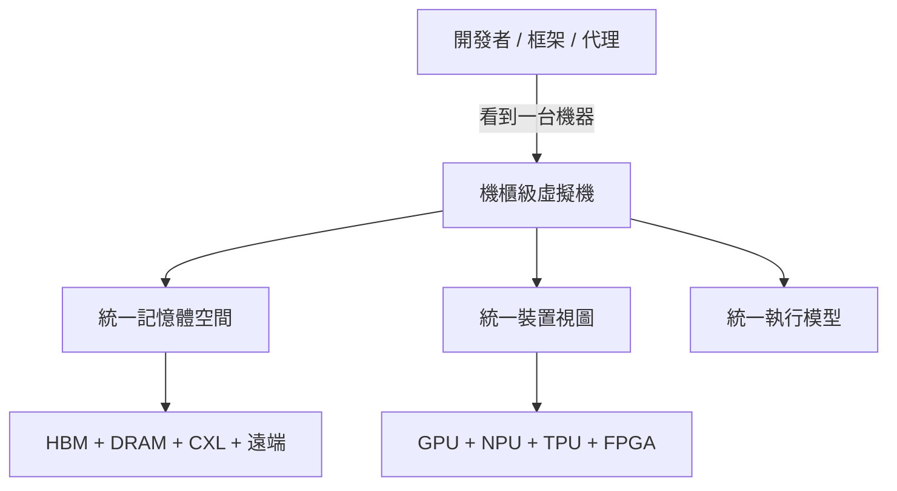

# 10.3　萬億參數模型的單機幻覺

> 本節導論：終極目標是讓開發者「感覺」自己在一台擁有海量統一記憶體的超級機器上跑模型，而底下其實是整座機櫃的異質算力。這一節說明「單機幻覺」如何維持。

## 10.3.1 什麼是單機幻覺

**單機幻覺（single-machine illusion）** 指的是：對上層使用者（開發者、框架、代理）而言，整座機櫃看起來就像「一台有海量記憶體與多種加速器的邏輯機器」，不需要知道資料在哪個節點、哪個 GPU。

這個幻覺由三部分組成：

* **統一記憶體空間**：所有記憶體（HBM、DRAM、CXL 池、遠端）被映射成一個連續的位址空間。
* **統一裝置視圖**：所有加速器被抽象成「可調度的算力節點」，不需要指定具體的 GPU 型號。
* **統一執行模型**：程式只需要表達計算圖，排程與遷移由虛擬機負責。

## 10.3.2 幻覺的維持：三個層次的透明

要維持「單機幻覺」，虛擬機必須在三個層次做到「透明」：

**記憶體透明**：
* 程式用統一的虛擬位址存取記憶體。
* 虛擬機負責把虛擬位址映射到「本地 / CXL / 遠端」的實體記憶體。
* 頁面遷移在使用者不知情的情況下發生（或透過提示 API 輔助）。

**裝置透明**：
* 程式呼叫「矩陣乘」，不需要指定在哪個 GPU。
* 虛擬機的排程器決定「這個運算跑在哪個裝置」。
* 裝置之間的資料傳輸由虛擬機處理。

**故障透明**：
* 某個節點故障，VM 自動遷移或恢復。
* 程式不需要寫容錯邏輯。

這三個透明，對應第 10.2 節的頁面遷移、裝置分配、故障容錯。

## 10.3.3 統一記憶體空間的挑戰

「統一記憶體空間」聽起來簡單，但實作極難：

* **位址空間大小**：整座機櫃的記憶體可能有數十 TB，需要 46 位元以上的位址空間。
* **延遲差異**：不同層級的記憶體延遲差異大（HBM 80 ns vs 遠端 10 μs），程式需要「局部性感知」。
* **一致性**：多個節點同時存取同一頁，需要一致性協定。
* **遷移的暫停**：頁面遷移時，存取該頁的執行緒要暫停或重定向。

目前的解法是「**分層虛擬記憶體**」：虛擬位址空間是統一的，但實體映射是分層的。虛擬機用硬體（如 CXL 的位址轉譯）與軟體（如頁表管理）配合，把「統一空間」映射到「分層實體」。

## 10.3.4 一個萬億參數模型的執行

設想一個 1 兆參數的模型，要在機櫃上執行一次前向傳播：

* **模型權重**（2 TB）存在 CXL 池。
* **當前層的權重**被遷移到 GPU 的 HBM（80 GB）。
* **中間激活值**存在本地 DRAM。
* **跨層的計算**在多個 GPU 上平行。
* **通訊**透過 NVLink / CXL 交換中間結果。

虛擬機的職責是：

* **預取**：根據計算圖，提前把下一層的權重從 CXL 遷到 HBM。
* **排程**：決定哪層在哪個 GPU 上算。
* **重疊**：讓「遷移」與「計算」重疊，隱藏延遲。

這是一個「**計算與資料流動的管線化**」問題：把模型切成層，層與層之間做流水線，資料在流動中被計算。

## 10.3.5 排程的複雜度

機櫃級排程的複雜度遠高於單機：

* **裝置異質**：GPU、NPU、TPU 各有不同的擅長運算。
* **記憶體分層**：HBM、DRAM、CXL、遠端，頻寬與延遲不同。
* **拓撲感知**：節點之間的連結（NVLink、CXL、網路）頻寬不同，排程要考慮「資料走哪條路」。
* **多租戶**：多個 VM 共享機櫃，要公平分配。

這是一個「**多維度、多約束的組合最佳化**」問題，通常用啟發式演算法（如貪婪、模擬退火）或機器學習來解。

## 10.3.6 幻覺的代價：什麼時候會破功

「單機幻覺」不是無限的，它在某些情況下會破功：

* **頻寬飽和**：當多個 VM 同時大量存取 CXL 池，頻寬飽和，延遲暴增。
* **一致性風暴**：多個節點頻繁同步同一頁，一致性協定成為瓶頸。
* **故障恢復**：節點故障時，恢復可能需要數秒到數分鐘，幻覺暫時中斷。
* **語意差異**：不同硬體的浮點行為不同，跨裝置計算可能得到不同結果。

好的虛擬機設計，會「**在幻覺破功前，優雅降級**」：例如頻寬飽和時，主動降低預取、減少平行度，維持可接受的延遲，而不是突然崩潰。

## 10.3.7 與三部曲其他環節的交接

機櫃級虛擬機不是孤立的，它與三部曲其他環節交接：

* **與編譯器**：計算圖 IR 由編譯器降階，虛擬機負責「把降階後的執行檔部署到機櫃」。
* **與作業系統**：作業系統管理單節點的資源，虛擬機管理跨節點的資源。
* **與硬體**：CXL、NVLink、機密計算，都是虛擬機依賴的硬體基礎。

這說明「單機幻覺」不是單一技術的成就，而是整個系統堆疊協作的結果。

## 10.3.8 本節小結

* 單機幻覺讓整座機櫃看起來像一台海量記憶體的超級機器。
* 三部分：統一記憶體空間、統一裝置視圖、統一執行模型。
* 三個透明：記憶體、裝置、故障。
* 統一記憶體空間靠「分層虛擬記憶體」實現，挑戰在位址大小、延遲、一致性、遷移暫停。
* 萬億參數模型的執行是「計算與資料流動的管線化」。
* 排程是多維度組合最佳化，需考慮異質、分層、拓撲、多租戶。
* 幻覺會破功，好的設計要「優雅降級」。

下一章是終章：**軟硬體共同演進，以及三部曲的終極交匯。**
