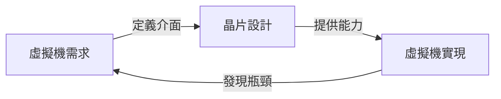

# 11.1　為虛擬化讓路的晶片設計

> 本節導論：過去是「軟體想辦法虛擬化硬體」，現在是「硬體主動為虛擬化設計」。這一節看晶片設計如何把虛擬化從「事後補救」變成「原生能力」。

## 11.1.1 從「是否可虛擬化」到「為虛擬化而設計」

1974 年 Popek–Goldberg 問的是「**這顆 CPU 能不能被有效率地虛擬化**」——虛擬化是事後檢驗硬體的能力。

AI 時代的問題反過來了：「**我們能不能設計一顆晶片，讓它天生就適合被虛擬化**」——虛擬化成為設計的約束條件。

這個轉變，體現在幾個層面。

## 11.1.2 硬體級異質頁表

CPU 有 MMU 做位址隔離，GPU 過去只有「驅動層檢查」。新一代晶片開始加入 **硬體級頁表**：

* **GPU MMU**：NVIDIA、AMD 的 GPU 都支援硬體位址轉譯，讓多個 VM 的 GPU 記憶體互相隔離。
* **統一頁表（unified page table）**：CPU 與 GPU 共享同一套頁表，減少位址轉譯的層級。
* **異質記憶體的位址空間**：CXL 讓周邊裝置也能有統一的位址空間，硬體負責轉譯。

這讓「隔離」從「軟體約定」變成「硬體強制」，是異質虛擬機的安全基礎。

## 11.1.3 脈動陣列的上下文快速切換

脈動陣列（systolic array，TPU 的核心）是「空間計算」：資料流過一排乘法器，計算在空間上展開。它的「上下文」不是暫存器，而是整條資料流的狀態。

為虛擬化設計的晶片，開始加入「**上下文快速切換**」：

* **可保存的管線狀態**：讓脈動陣列的「中途狀態」可以被保存與恢復。
* **分區（partitioning）**：把陣列切成多個獨立分區，每個分區服務一個租戶。
* **時間片（time-slicing）**：在分區之間快速切換（雖然成本仍高於 CPU）。

這讓「TPU 也能被多租戶共享」，而不只是整顆獨占。

## 11.1.4 內建安全驗證指令

未來的晶片可能內建「**安全驗證指令**」：在硬體層檢查程式的安全性，而不是純靠軟體驗證器。

例如：

* **記憶體標籤（memory tagging）**：ARM MTE（Memory Tagging Extension）給每個記憶體區塊一個標籤，硬體檢查存取是否匹配。
* **控制流完整性（CFI）**：硬體檢查間接跳躍的目標是否合法。
* **能力指標（capability pointer）**：CHERI 架構用「能力」取代裸指標，硬體檢查每次存取。

這些機制，把「驗證」從「載入前的靜態分析」延伸到「執行時的硬體檢查」，形成「軟硬體協同的驗證」。

## 11.1.5 機密計算的硬體支援

第 8 章談過的 TEE，也在硬體層持續演進：

* **記憶體加密引擎**：硬體自動加解密記憶體，軟體無感。
* **安全啟動**：硬體驗證載入的軟體，防止篡改。
* **遠端證明的硬體根**：硬體產生不可偽造的證明。

這些能力，讓「機密虛擬機」成為晶片的標準功能，而不是額外的軟體堆疊。

## 11.1.6 為虛擬化而設計的成本

「為虛擬化而設計」不是免費的：

* **面積成本**：額外的頁表、標籤、驗證邏輯，佔用晶片面積。
* **效能成本**：位址轉譯、加密、驗證，都有延遲。
* **複雜度成本**：硬體與軟體的介面變複雜，驗證與除錯更難。

晶片設計者必須在「虛擬化能力」與「原始效能」之間取捨。這也是為什麼「通用虛擬化」與「專用加速」常常是兩條不同的產品線。

## 11.1.7 軟硬體共同設計的循環

最終，晶片設計與虛擬機設計形成一個「**共同演進的循環**」：

* 虛擬機告訴晶片「我需要什麼」（如快速上下文切換、硬體頁表）。
* 晶片提供這些能力。
* 虛擬機用這些能力實作，發現新的瓶頸。
* 新的瓶頸又回饋給下一代晶片設計。

這個循環，正是「軟硬體共同演進」的具體體現。

## 11.1.8 本節小結

* 虛擬化從「事後檢驗硬體」變成「設計約束」。
* 硬體級異質頁表讓 GPU/NPU 也有硬體位址隔離。
* 脈動陣列加入上下文快速切換與分區，支援多租戶。
* 內建安全驗證指令（MTE、CFI、CHERI）把驗證延伸到執行時。
* 機密計算的硬體支援（加密引擎、安全啟動、遠端證明）成為標準。
* 軟硬體共同設計形成「需求 → 設計 → 實現 → 新瓶頸」的循環。

下一節，我們把三部曲收束：編譯器、作業系統、虛擬機如何交匯。
