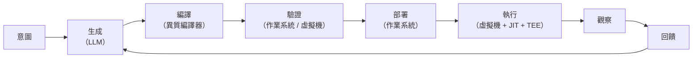

# 11.2　三部曲的終極交匯

> 本節導論：編譯器、作業系統、虛擬機不是三個獨立的層，而是同一個「意圖到算力」轉化過程的三個階段。這一節把三部曲收束成一條完整的鏈路。

## 11.2.1 一次完整的旅程

讓我們追蹤一次「AI 生成程式從意圖到執行」的完整旅程：

1. **意圖**：人類給出一個 prompt，或代理規劃出一個任務。
2. **生成**：LLM 生成高階程式或計算圖 IR。
3. **編譯**：異質編譯器把 IR 降階成多層 IR，最終變成硬體指令。
4. **驗證**：作業系統 / 虛擬機在載入前驗證 IR 的安全性與資源預算。
5. **部署**：作業系統分配物理拓撲，虛擬機切分算力池。
6. **執行**：虛擬機在沙盒裡執行，JIT 特化，TEE 隔離。
7. **觀察**：收集結果與副作用。
8. **回饋**：結果回饋給代理，決定下一步。

這八個步驟，橫跨三部曲的所有技術。把它畫出來：

## 11.2.2 編譯器的角色：把意圖變成「帶證明的 IR」

異質編譯器的核心貢獻，是「**帶證明的多層 IR**」：

* **降階**：把高階 IR（StableHLO）逐步降到低階 IR（LLVM、機器碼）。
* **最佳化**：融合、分塊、佈局、排程，榨乾硬體效能。
* **證明**：在降階的每一步，保留「語意等價」的證明，讓驗證器可以檢查。

「帶證明」是關鍵：傳統編譯器只保證「輸出正確」，不保證「過程可驗證」。AI 時代需要「每一步降階都可被獨立驗證」，因為程式是 AI 生成的，不可信。

## 11.2.3 作業系統的角色：管理物理拓撲與載入前驗證

異質作業系統的核心貢獻，是「**物理拓撲的管理**」：

* **資源發現**：發現節點上有哪些 CPU、GPU、NPU、記憶體。
* **拓撲感知**：知道「哪些裝置靠得近、哪些資料在哪」。
* **載入前驗證**：在程式進入執行前，用 eBPF 式的驗證器檢查安全性。
* **排程**：決定「哪個任務跑在哪個裝置」。

作業系統是「**單節點的守門人**」：它確保進入這個節點的程式是安全的，並把任務放到對的裝置上。

## 11.2.4 虛擬機的角色：跨節點切分與微秒級隔離

異質虛擬機的核心貢獻，是「**跨節點的中介**」：

* **可攜性**：用計算圖 IR 抽象硬體，讓程式跨晶片執行。
* **切分**：把異質算力池動態切分給多租戶。
* **隔離**：用 MicroVM、Wasm、TEE 隔離不可信程式。
* **JIT**：用執行期觀測驅動特化，讓程式越跑越快。
* **規模**：用 CXL 與分布式 hypervisor，把機櫃虛擬成單機。

虛擬機是「**跨節點的中介**」：它把多個節點的算力聚合成一個邏輯機器，並在微秒級隔離代理的執行。

## 11.2.5 三者的邊界正在模糊

有趣的是，三部曲的三個角色，邊界正在模糊：

* **編譯器做作業系統的事**：MLIR 的 bufferization 做記憶體管理，本來是 OS 的職責。
* **作業系統做編譯器的事**：eBPF 的 JIT、IR 執行介面，讓 OS 直接執行 IR。
* **虛擬機做編譯器的事**：JIT 特化，讓虛擬機在執行期編譯。
* **虛擬機做作業系統的事**：分布式 hypervisor 管理跨節點資源，本來是 OS 的職責。

這種「邊界模糊」不是混亂，而是「**融合**」：三者正在融合成一個「**意圖到算力的統一轉化系統**」。

## 11.2.6 統一的抽象：計算圖作為共同語言

三者之所以能融合，是因為它們共享一個抽象：**計算圖 IR**。

* 編譯器以計算圖為輸入與輸出。
* 作業系統以計算圖為調度單位。
* 虛擬機以計算圖為可攜執行檔。

計算圖成為「**意圖與硬體之間的共同語言**」：人類與 LLM 用高階語言表達意圖，編譯器把它翻譯成計算圖，作業系統與虛擬機用計算圖管理與執行。

這就是三部曲的核心洞見：**多層 IR 不只是編譯器的內部表示，而是整個系統堆疊的通用介面**。

## 11.2.7 一個具體的交匯場景

設想一個 AI 代理要「在邊緣設備上跑一個客製化的視覺模型」：

1. **編譯器**：把模型降階成 StableHLO，再降到邊緣 NPU 的指令。
2. **作業系統**：發現邊緣設備的 NPU，驗證編譯後的 IR 安全，分配記憶體。
3. **虛擬機**：把 IR 放進 Wasm 沙盒，在 NPU 上執行，用 TEE 保護模型權重。
4. **回饋**：執行結果回饋給代理，代理決定是否調整模型。

這個場景裡，三部曲的技術全部用上：MLIR 降階、eBPF 驗證、Wasm 沙盒、TEE 隔離。它們不是「三個獨立的步驟」，而是「一個連續的流程」。

## 11.2.8 本節小結

* 一次完整旅程：意圖 → 生成 → 編譯 → 驗證 → 部署 → 執行 → 觀察 → 回饋。
* 編譯器的貢獻：帶證明的多層 IR。
* 作業系統的貢獻：物理拓撲管理與載入前驗證。
* 虛擬機的貢獻：跨節點切分與微秒級隔離。
* 三者邊界正在模糊，融合成「意圖到算力的統一轉化系統」。
* 計算圖是共同語言，多層 IR 是整個堆疊的通用介面。

下一節是終章：**虛擬機的最高境界——讓開發者與 AI 徹底忘記硬體的物理邊界。**
