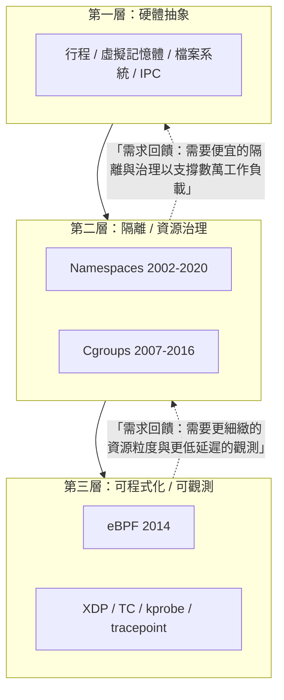
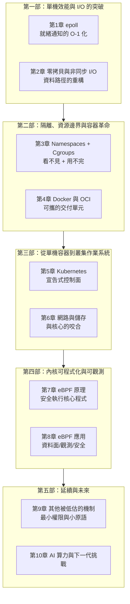

# 序章：Linux 如何成為雲端的共同底座

## 0.1 一顆內核如何撐起現代雲端世界？

在 1991 年 8 月 25 日，21 歲的 Linus Torvalds 在 `comp.os.minix` 發貼，說他正在寫一個「只是業餘愛好，不是嚴肅的作業系統」的 386 作業系統，僅僅為了能在他的 PC 上跑 Minix 的終端模擬器。幾乎沒有人意識到，那個 10,000 行、放在 8 張 1.44M 軟碟上的 "0.01 release"，最終會成為支撐全球雲端基建的共同底座。

今天，人類的「伺服器」有極高比例跑在 Linux 之上。從最上層的模型服務，到 Kubernetes 叢集、容器執行器、虛擬化 hypervisor、資料庫、訊息佇列、CDN 節點，再到最底層的虛擬機監視器本身——Linux 幾乎無所不在。但更關鍵的問題是：

> 為什麼是 Linux？為什麼不是 Solaris、不是 FreeBSD、不是 Windows、不是某個專為雲端而生的新作業系統？

答案不在於某一項單一功能。答案在於 **Linux 採用了一種「以可組合原語（composable primitives）取代巨型功能」的系統設計哲學**，並且在三十餘年間持續、且成功地以工程手段把這個哲學兌現。

## 0.2 三個層次的抽象

要理解「Linux 的獨創基因」，得先區分三個層次。

### 第一層：硬體抽象層

所有作業系統都在做這件事：把 x86 的中斷描述符表（IDT）、控制暫存器（CR3）、頁表格式、MMIO 暫存器映射，包裝成行程、虛擬記憶體、檔案、行程間通訊（IPC）等抽象。這一層，Linux 並不獨特——BSD 做得很好，Solaris 做得更好。

### 第二層：隔離與資源治理層

這一層回答兩個問題：

- **能看見什麼？**（isolation / visibility）—— 行程能不能看到別的行程、看到主機的檔案系統、看到別人的網路裝置？
- **能用掉多少？**（governance / accounting）—— 這個行程組能用多少 CPU 時間、多少記憶體、多少磁碟 I/O 頻寬？

Linux 的 **Namespaces** 與 **Cgroups** 就是在這一層做到了幾乎無可匹敵的完整度：八種命名空間、統一的階層式資源控制樹、可插拔的控制器（controller）機制。這是本書第二部的核心。

### 第三層：可程式化與可觀測層

這一層回答：

- 當我需要一個**現成的功能**（負載平衡、追蹤、封包過濾、資源用量記帳），能不能**不必修改核心原始碼**就加上去？
- 當線上出問題時，我能不能在**不重啟、不中斷**的情況下看清楚發生了什麼？

這一層是 **eBPF** 的戰場，是本書第四部的核心。

### 三層之間的驅動關係

重要的是箭頭是**雙向**的。namespaces 讓隔離變得便宜，容器讓應用程式數量暴增，應用程式數量暴增讓「哪個應用在哪個容器裡」變得無法用舊方法診斷，於是有了 eBPF 追蹤；而 eBPF 提供的 per-program 成本追蹤，又回頭讓 cgroups 的用量記帳更精細。同樣地，eBPF 讓人敢在核心裡跑第三方程式，於是必須有更強的 verifier 與更細的權限模型，反過來催生了 capability 與 LSM 的演進。

## 0.3 一個數學視角：Amdahl 定律與「逐層優化」的陷阱

每個人都熟悉 Amdahl 定律：

$$
S_{total} = \frac{1}{(1-p) + \frac{p}{s}}
$$

其中 $p$ 是可被加速部分的比例， $s$ 是該部分的加速倍率。它告訴我們一件事：**在一個系統裡，把某個瓶頸優化到極致，收益會急劇飽和。**

用這個框架看 Linux 的歷史會非常清楚。

### 單機 Web 服務時代（1995-2003）

在 Apache + fork 模型時代，瓶頸是 **CPU 與行程切換**。 $p$ 接近 1（幾乎所有時間都在應用邏輯與 `fork` 的複製），所以優化 `fork` 立刻有效。之後 Web 負載變成長連線、慢客戶端，「一連線一行程」的模型崩潰，瓶頸轉移到 **等待 I/O 的空轉時間**。

### 事件驅動時代（2003-2010）

$O(n)$ 掃描變成 $O(1)$ 的就緒通知。對 $n = 10000$ 個連線，掃描成本從「每次事件都檢查全部 fd」變成「只回報有變化的 fd」。這是一個**乘法級**的改善，因為它直接改變了等待期間的成本結構，而不是把常數縮小一點。

### 容器時代（2013-2018）

瓶頸轉移到**每個工作負載的啟動成本**與**資源隔離成本**。虛擬機的啟動需要數十秒、佔用數 GB RAM、還要跑 hypervisor。容器的啟動需要數百毫秒、幾 MB RAM、共用同一個核心。這是把 $p$ （可優化的部分）重新框定：不是讓虛擬機更快，而是**用不同的抽象層讓「啟動一個隔離環境」這件事本身變成 O(1) 且近乎零成本**。

### eBPF 時代（2014-至今）

瓶頸再轉移到**可觀測性與資料面的成本**。傳統做法要嘛在核心裡加程式碼（要重開機、有維護負擔），要嘛在 user space 攔截（TCP proxy、DPDK，多一次 context switch、多一次記憶體複製）。eBPF 的做法是讓**程式碼在核心中就地執行**，把 context switch 與複製成本降到近乎為零，同時用 verifier 取代「程式碼審查」作為安全機制。

> 這個觀點很重要：**Linux 的每次演進，都是把瓶頸重新框定到一個新的抽象層，而不是在同一層裡把常數不斷縮小。** 這是「可演進的原語」策略的直接後果。

## 0.4 什麼是「原語」？

在本書的語境中，一個**原語（primitive）** 指的是滿足以下條件的內核機制：

| 條件 | 說明 |
|---|---|
| **小** | 語意單一，可以用一句話講清楚（例如：「行程可以在自己的 PID 命名空間裡看到自己的 PID 是 1」） |
| **正交** | 與其他原語組合作用時互不干擾（八種命名空間可以任意組合） |
| **可組合** | 能被組合出上層抽象（八種命名空間 + cgroups + 分層檔案系統 = 容器） |
| **可授予 / 可撤銷** | 權限可以精確地給予或收回（capability、seccomp、cgroup 權限） |
| **在核心內** | 不需要為了使用它而付出 user space 往返的固定成本 |

用這個標準檢視：

- `epoll` 是原語：一句話講清楚、O(1)、核心內、可組合進事件迴圈。
- `clone(CLONE_NEWPID)` 是原語：可組合、可授權（需 CAP_SYS_ADMIN）、核心內。
- `sendfile` 是原語：把「檔案到 socket 的零拷貝傳輸」抽象成一個系統呼叫。
- `bpf()` 是原語：把「掛載一段受驗證的程式到某個 hook 點」抽象成一個系統呼叫。

反例：

- 「容器」不是原語，它是上千個原語的**組合**。
- 「Kubernetes」不是原語，它是數萬個 cgroup、數萬個網路命名空間、數萬個 mount namespace 加上使用者空間控制迴圈的**組合**。

**這是本書的組織方式**：我們先逐一拆解原語，然後看它們如何被組裝成上層的龐大抽象。

## 0.5 全書地圖

### 各部的因果鏈

- **第一部 → 第二部**：把單機效能做到極致之後，新的瓶頸出現了。當你能輕鬆支撐一萬條連線，你會開始想在一台機器上跑一萬個**彼此隔離**的服務——於是有了隔離的需求。
- **第二部 → 第三部**：容器解決了「單機上的隔離」，但隨即製造了新的問題：幾百台機器上成千上萬個容器要怎麼排程、怎麼發現、怎麼在壞掉時自癒？於是有了叢集作業系統。
- **第三部 → 第四部**：叢集裡有上萬個容器，「我的服務現在為什麼這麼慢？」這個問題，用傳統方法已經回答不了。於是有了核心級別的觀測。
- **第四部 → 第五部**：核心既然已經可以執行程式，那麼「安全執行」就變成核心議題——seccomp、capability、LSM、Landlock 都是這條線的產物。

## 0.6 一個方法論上的提醒

Unix 哲學常被簡化為「小工具、組合、每件事做一次、介面是文字」。但把它套用到 Linux 三十年的歷史上，更貼切的描述是：

> **Linux 的原語通常是「機制」而非「策略」（mechanism, not policy）。**
>
> `epoll` 不規定你的事件迴圈長什麼樣；`cgroups` 不規定你怎麼排程；`clone` 不規定你的容器格式。核心只提供機制，把策略留給使用者空間。結果是：**同一批原語，可以被組裝成完全不同的上層系統。**
>
> cgroups + namespaces → Docker → Kubernetes → OpenShift
>
> 完全相同的原語，也可以被組裝成 systemd 的服務隔離、Chrome 的 renderer sandbox、Flatpak 的應用程式沙箱、Andriod 的 per-app 權限模型。

這也是「Linux 的獨創基因」中最有價值的一條：**原語的可重用性，讓生態系得以在核心之外快速演化，而不必等待核心發布。**

## 0.7 本章小結

1. Linux 的核心優勢不在任何單一功能，而在**以小而正交的原語，允許上層自由組合**的系統設計。
2. 三個關鍵層次——硬體抽象、隔離與治理、可程式化與可觀測——構成本書的敘事骨架。
3. Amdahl 定律教會我們：真正的進步來自**重新框定瓶頸**，而非在同一層優化常數。這正是 Linux 三十年演進的主線。
4. 每一代 Linux 抽象層都會製造下一代的瓶頸，而瓶頸會再次迴到核心，催生新的原語。

下一章，我們從最古典也最關鍵的一次重新框定開始：**當等待 I/O 的時間佔了絕大多數，如何讓核心主動告訴你「哪一個 fd 好了」？** 這個問題的答案，就是 `epoll`。
