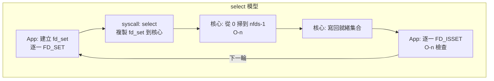
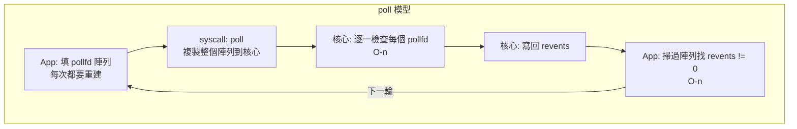

# 1.1 1999 年 C10K 問題與 select/poll 的瓶頸

## 一個被低估的問題陳述

1999 年 10 月，Dan Kegel 在 `comp.os.linux.developers` 發表了一篇後來被稱為 **C10K 問題**的文章。他的挑戰是：

> 「Apache 每天處理一百萬個請求很輕鬆。但 Apache 同時處理一萬個連線時會垮掉，而它的 MPM 設定（`ThreadsPerChild` / `MaxClients`）根本不是解決辦法。我們能不能讓 Apache 同時處理一萬個**連線**（connection），每個連線每秒只有一個 request？」

Kegel 估算，2003 年時，一台 2GHz 的機器有 2GB RAM，能夠讓 Apache 用 thread-per-connection 模型支撐一萬個連線——前提是**每個連線的 I/O 量都很小**。而在 1999 年的硬體上，每個 thread 要佔 8MB stack，一萬個 thread 就是 80GB，遠超 2GB。

Kegel 的結論是一個設計方向的轉折：

> 不要為每個連線生一個 thread；改成**一個 thread（或少數幾個）同時監看所有連線**，用某種機制讓核心通知「哪一條連線有資料可以讀了」。

**注意：這個結論還沒有回答「怎麼通知」。** 那是 Linux 三年後才給出的答案。

## select(2)：BSD 的遺產

`select` 源於 BSD，是 POSIX 的一部分。它的介面是這樣的：

```c
#include <sys/select.h>

int select(int nfds,
           fd_set *readfds, fd_set *writefds, fd_set *exceptfds,
           struct timeval *timeout);
```

使用流程是：每次呼叫前，**由應用程式**把感興趣的 fd 放進 `fd_set`，`select` 從核心複製到使用者空間，核心掃描全部 fd，阻塞等待，然後把「哪些 fd 就緒了」寫回使用者的 `fd_set`，應用程式再逐位檢查。

`fd_set` 是一個位元陣列，其大小在編譯期固定：

```c
#define FD_SETSIZE 1024
typedef struct {
    unsigned long fds_bits[FD_SETSIZE / (sizeof(unsigned long) * 8)];
} fd_set;
```

### 瓶頸一：`FD_SETSIZE` 的硬上限

傳統 BSD 與早期 Linux 的 `fd_set` 固定為 1024 位元，因此單次 `select` 最多監看 1024 個 fd。想要更多，就必須在 user space 手工分批，把 fd 塞進多個陣列輪流呼叫 `select`——這正是 libevent 早期「`select` 後端」的痛苦。

### 瓶頸二：O(n) 掃描，而且是「每次都要重掃」

核心必須在每次 `select` 呼叫時，從 fd 0 掃到 `nfds-1`，逐一檢查該 fd 是否有事件。假設有 $n$ 個 fd，其中 $k$ 個就緒，成本是：

$$
T_{select} = O(n) \quad \text{每次呼叫（含掃描 + 複製進 + 複製出）}
$$

更糟的是 `nfds` 是「最大的 fd 編號 + 1」，**不是** fd 的數量。假設你監看 fd 3、7、10000 這三個連線，`nfds` 就是 10001——即使只有 3 個 fd 感興趣，核心仍要掃過一萬個位置。

### 瓶頸三：核心與使用者空間的集體運輸

`select` 需要：

1. 把 `readfds`/`writefds`/`exceptfds` **從 user space 複製到 core**（每個 128 bytes 起，典型情況 1024/8 = 128 bytes × 3）。
2. 核心掃描。
3. 把結果**寫回 user space** 的 `fd_set`。
4. 應用程式呼叫 `FD_ISSET` **逐一檢查每一位**。

這四步，全部發生在「每一次等待」上。一個處理 10,000 個連線的伺服器，每秒處理 10,000 個事件，就等於每秒做 10,000 次「複製 384 bytes + 掃描 10,000 位 + 複製回來 + 檢查 10,000 位」。

### 瓶頸四：阻塞的 syscall 與 EINTR

`select` 是一個阻塞的系統呼叫。訊號到達時它會返回 `-1`/`EINTR`，應用程式必須重試。在多執行緒的伺服器裡，這種「阻塞式等待 + 訊號打斷 + 重試」的模式會讓延遲分布出現長尾。



## poll(2)：1997 年的小幅改良

`poll` 由 POSIX.1 定義於 1997 年，放棄了 `FD_SETSIZE` 限制，改用一個動態長度的陣列：

```c
struct pollfd {
    int   fd;
    short events;   /* POLLIN, POLLOUT, POLLERR, POLLHUP, POLLNVAL */
    short revents;  /* 結果 */
};

int poll(struct pollfd *fds, nfds_t nfds, int timeout);
```

改進了兩件事：

1. **沒有了 1024 上限**（雖然 `/proc/sys/fs/file-max` 仍限制總量）。
2. **每個 fd 帶自己的事件遮罩**，不需要三個獨立的陣列。

但核心的問題完全沒變：



仍然是 **O(n) 掃描 + 每次重新提交整份清單**。`poll` 解決了「1024 這個任意的魔術數字」，卻沒有解決「成本隨 fd 數線性成長」這個真正的問題。

## 為什麼 O(n) 真的是問題？

用一個簡化的排隊論模型來量化。

假設伺服器維持 $n$ 條活躍連線，平均每條連線每秒產生 $\lambda$ 個事件，總事件率為：

$$
\Lambda = n \lambda
$$

在 `select`/`poll` 模型下，每次 `select` 返回時最多處理 $k$ 個事件（通常就是「這次有多少就緒」），而每次呼叫的成本是 $O(n)$ 。若事件是同時到齊（最壞情況，也是設計上必須保證的情況），那麼每秒需要呼叫 $n$ 次 `select`（每次只回報 1 個事件），總成本：

$$
T_{cpu} = n \cdot O(n) = O(n^2)
$$

每秒的 CPU 時間：

$$
C_{select} = n^2 \cdot c_{scan}
$$

其中 $c_{scan}$ 是掃描單一 fd 的成本（數十奈秒）。 $n = 10^4$ 時， $C_{select} = 10^8 \cdot c_{scan}$ ，已經遠超一顆 2GHz CPU 在一秒內能提供的 $2 \times 10^9$ 個時鐘週期的可用比例。

反過來說， $O(1)$ 的就緒通知把這個成本變成：

$$
C_{epoll} = \Lambda \cdot c_{event} = O(n) \text{ 而不是 } O(n^2)
$$

這是**複雜度層級**的差異，不是常數的差異。

> 這裡有個漂亮的直覺：Kegel 的 C10K 問題本質上是一個 ** $O(n^2)$ 對 $O(n)$ 的競賽**。誰能讓「監看集合」的維護成本與「等待期間的掃描成本」脫鉤，誰就能贏。

## select 的另一個致命傷：FD_SET 的不可重用

除了效能，`select` 還有 API 層面的問題：`fd_set` 必須在**每次呼叫前重新填入**。這代表：

- 你不能只註冊一次、讓核心記住。
- 每次事件返回後，你得重新把 10,000 個 fd 塞回去（`FD_SET` 迴圈本身就是 O(n) 的使用者空間工作）。

也就是說，**`select` 的使用模型是「輪詢式提交」，而不是「註冊式」**。這個 API 形狀上的差異，幾乎注定了 $O(n^2)$ 的命運。

## 另一條被忽略的路線：非阻塞 I/O + 輪詢

另一個思路是「全部設成 non-blocking，然後不停輪詢」。這在 1990 年代被實驗過（`O_NONBLOCK` + `fcntl`），結論是：

| 面向 | 輪詢模型 | 事件驅動模型 |
|---|---|---|
| 等待期間的 CPU | 100%（忙等） | 0%（核心睡著） |
| 延遲 | 最低 | 略高（有喚醒開銷） |
| 適合的場景 | 極少數連線、極高頻 | 大量連線、多等待 |
| 核心規模 | 大 | 中 |
| 韌性 | 單點故障 | 好 |

在「一萬條連線、每條大部分時間閒置」的模型下，忙等會把 CPU 全部燒光。事件驅動是唯一合理的答案。

## 小結

- C10K 問題的真正本質是：**監控機制的成本必須與「活躍事件數」成正比，而不是與「被監看的 fd 總數」成正比。**
- `select`（1983，BSD）與 `poll`（1997，POSIX）都採用「每次呼叫重新提交整份清單 + O(n) 掃描」的形狀，因此注定 O(n²)。
- 解法必須由核心提供一個**註冊式**的介面：註冊一次，核心記住狀態，只在狀態變化時通知。
- 這個介面就是 `epoll`——2002 年 10 月，Linux 2.5.45 由 Davide Libenzi 提交。

下一節，我們拆解 `epoll` 的內部設計。
