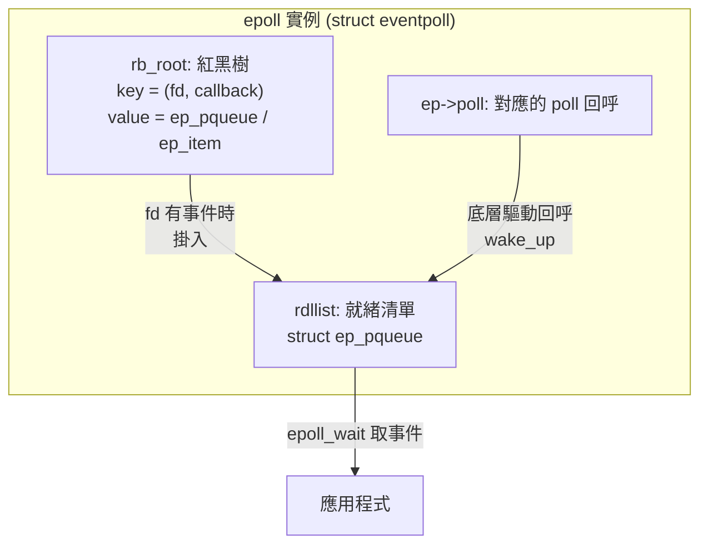
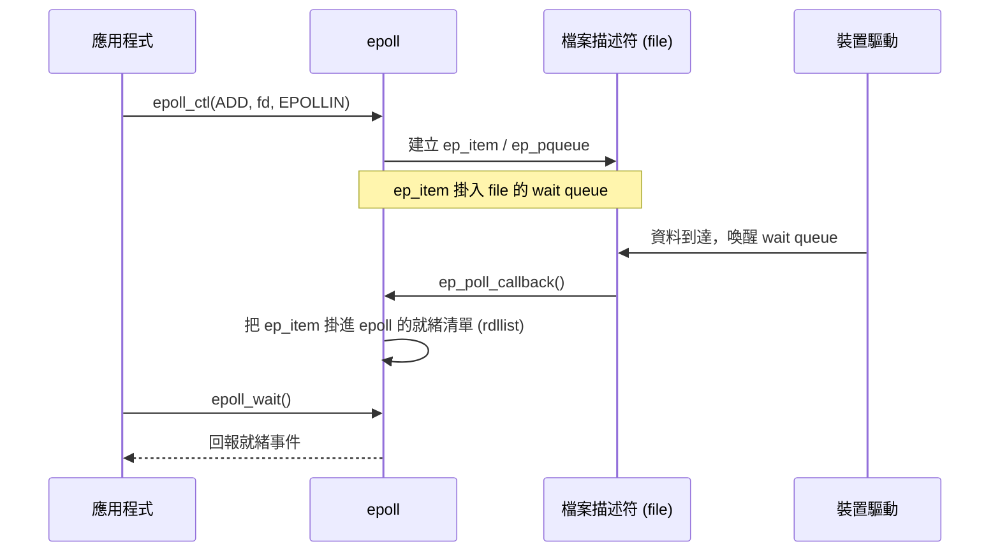
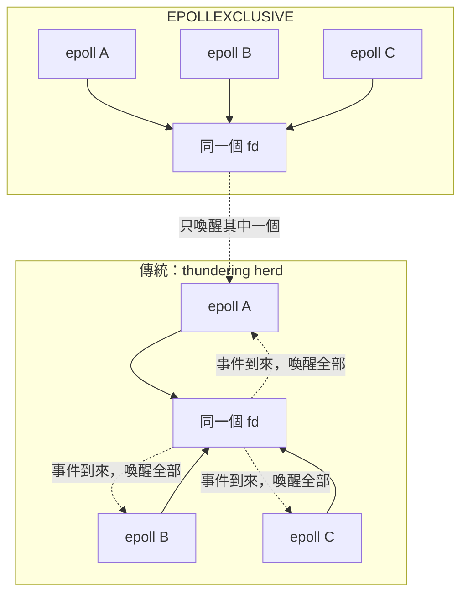

# 1.2 2002 年 epoll 的設計與 LT / ET 語意

## 介面：三個系統呼叫

`epoll` 的 API 極小，這本身就是 Unix 風格的體現：

```c
#include <sys/epoll.h>

// 1. 建立一個 epoll 實例（本身也是一個 fd）
int epoll_create1(int flags);          // flags 目前只有 EPOLL_CLOEXEC

// 2. 對實例做增刪改
int epoll_ctl(int epfd, int op, int fd, struct epoll_event *event);
// op ∈ { EPOLL_CTL_ADD, EPOLL_CTL_MOD, EPOLL_CTL_DEL }

// 3. 等待事件
int epoll_wait(int epfd, struct epoll_event *events, int maxevents, int timeout);
```

```c
struct epoll_event {
    uint32_t     events;  // EPOLLIN | EPOLLOUT | EPOLLERR | EPOLLHUP | EPOLLET | ...
    epoll_data_t data;    // union { void *ptr; int fd; uint32_t u32; uint64_t u64; }
};
```

`epoll_create1` 返回的 fd 本身可以放進別的 `epoll`（`epoll` 可以巢狀），這是之後講「事件層層堆疊」時會用到的特性。

### `epoll_create` 與 `epoll_create1`

舊有的 `epoll_create(size)` 的 `size` 參數完全被忽略，只是歷史包袱；Linux 2.6.27（2008）起已棄用。`epoll_create1` 唯一有用的 flag 是 `EPOLL_CLOEXEC`，避免在 `exec` 時洩漏 fd——這在 2010 年代之後成為強制規範（很多語言的 runtime 預設對 `epoll` fd 設 CLOEXEC）。

## 內部資料結構：紅黑樹 + 就緒佇列

`epoll` 的核心設計是**兩層資料結構**，分別對應兩種查詢模式：



### 為什麼是紅黑樹？

紅黑樹提供 $O(\log n)$ 的：

- `epoll_ctl(ADD)`：把 fd 插入樹中
- `epoll_ctl(DEL)`：移除
- 事件回呼：從 fd 找到對應的 `ep_item`

但更關鍵的是：**紅黑樹的 $O(\log n)$ 只發生在「狀態變化」時**（註冊、移除、事件觸發）。而「等待期間要回報誰」的查詢成本是 $O(k)$ ，其中 $k$ 是就緒事件數，與總 fd 數無關。

這就是關鍵的複雜度分離：

$$
T_{epoll\_wait} = O(k + \log n), \quad k \ll n
$$

相較於 `select` 的 $O(n)$ 。

> 註：核心實際上使用「紅黑樹（rbtree）」而非 AVL 樹，是因為 rbtree 在 Linux 中是核心基礎設施（`lib/rbtree.c`），可直接重用且不需要旋轉的複雜平衡邏輯；AVL 的旋轉次數較少但實作更複雜。

### 底層的 `poll` 回呼機制

`epoll` 不是自己實作 I/O 就绪偵測，而是**重用 VFS 的 `->poll()` 機制**。每個檔案描述符（socket、pipe、tty、eventfd…）在 `struct file` 中有一個 `f_op->poll(file, wait)` 函式指標。

`epoll` 在註冊 fd 時，會建立一個 `ep_pqueue` 並把 `ep_item` 掛進該 fd 的等待佇列：



這種「重用既有 `->poll()` 抽象」的設計，是 Linux 一貫的風格：**epoll 沒有新增 I/O 等待原語，它只是給 `poll` 機制加了一個高效索引。** 這也是為什麼幾乎任何「可 poll 的物件」都能被 epoll 監看——包括後來才加入的 `eventfd`、`timerfd`、`signalfd`、`io_uring`。

## 觸發模式：LT 與 ET

這是 `epoll` 最重要、也最容易出錯的語意區別。

### Level-Triggered（水平觸發，LT）

**語意：只要條件仍然成立，每次 `epoll_wait` 都會回報這個 fd。**

這與 `select`/`poll` 的語意完全相同——這是刻意的設計，目的是讓 `epoll` 能作為 `select`/`poll` 的**透明替代品**。任何用 `poll` 寫對的程式，改用 `epoll` 的 LT 模式後行為不變。

```
資料量
  ^
5 |    ↓ 寫入 5 bytes
4 |    ████████  剩餘 4 bytes 未读
3 |    ████████
2 |    ████████
1 |    ████████
0 +----+-------------------> time
       ↑     ↑     ↑
      寫入  epoll_wait(1)  epoll_wait(2)  ← LT: 每次都回報
            讀2→剩3    讀1→剩2
```

### Edge-Triggered（邊緣觸發，ET）

**語意：只有在「狀態發生變化」的瞬間才回報一次。**

```c
struct epoll_event ev = {
    .events = EPOLLIN | EPOLLET,
    .data   = { .fd = sockfd },
};
```

```
資料量
  ^
5 |    ↓ 寫入 5 bytes  ← 邊沿！
4 |    ████████  剩餘 4 bytes 未读
3 |    ████████
2 |    ████████
1 |    ████████
0 +----+-------------------> time
       ↑              ↑
      寫入        epoll_wait(1)  ← ET: 只在這裡回報一次
      （若只讀了 2 bytes，剩下 3 bytes 不會再通知）
```

用數學語言說：

- **LT**：回報條件是 $f(fd, t) = \text{true}$ ，只要 $f$ 為真就回報。
- **ET**：回報條件是 $f(fd, t) \neq f(fd, t-1)$ ，只在**跳變**時回報。

### LT 與 ET 的取捨

| 面向 | LT | ET |
|---|---|---|
| 正確性容錯 | 高（寫法對錯都大致能跑） | 低（讀不乾淨就永久卡死） |
| 系統呼叫次數 | 較多（可能反覆回報同一 fd） | 較少（每個就緒事件回報一次） |
| 事件批次 | 一次 `epoll_wait` 可能回報多個事件 | 通常只回報新跳變的 |
| 適用 | 一般用途、教學 | 高效能代理、已知資料量的協定 |

**為什麼 ET 更省？**

在 LT 下，如果一個 fd 持續可讀而應用程式每次只讀一點點，`epoll_wait` 會反覆回報它。假設有 $k$ 個 fd 持續可讀、每次 `epoll_wait` 最多回報 $m$ 個，那麼每秒的系統呼叫次數是 $O(k)$ 級別（每次都要把這 $k$ 個都取出來）。

在 ET 下，同樣情境只會回報一次（除非有新資料寫入）。系統呼叫次數降到 $O(\text{新事件數})$ 。

這在**批次處理大量已就緒的資料**時特別明顯：Nginx 在 ET 模式下，一個連線一次可讀事件會把 socket buffer 讀到 `EAGAIN` 為止，之後除非有新資料否則不再被喚醒。這把「每個事件一次系統呼叫」變成「每個連線一次系統呼叫」。

### ET 的必要紀律：讀到 `EAGAIN`

這是實戰上最常見的坑。正確的 ET 處理迴圈必須把 fd 讀（或寫）到 `EAGAIN`：

```c
// ET 模式下的正確處理
for (;;) {
    ssize_t n = read(fd, buf, sizeof buf);
    if (n > 0) {
        process(buf, n);
        continue;              // 繼續讀，直到 EAGAIN
    }
    if (n < 0 && errno == EAGAIN) {
        break;                 // 讀乾淨了，安全返回事件迴圈
    }
    if (n < 0 && errno == EINTR) {
        continue;              // 被訊號打斷，重試
    }
    handle_error(errno);
    break;
}
```

**如果只讀了一部分就返回事件迴圈**，那個 fd 雖然還有資料，但因為沒有新的「邊沿」，`epoll_wait` 將**永遠不會再回報它**。連線就這樣靜悄悄地卡住了——這是 ET 模式最經典的 bug，而且往往在低流量時不出現，只有壓力測試才會浮現。

> 反過來說，ET 也帶來一個好處：**避免重複處理**。LT 模式下，同一批資料可能被回報多次，應用程式必須自己去判斷「是否已處理過」，這在串流協定中很容易出錯。ET 的「一次性」語意天然避免了這個問題。

### `EPOLLONESHOT` 與 `EPOLLEXCLUSIVE`

Bryan Cantrill 曾公開批評 `epoll` 沒有從 Solaris 的 I/O 完成埠（IOCP）與 event ports 學到教訓，核心後來加入兩個選項來部分補償：

- **`EPOLLONESHOT`**（Linux 2.6.2，2004 年 2 月）：事件回報後，該 fd 會被**自動禁用**（等同 `epoll_ctl(MOD)` 設為 0 事件）。應用程式處理完後必須顯式重新 `MOD` 才能再次收到事件。
  - 用途：多執行緒伺服器中，把「一個 fd 同時只允許一個執行緒處理」變成核心保證，避免重入。
- **`EPOLLEXCLUSIVE`**（Linux 4.5，2016 年 3 月）：多個 `epoll` 實例可以同時監看同一個 fd（例如多個執行緒各自有一個 epoll），但**至少有一個**（而非全部）會被喚醒。
  - 用途：避免 thundering herd（驚群）問題。傳統上，多個執行緒 `epoll_wait` 同一個 fd 時，事件會喚醒所有等待者，導致 $N$ 個執行緒搶 1 個事件。



### `EPOLLIN` 與 `EPOLLOUT` 的非對稱性

一個實務上非常重要的細節：**可讀事件（`EPOLLIN`）幾乎永遠可以註冊，但可寫事件（`EPOLLOUT`）要小心。**

如果對一個尚未連線完成的 socket 註冊 `EPOLLOUT`，可能立刻收到事件；更常見的問題是對一個**永遠可寫**的 socket 註冊 `EPOLLOUT`，你會陷入「不斷回報、但沒事可做」的忙迴圈（spin loop）。實務上標準做法是：

1. 先註冊 `EPOLLIN`。
2. 資料寫入 `send()` 回傳 `EAGAIN`（socket buffer 滿）時，才 `MOD` 加入 `EPOLLOUT`。
3. 收到 `EPOLLOUT` 事件後，寫到 `EAGAIN` 為止，然後 `MOD` 移除 `EPOLLOUT`。

## `data` 欄位的 use-after-free 陷阱

`epoll_event.data` 是一個 union。實務上有兩種用法：

**用法 A：存 fd 編號**

```c
ev.data.fd = sockfd;
```

安全，但每次事件回來要再查一次 `HashMap<RawFd, Connection>`。

**用法 B：存指標**

```c
ev.data.ptr = &conn;   // 快，但有生命週期問題
```

危險在於：`epoll` 持有的是**裸指標**。若 `conn` 被 `free`（或 Rust 裡的 `drop`），而 fd 尚未從 `epoll` 中移除，此時事件到來，核心會把已失效的 `ptr` 交給你——**use-after-free**。

Rust 的 `OwnedFd` 模型天然解決了這個問題：把 `fd` 存進 `HashMap`，事件回來時用 `HashMap` 的 `get` 取得擁有權，事件處理完（或連線關閉時）從 map 移除，記憶體生命週期由容器管理。相較之下，C/C++ 語言則需要額外的引用計數或世代標記。

> 這個細節看似是語言層面的問題，但它的根源在 **API 形狀**：`epoll` 把「事件的 payload」定義為一個不透明的 64-bit 欄位，沒有型別安全，也沒有生命週期管理。這正是後來 `io_uring`、`fanotify` 等新 API 在設計時要處理的問題——而它們往往選擇了「讓核心管理生命週期」或「在核心裡做參考計數」的解法。

## 小結

1. `epoll` 的核心創新是把**註冊**（狀態）與**通知**（事件）分離，並用紅黑樹把註冊成本壓到 $O(\log n)$ 、把通知成本壓到 $O(k)$ 。
2. `epoll` 並未新增 I/O 原語，而是**重用 VFS 的 `->poll()` 回呼機制**，因此幾乎所有可 poll 的物件都能被監看。
3. LT 保持與 `poll` 的語意相容以便遷移；ET 以「讀到 `EAGAIN`」為紀律換取更少的系統呼叫。
4. `EPOLLONESHOT` 與 `EPOLLEXCLUSIVE` 補上了多執行緒語意的缺口，顯示核心仍在持續演進。

下一節，我們看 `epoll` 如何在實務上成為 Nginx、Envoy、Redis 等大量軟體的基石，以及它如何與「水平擴展的伺服器」這個更大的故事接起來。
