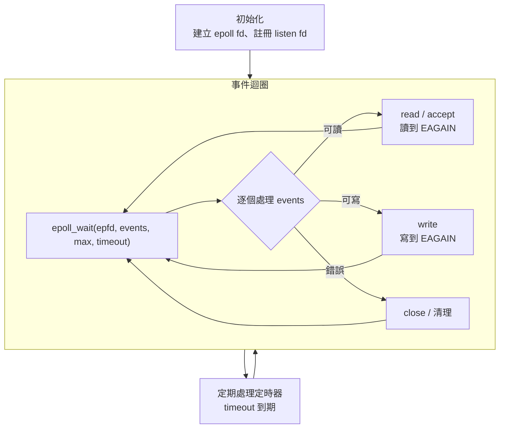
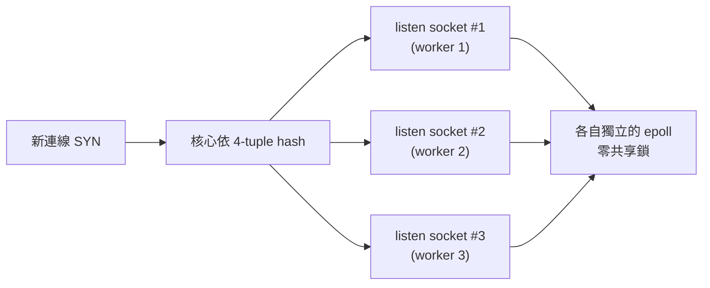

# 1.3 epoll 如何成為高並發伺服器的基石

## 2004 年：Nginx 的誕生

Igor Sysoev 在 2002 年底到 2003 年初之間開始寫 Nginx，最初的目標非常明確：用一個新的事件驅動架構來取代 Apache 的「一連線一行程」模型。Nginx 1.0 在 **2004 年 10 月**發布，此時 Linux 2.6 已經普及，`epoll` 也已經存在三年。

Nginx 的架構選擇：

| 層 | 選擇 |
|---|---|
| 程序模型 | Master + Worker（多行程） |
| 事件模型 | 非阻塞 I/O + 事件迴圈 |
| 事件後端 | `epoll`（Linux）/ `kqueue`（BSD）/ `select`（fallback） |
| 記憶體 | 每 worker 獨立、幾乎零鎖（避免 context switch） |

一個 Nginx worker 處理 10,000 條連線，記憶體占用大約是 stack 加上每連線的 buffer 與狀態，數十 MB 級。相較之下 Apache 的 thread-per-connection 模型在同樣負載下需要數 GB。

> 值得強調的因果關係：**Nginx 的成功並非只是「用 epoll」，而是「用 epoll + 非阻塞 fd + 單 worker 事件迴圈」三者的組合。** epoll 只是讓「單一執行緒監看大量 fd」這件事在核心中變得可行。

## 事件迴圈的通用形狀

幾乎所有高性能伺服器（Redis、Envoy、HAProxy、Nginx、Node.js、DPDK-based proxy、Tokio）的核心都是同一個骨架：



這個「註冊一次、事件驅動、非阻塞、讀到 `EAGAIN`」的四元素組合，後來被抽象成許多函式庫（libevent、libuv、Boost.Asio），並最終被語言層吸收（Go 的 netpoller、Rust 的 mio/tokio、Node.js 的 libuv）。

## Rust 的 mio 與 tokio：把 epoll 抽象成「就緒事件」

Rust 生態的做法很值得一看，因為它把 C 語言的手工陷阱系統性地處理掉了。

`mio`（Metal I/O）把 epoll 包成一個安全的事件迴圈：

```rust
use mio::{Events, Interest, Token};
use mio::net::TcpListener;
use std::net::SocketAddr;

fn main() -> std::io::Result<()> {
    let mut events = Events::with_capacity(1024);
    let mut listener = TcpListener::bind("0.0.0.0:8080".parse::<SocketAddr>()?)?;

    // 關鍵：註冊一次，核心記住
    listener.register(
        mio::Registry::default(),  // 實際程式會傳入 poll 物件
        Token(0),
        Interest::READABLE,
    )?;

    loop {
        events.clear();
        // 阻塞等待，可被 ctrl-c 打斷
        poll.poll(&mut events, Some(Duration::from_millis(100)))?;
        for event in events.iter() {
            if event.token() == Token(0) {
                // 連線可接受
                loop {
                    match listener.accept() {
                        Ok((stream, _addr)) => {
                            // 連線 socket 也設為 non-blocking，註冊到同一個 poll
                            stream.set_nonblocking(true)?;
                            stream.register(
                                mio::Registry::default(),
                                Token(next_token()),
                                Interest::READABLE | Interest::WRITABLE,
                            )?;
                        }
                        Err(e) if e.kind() == ErrorKind::WouldBlock => break, // 讀到 EAGAIN
                        Err(e) => return Err(e),
                    }
                }
            }
        }
    }
}
```

`mio` 提供的抽象層次，正是本章要說明的核心觀念：**`epoll` 回報的是「fd 就緒」，不是「資料到達」。** 這個區別是理解所有事件迴圈的鑰匙：

- **就緒（readiness）**：核心說「你現在讀這個 fd 不會阻塞」。
- **完成（completion）**：核心說「你要求的操作已經完成，結果在這裡」。

`epoll` 是 readiness 模型，`io_uring` 是 completion 模型。兩者在語意、錯誤處理、甚至 API 形狀上都有根本差異——這是第 2 章的主題。

## Node.js：libuv 的跨平台抽象

Node.js 的 `libuv` 走的是另一條路：在 Linux 上用 `epoll`，在 macOS/BSD 上用 `kqueue`，在 Windows 上用 `IOCP`（或近年改用 `io_uring`/`iocp`）。

`libuv` 的 `uv_run` 迴圈結構體現了跨平台事件後端的抽象難題：

```
uv_run(mode):
    while (loop_alive):
        uv__io_poll(loop, timeout)      // 抽象為 poll()
        uv__run_timers(loop)             // 定時器
        uv__run_pending(loop)            // deferred callback
        uv__run_idle(loop)
        uv__run_prepare(loop)
```

而 `uv__io_poll` 底下就是 `epoll_wait`。Node.js 因此可以在單一執行緒中同時處理數萬條連線，並且讓 HTTP 伺服器、Crypto、DNS、檔案系統等非同步 API 共享同一個事件迴圈。

> 這裡出現了一個重要的**模式**：Linux 的原語往往是「Linux 特有的」，但生態系會建立**跨平台抽象層**（libuv、Boost.Asio、libevent），讓應用程式碼可以攜帶，而抽象層在 Linux 上剛好能獲得最佳效能。這是「原語 + 生態」互補的典型。

## C10M 與後續的擴展問題

Kegel 後來把問題延伸為 **C10M**：如何在單機上處理一千萬個連線？

`epoll` 解決了「監看成本」的問題，但在 2010 年代，連線數推到百萬級時，新的瓶頸浮現：

| 瓶頸 | 來源 | 典型解法 |
|---|---|---|
| 每 fd 核心記憶體 | 內核 socket 結構 + `sk_buff` | 減少 per-connection buffer |
| 3-tuple/4-tuple 查表 | 核心的連線追蹤表 | `conntrack` 表格、`nf_conntrack` 優化 |
| IRQ 與軟中斷 | 大量封包 | RSS/RPS/XPS、縮排 poll 隊列 |
| 跨 NUMA | 跨 socket 記憶體存取 | NUMA 親和性、`SO_REUSEPORT` |
| GC 與上下文切換 | 使用者空間 | 多程序 + `SO_REUSEPORT` 分片 |

`SO_REUSEPORT`（Linux 3.9，2013）就是這個階段的代表：**讓多個行程/執行緒各自擁有一個獨立的 listen socket，由核心把新連線雜湊分配給其中一個**，以核心級別的方式消除共享鎖的競爭。



## 從 epoll 到「雲原生資料面」的伏筆

epoll 的成功模式——**把「等待」的成本交給核心，讓使用者空間只在「有 事要做」時才被喚醒**——在第 8 章會以 eBPF 的形式重新出現，但更激進：

- `epoll` 只在**檔案描述符層級**通知就緒。
- eBPF 的 XDP 可以在**封包抵達網路卡的那一刻**就在核心中執行程式，甚至不需要建立 socket。

同樣的思想——「核心在正確的時刻、在正確的地點做最少但最有效的工作」——從 2002 年的 `epoll` 一路貫穿到 2016 年的 XDP。

## 實作：手寫一個 ET 模式事件迴圈

把前面幾節的內容整合起來，一個完整的 ET 事件迴圈（Rust 版，重點在生命週期管理）：

```rust
use std::collections::HashMap;
use std::io::{ErrorKind, Read, Write};
use std::net::TcpListener;
use std::os::fd::{AsRawFd, FromRawFd, OwnedFd, RawFd};
use std::os::unix::io::OwnedFd as UnixOwnedFd;

struct Conn {
    fd: OwnedFd,
    buf: Vec<u8>,
    want_write: bool,
}

fn main() -> std::io::Result<()> {
    let listener = TcpListener::bind("0.0.0.0:8080")?;
    listener.set_nonblocking(true)?;
    let listen_fd = listener.as_raw_fd();

    let epfd = unsafe { libc::epoll_create1(libc::EPOLL_CLOEXEC) };
    assert!(epfd >= 0);

    let mut add = libc::epoll_event {
        events: (libc::EPOLLIN | libc::EPOLLET) as u32,
        u64: listen_fd as u64,
    };
    unsafe {
        libc::epoll_ctl(epfd, libc::EPOLL_CTL_ADD, listen_fd, &mut add);
    }

    // fd → 連線的所有權表：確保事件回來時連線一定還活著
    let mut conns: HashMap<RawFd, Conn> = HashMap::new();
    let mut events = [libc::epoll_event { events: 0, u64: 0 }; 1024];
    let mut chunk = [0u8; 8192];

    loop {
        let n = unsafe { libc::epoll_wait(epfd, events.as_mut_ptr(), 1024, -1) };
        if n < 0 {
            let e = std::io::Error::last_os_error();
            if e.kind() == ErrorKind::Interrupted {
                continue; // EINTR：被訊號打斷，重試
            }
            return Err(e);
        }

        for ev in &events[..n as usize] {
            let fd = ev.u64 as RawFd;

            if fd == listen_fd {
                // ET 語意：accept 直到 EAGAIN
                loop {
                    match listener.accept() {
                        Ok((stream, _)) => {
                            stream.set_nonblocking(true)?;
                            let raw = stream.into_raw_fd();
                            let owned = unsafe { UnixOwnedFd::from_raw_fd(raw) };
                            let mut e2 = libc::epoll_event {
                                events: (libc::EPOLLIN | libc::EPOLLET) as u32,
                                u64: raw as u64,
                            };
                            unsafe {
                                libc::epoll_ctl(epfd, libc::EPOLL_CTL_ADD, raw, &mut e2);
                            }
                            conns.insert(raw, Conn {
                                fd: owned,
                                buf: Vec::new(),
                                want_write: false,
                            });
                        }
                        Err(ref e) if e.kind() == ErrorKind::WouldBlock => break,
                        Err(ref e) if e.kind() == ErrorKind::Interrupted => continue,
                        Err(e) => return Err(e),
                    }
                }
                continue;
            }

            // 取出可用的連線；用 HashMap 借用，避免生命週期問題
            let Some(conn) = conns.get_mut(&fd) else { continue };

            if ev.events & (libc::EPOLLIN as u32) != 0 {
                // ET 的紀律：讀到 EAGAIN 為止
                loop {
                    match (&conn.fd).read(&mut chunk) {
                        Ok(0) => {
                            // 對端關閉
                            conns.remove(&fd);
                            unsafe { libc::epoll_ctl(epfd, libc::EPOLL_CTL_DEL, fd, std::ptr::null_mut()) };
                            break;
                        }
                        Ok(nread) => {
                            conn.buf.extend_from_slice(&chunk[..nread]);
                            if conn.buf.len() > 1024 * 1024 {
                                // 背壓：暫停讀取，改用 EPOLLOUT 等待
                                let mut e2 = libc::epoll_event {
                                    events: (libc::EPOLLOUT | libc::EPOLLET) as u32,
                                    u64: fd as u64,
                                };
                                unsafe { libc::epoll_ctl(epfd, libc::EPOLL_CTL_MOD, fd, &mut e2) };
                                conn.want_write = true;
                                break;
                            }
                        }
                        Err(ref e) if e.kind() == ErrorKind::WouldBlock => break,
                        Err(ref e) if e.kind() == ErrorKind::Interrupted => continue,
                        Err(_) => {
                            conns.remove(&fd);
                            unsafe { libc::epoll_ctl(epfd, libc::EPOLL_CTL_DEL, fd, std::ptr::null_mut()) };
                            break;
                        }
                    }
                }
            }
        }
    }
}
```

這段程式碼裡，每一個設計決策都直接對應本章的論點：

- `HashMap<RawFd, Conn>` 取代 `data.ptr` → 解決 use-after-free。
- `read` 迴圈直到 `WouldBlock` → 滿足 ET 紀律。
- `EINTR` 明確重試 → 處理阻塞 syscall 的訊號打斷。
- `EPOLLONESHOT` 沒有使用 → 多執行緒時才需要。
- `OwnedFd` → `Drop` 時自動關閉 fd，避免 fd 洩漏（`RLIMIT_NOFILE`）。

## 小結

1. `epoll` + 非阻塞 fd + 單執行緒事件迴圈的組合，是 Nginx（2004）取得效能霸主地位的技術基礎。
2. 生態系迅速抽象出跨平台事件層（libevent、libuv、mio、Boost.Asio），而 Linux 原語在抽象層底下提供最佳效能。
3. 隨著連線數再上一個數量級，瓶頸轉移到核心的 per-connection 記憶體、封包處理與 IRQ 分配；`SO_REUSEPORT`（2013）是這個階段的核心級回應。
4. `epoll` 的「核心在正確時刻通知」思想，在第 8 章會以 XDP 的形式推到更極致——在封包抵達時就介入，甚至不需要 socket。

第一部的故事到此告一段落。我們看完了「怎麼讓一台機器同時服務大量連線」。接下來的問題是：**資料要怎麼在核心與使用者空間之間流動，才能不浪費在無謂的複製與上下文切換上？**
