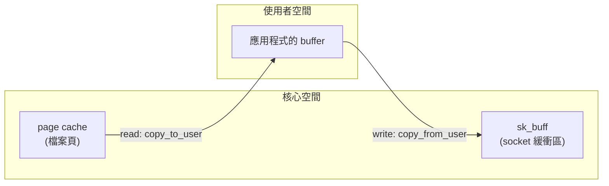
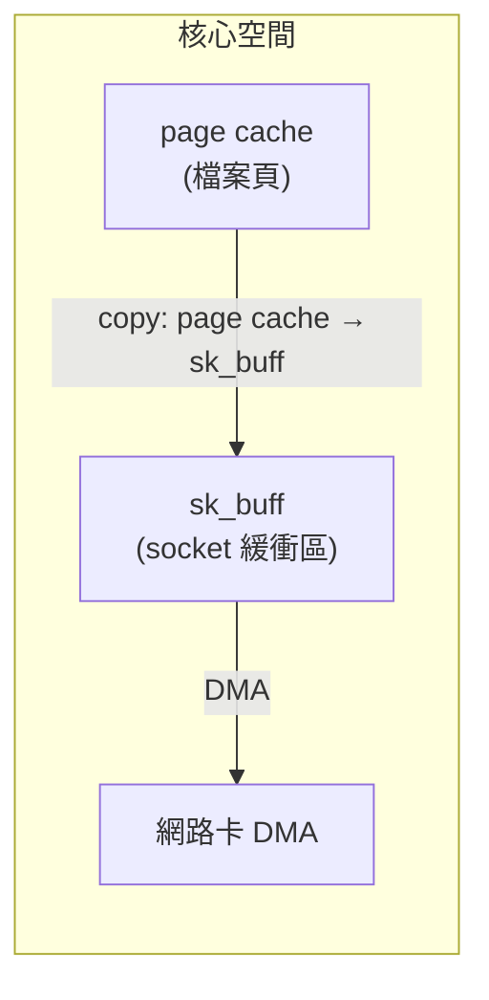
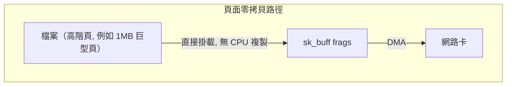

# 2.1 零拷貝的原理與 sendfile

## 一次傳統傳輸的四次拷貝

先建立基準線。用 `read()` + `write()` 把一個檔案送到 socket，資料會經歷：



在這個模型裡，資料被**複製兩次**（disk → page cache → user buffer → sk_buff），加上兩次**上下文切換**（user → kernel → user）。

四項成本：

| 成本 | 量級 | 說明 |
|---|---|---|
| 拷貝 | $2 \times | 記憶體頻寬，$ \sim$ 數 GB/s 到數十 GB/s |
| 上下文切換 | $2 \times$ | 約 1–5 μs（現代核心，含 cache 污染） |
| 系統呼叫 | $2 \times$ | 約 0.5–2 μs（vDSO 外的真實 syscall） |
| 核心繞路 | — | 資料經過 socket 佇列、softirq、socket lock |

以 10 Gbps 的傳輸率計算， $1.25 \times 10^9$ bytes/s。若單次拷貝成本是 $10 \text{ GB/s}$ ，兩次拷貝就吃掉約 25% 的記憶體頻寬；若單次上下文切換是 2 μs，以 64 KB 一個 buffer 計算，每秒約 19,500 次系統呼叫 × 2 次切換 = 39,000 次切換，約 78 ms/s（8% CPU）。

> 這些數字看起來還能忍受，但這是在**單流**的前提下。當你要支撐數十條、上百條併發流，或者做檔案分發、影片轉碼、大檔案代理時，拷貝成本會成為硬牆。

## 零拷貝的定義

「零拷貝」（zero-copy）這個詞在文獻中有兩種用法，需要先釐清：

1. **嚴格零拷貝**：資料從來源到目的地完全不經過 CPU 可見的緩衝區。在使用者空間完全不可能——資料必須經過 CPU 或 DMA 引擎。
2. **工程零拷貝**（本文用法）：**減少**核心內部與使用者空間之間的資料複製次數，或讓複製由 DMA 引擎完成、CPU 不參與。

常見的分類（取自《Zero-Copy in Linux》相關文獻）：

| 手法 | 說明 |
|---|---|
| 零次拷貝 | 完全沒有資料複製（DMA 直接在裝置與記憶體間搬移） |
| 一次拷貝 | 資料只在 DMA 引擎與記憶體之間搬一次 |
| 兩次拷貝 | page cache → user buffer → sk_buff（傳統 `read`+`write`） |
| 多次拷貝 | 加上中間轉接的多次 |

## `sendfile(2)`

`sendfile` 把「把檔案送到 socket」這件事從兩次 syscall 縮成一次，並且消除了 user space 往返。

```c
#include <sys/sendfile.h>

ssize_t sendfile(int out_fd, int in_fd, off_t *offset, size_t count);
```

語意：從 `in_fd` 的 `*offset` 位置開始讀取最多 `count` bytes，直接送到 `out_fd`。**整個過程在核心中完成，使用者空間完全不碰資料。**

版本沿革：

- **Linux 2.2**（1999）加入 `sendfile`，glibc 2.1 提供包裝。最初只支援 socket → socket。
- **Linux 2.6.33**（2009）恢復了「檔案 → socket」的能力。在此之前的 2.6.x 中，`out_fd` 若是普通檔案會報錯。

### 一次 sendfile 的資料路徑



CPU 參與了一次「頁對頁」的複製（`copy_page_to_iter`），但**省掉了**：

- `copy_to_user` 與 `copy_from_user`（各一次）
- 兩次上下文切換
- 兩次系統呼叫

在 Linux 2.6.x 之前，`sendfile` 還會用到 `tmp page` 的中間緩衝區（因為 `sk_buff` 的頁可能不是高階頁），造成額外一次複製。2.6.x 系列引入了 `splice` 式的「頁片段鏈」（`skb_shinfo`）支援後，這部分被消除。

### 現代 Linux 的頁面零拷貝（page zero-copy）

更現代的做法利用了 **高階頁（high-order page）** 與 `sk_buff` 的 fragment 支援：

- 若檔案頁是連續的高階頁（例如 4KB 或更大），核心可以把它**直接掛到 sk_buff 的 page fragment 鏈上**，完全不做 CPU 複製。
- 這就是「一次拷貝」（甚至零次 CPU 拷貝）路徑。



Nginx 的 `sendfile` + `tcp_nopush` + `output_buffers` 就是走這條路。相關核心選項：

```
# /etc/sysctl/net/core/netdev_max_backlog
# /proc/sys/vm/drop_caches   （觀察 page cache 行為）
# Nginx: sendfile on; tcp_nopush on;
```

### `sendfile` 的侷限

1. **只能處理「檔案 → socket」或「socket → socket」**，資料必須順序走，無法在中途做轉換（壓縮、加解密）。
2. **需要檔案事先在 page cache 中**。若不在，會阻塞讀取（除非用 `O_DIRECT` 或 `posix_fadvise`）。
3. **對 TLS 無效**。TLS 加密必須在資料進入 socket 之前完成，因此 `sendfile` 無法直接用於 HTTPS——除非搭配 **kTLS**（Linux 4.13 起，2017），讓 TLS 加密下沉到核心，或使用支援 `sendfile` 的 `splice` 到 crypto 介面的路徑。
4. **每次呼叫仍有 syscall 成本**。要傳 1GB 檔案仍需要多次 `sendfile` 呼叫。

## `mmap` 式的零拷貝

另一條路徑是 **記憶體映射 I/O**：

```c
void *mmap(void *addr, size_t length, int prot, int flags, int fd, off_t offset);
```

把檔案映射到虛擬記憶體，程式直接以指標存取，頁面由需求分頁（demand paging）載入。

**相對於 `read` 的優勢**：沒有額外的緩衝區配置，資料直接在 page cache 與應用程式的頁面之間共享（同一個實體頁被映射到多個行程時，核心只保留一份）。

**代價**：

- 頁面錯誤（page fault）的成本。首次存取每個頁面都要一次 page fault（數百奈秒到數微秒），對於隨機存取模式可能比 `read` 還慢。
- 對 `SIGBUS` 的處理：檔案被截斷時，映射的頁面會變成無效，存取時收到 `SIGBUS`。
- 無法直接用於 socket。

**實務建議**：**循序大檔案讀取**用 `sendfile`（或 `io_uring` 的 `sendfile` opcode）；**隨機小檔案讀取**用 `pread` + 頁快取；**需要 mmap 語意的工具**（如資料庫、索引）才用 `mmap`。

### `readv` / `writev` 的向量化

```c
ssize_t readv(int fd, const struct iovec *iov, int iovcnt);
ssize_t writev(int fd, const struct iovec *iov, int iovcnt);
```

一次 syscall 處理多個 buffer，避免多次 syscall 與多次上下文切換。這在「一個訊息分散在多個來源」或「一個訊息要送到多個 socket」時特別有用：

```c
struct iovec iov[3] = {
    { header,  header_len },
    { payload, payload_len },
    { trailer, trailer_len },
};
writev(fd, iov, 3);
```

## `copy_file_range(2)`：2016 年的新原語

Linux 4.5（2016）加入 `copy_file_range`：

```c
ssize_t copy_file_range(int fd_in, off_t *off_in,
                        int fd_out, off_t *off_out,
                        size_t len, unsigned int flags);
```

它可以在**兩個檔案描述符之間**直接複製資料（也可以複製到 socket），且在某些檔案系統間（例如 XFS → Btrfs，或兩個 Btrfs 檔案系統之間）可以做到**真正的伺服器端複製（server-side copy）**：完全不經過 page cache，核心直接安排兩端的 I/O。

在雲端環境中這很有價值：雲端物件儲存的上傳/下載（AWS S3 這類服務）在底層正是靠 `copy_file_range` 之類的機制，避免資料流經應用程式節點。

## 成本模型總結

讓我們把四種策略的成本放在一起比較。令：

- $B$ = 資料大小
- $S$ = 區塊大小（典型 64KB）
- $c_{copy}$ = 單次拷貝成本（ $\sim$ 記憶體頻寬的倒數）
- $c_{syscall}$ = 系統呼叫 + 上下文切換成本
- $N = B/S$ = 區塊數

| 策略 | 拷貝次數 | 系統呼叫次數 | 總成本（近似） |
|---|---|---|---|
| `read` + `write` | $2N$ | $2N$ | $2N c_{copy} + 2N c_{syscall}$ |
| `sendfile` | $N$ | $N$ | $N c_{copy} + N c_{syscall}$ |
| `sendfile` + 頁面零拷貝 | $0 \sim N$ | $N$ | $N c_{syscall}$ |
| `mmap` | $0$ （hit cache） | 少量 | $N c_{fault} + N c_{copy}$ （miss 時） |
| `copy_file_range`（跨 FS） | 0（server-side） | 少量 | $\approx O(1)$ 的 syscall + 裝置 I/O |

**關鍵洞見**：`sendfile` 系列把成本從「資料量 × 常數」降到「資料量 × syscall」；而 `copy_file_range` 的 server-side copy 甚至連資料量都不用乘。

> 這裡的量變提醒我們：**當資料量很大時，減少拷貝的邊際效益是線性的（省 $B \times c_{copy}$ ）；但當 syscall 數量很大時，減少 syscall 的邊際效益是線性的（省 $N \times c_{syscall}$ ）。** 兩者都重要，但後者的上限被 $c_{syscall} \approx 1\mu s$ 這個物理常數所限制。要再往下，就必須改變「用 syscall 表達意圖」這個模型——這正是 `io_uring` 的動機。

## 小結

1. 傳統 `read`+`write` 有 2 次拷貝、2 次上下文切換、2 次 syscall。
2. `sendfile`（Linux 2.2，1999）把資料留在核心，消除 user space 往返；配合高階頁可做到頁面零拷貝。
3. `mmap` 以共享 page cache 換取零拷貝，但代價是 page fault 與 `SIGBUS` 風險，適用於隨機存取或特殊語意需求。
4. `copy_file_range`（Linux 4.5，2016）在特定檔案系統間可做到真正的 server-side copy，把成本降到接近 $O(1)$ 的 syscall。
5. 所有這些手段仍受制於「syscall 數量」這個瓶頸。要突破，需要**批次提交 I/O 描述符**——這是第 2.3 節 `io_uring` 的舞台。
