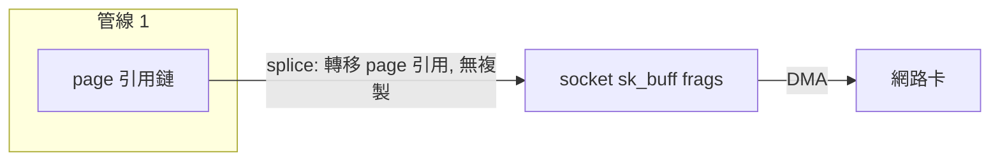
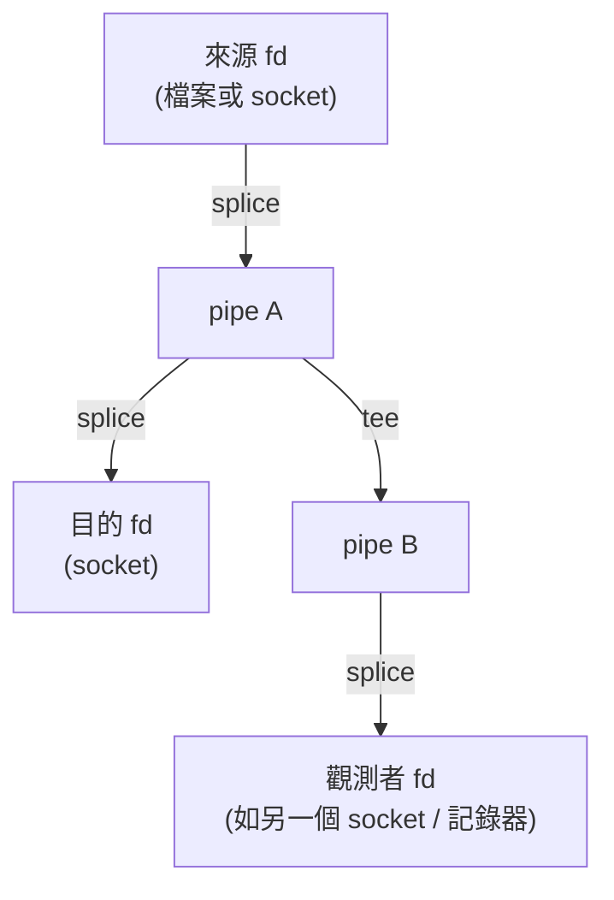
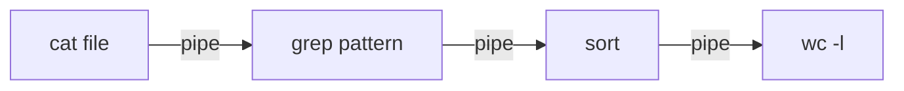
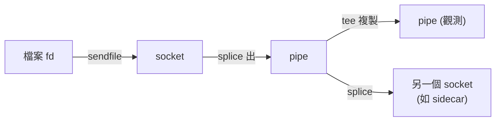

# 2.2 splice 與管線狀資料傳遞

## 一個更激進的想法：讓資料在核心中「流」起來

`sendfile` 解決了「檔案 → socket」的路徑。但很多真實的資料流是多段串接的：

```
TLS 解密 → 解析 → 壓縮 → 寫入 socket
磁碟 → 加密 → 網路
```

每一段轉換都是一次「核心 → user space → 核心」的往返。Linux 的答案是一個極簡的介面：**管線（pipe）**。

## `splice(2)`：Linux 2.6.17（2004）

```c
ssize_t splice(int fd_in, off_t *off_in,
               int fd_out, off_t *off_out,
               size_t len, unsigned int flags);
```

`splice` 的核心語意極其精簡：

> 把一個 **pipe** 的一端 pipe buffer 中的頁（或一段資料），**零拷貝**地接到另一個 fd 上（或反過來）。

`fd_in` 與 `fd_out` 中必須**至少有一個是 pipe**。管線 buffer 中儲存的是「頁的引用（page reference）」而不是資料本身，因此 `splice` 幾乎不涉及 CPU 複製。

### 資料路徑



`splice` 之所以能零拷貝，是因為 **Linux 2.6.x 引入的「頁面片段（page fragment）」機制**：`struct sk_buff` 不再只指向一塊連續的 `skb->data`，而是可以掛一條 `skb_shared_info` 的 fragment 鏈，每一格是一個 page 的一個區段。管線 buffer 天然就是這樣的結構。

### 經典組合：`tee` + `splice` 實作高效能 tee

`splice` 只能把資料**從管線移走**（move），不能複製（copy）。需要「複製一份出去、原件留下」時，用 `tee(2)`：

```c
ssize_t tee(int fd_in, int fd_out, size_t len, unsigned int flags);
```

`tee` 把管線 buffer 中的頁引用**複製**到另一個管線（增加引用計數，不複製資料）。

這兩個原語組合起來，可以在核心中完成「複製 + 轉發」：



這正是負載均衡器（如 HAProxy 在透明模式、Envoy）做「複製流量到觀測通道」的經典手法：全程核心內、零使用者空間資料往返。

## `vmsplice(2)`：把使用者緩衝區接到管線

反方向的操作是 `vmsplice`：

```c
ssize_t vmsplice(int fd, struct iovec *iov, unsigned long nr_segs,
                  unsigned int flags);
```

它把**使用者空間的記憶體**接到管線上（以 zero-copy 的方式讓管線引用使用者的頁）。但要注意：

- `vmsplice` **不保證**資料被複製，核心可能直接引用使用者的記憶體。
- 因此在使用者空間修改該記憶體之前，必須先 `splice` 出去，否則會有資料競爭。
- 這也是為什麼 `vmsplice` 需要使用者空間自行管理生命週期——它是三個 splice 家族中「最不安全的」。

## 為什麼 splice 系列在實務上沒有 sendfile 流行？

這是一個很有教育價值的案例：**技術上更優越的原語，未必會成為主流。**

| 面向 | `sendfile` | `splice` |
|---|---|---|
| API 複雜度 | 一個 fd 進、一個 fd 出的直覺介面 | 需要自己建管線、管理兩端的生命週期 |
| 使用者空間負擔 | 零 | 需要多個 fd 與非阻塞協調 |
| 與事件迴圈的整合 | 直接（`EPOLLIN` on socket） | 需要 `EPOLLIN` on pipe 兩端，較繁瑣 |
| 效能改善幅度 | 從 2 拷貝降到 1 | 從 2 拷貝降到 0（但只在特定路徑） |
| 邊際效益 | 大 | 較小（在大多數場景中） |

關鍵在於：**`sendfile` 消除了「user space 往返」這個維度上的大開銷，而 `splice` 只是在此基礎上再省掉一次核心內部的頁拷貝。** 在實務中，前者的收益遠大於後者，但兩者的差異遠小於兩者與傳統 I/O 的差異。

這是一個重要的系統設計教訓：

> **一個原語的採用率，取決於它能消除的瓶頸大小，而不是它能消除瓶頸的徹底程度。**

`sendfile` 贏在「消除整個維度」（user space 往返），所以被廣泛採用；`splice` 贏在「同一維度上的最後一點」，所以侷限於特定高階用途。

## 但 splice 家族留下了一個關鍵遺產

`splice` 家族引入的**核心基礎設施**，後來被 `io_uring` 全面繼承：

1. **共享的頁面片段鏈**（`skb_shared_info` / `bio_vec`）：核心可以讓一個 I/O 描述符引用一組分散的頁。
2. **I/O 上下文（`struct io_context`）與提交佇列的概念**。
3. **「資料在核心中流動」這個心智模型**。

特別值得一提的是，Linux 3.x 之後 `io_uring` 的 opcode 集合裡，`IORING_OP_SPLICE`、`IORING_OP_SEND_ZC`（zero-copy send，Linux 6.0 起）都直接建立在這些基礎上。

## 更上層的抽象：pipe 與 shell 的血緣

`splice` 讓我們重新審視 Unix 最古老的抽象——**管線**。



Unix 的管線模型是「串聯過濾器，每個過濾器從前一個讀、往下一個寫」。而 `splice` 讓這個模型**第一次深入到核心內部**：在 `cat → grep` 之間的資料，可以完全不進使用者空間就直接被 `grep` 讀到。

這是一個漂亮的閉環：

- 1970 年代：Unix 用管線建立「組合」的範式。
- 2004 年：Linux 用 `splice` 把管線下沉到核心的資料路徑層。
- 2019 年：`io_uring` 用共享的 SQ/CQ 環把「組合 I/O 意圖」變成一個可批次提交的模型。

## `tee` 的實戰：Envoy / HAProxy 的流量複製

在雲原生環境中，「sidecar 代理」模式意味著每個請求可能經過多層代理。每一層都需要觀察流量（metrics、tracing、access log），如果每層觀察都要把資料複製到使用者空間，代價極高。

`tee` 讓這個模式變得廉價：

```c
// 概念示意：把 socket 的資料同時送到兩個目的地
int pipe_in[2], pipe_obs[2];
pipe(pipe_in);
pipe(pipe_obs);

// 背景執行緒
ssize_t n;
// 從來源 socket 搬到 pipe_in
n = splice(src_fd, NULL, pipe_in[1], NULL, len, 0);
// 複製一份到 pipe_obs
tee(pipe_in[0], pipe_obs[1], n, 0);
// 從 pipe_in 搬到目的 socket
splice(pipe_in[0], NULL, dst_fd, NULL, n, 0);
```

這個技巧在 eBPF 時代被進一步發揚——**Cilium** 之類的方案讓代理直接在核心中複製流量（第 6.2 節會詳細討論），完全不需要使用者空間的 `tee` 迴圈。

## 與 `sendfile` 的組合

在實務中，`splice` 最常與 `sendfile` 搭配，形成一條完全零拷貝的鏈：



這是「資料在核心中流過多個目的地」的完整圖景。

## 小結

1. `splice`（Linux 2.6.17，2004）把資料以「頁引用」的形式在核心中流轉，零 CPU 複製；`tee` 提供複製分支；`vmsplice` 反方向接入使用者記憶體。
2. `splice` 家族建立在「頁面片段鏈」這個核心基礎設施上，後來被 `io_uring` 全面繼承。
3. 技術上更優越卻未被廣泛採用的原因：它消除的是「同一維度上的最後一點」收益，而 `sendfile` 消除的是「整個維度」的收益。**原語的採用率由瓶頸大小決定，而非徹底程度。**
4. Unix 的管線哲學從 1970 年代的使用者空間，一路走到 2004 年的核心資料路徑，再走到 2019 年的批次提交模型。

下一節，我們進入 `io_uring`：把「用 syscall 表達 I/O 意圖」徹底改寫成「把 I/O 意圖寫進共用環形緩衝區」。
