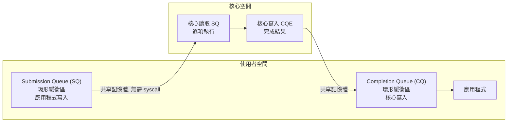
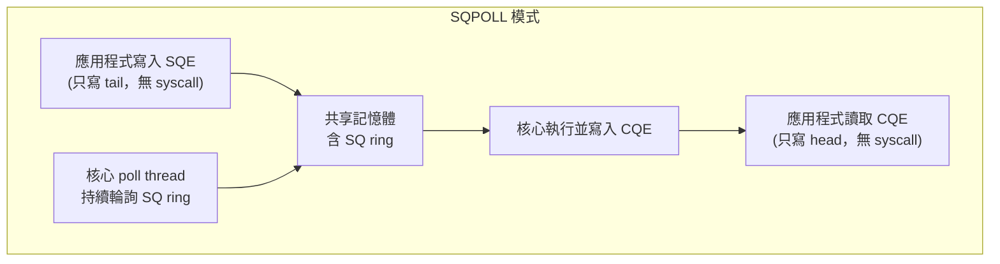
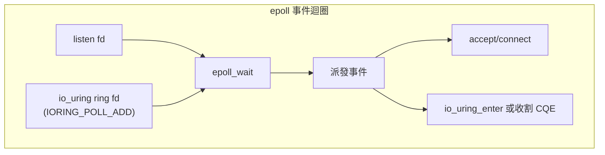
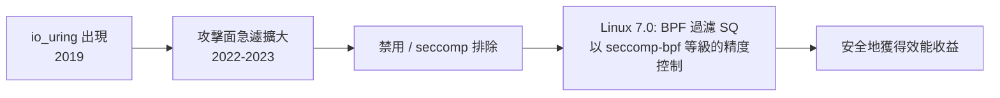
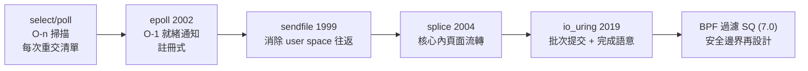

# 2.3 2019 年 io_uring 與非同步 I/O 革命

## 被遺忘的歷史：Linux AIO 的失敗

在 `io_uring` 之前，Linux 其實有過非同步 I/O——**Linux AIO（Linux Asynchronous I/O）**，於核心 2.5（2002 年左右）加入。它是一套完全獨立的介面：

```c
#include <libaio.h>

struct iocb *iocb = malloc(sizeof(struct iocb));
io_prep_pread(&iocb[0], fd, buf, nbytes, offset);
io_submit(ioctx, 1, &iocb[0]);
// ...
io_getevents(ioctx, min_nr, nr_events, events, NULL);
```

它失敗的原因，官方文件與社群的分析高度一致：

| 問題 | 說明 |
|---|---|
| 只支援 `O_DIRECT` | 無法使用 page cache，效能反而變差 |
| 只支援「已分配檔案」 | 檔案系統必須先配置 block |
| 不支援 socket | 無法複用網路 I/O 的多路複選模型 |
| 部分操作實際上是同步的 | 對 buffered I/O、`io_submit` 內部直接阻塞完成 |
| 語意混雜 | 「非同步」只對部分 opcode 成立 |
| 無法與 `epoll` 結合 | 必須用 `io_getevents` 阻塞等待，無法整合進既有事件迴圈 |

> 換句話說：Linux AIO 是一個**獨立的、非組合的**介面。它無法與 `epoll` 組合，因此無法進入既有的伺服器架構，也就無法流行。

**這是本章最重要的教訓：非同步 I/O 的成敗，不在於它是否「非同步」，而在於它能否與既有的組合模型共存。**

## `io_uring` 的設計哲學

Jens Axboe（原本是 blkio 的作者）在 2019 年提交的 `io_uring` 完全重做了一遍：

> **把 I/O 描述符寫進一個核心與使用者空間共享的環形緩衝區，然後只提交一次「喚醒我」的 syscall。**

三個關鍵設計：

### 1. 兩個共享環：Submission Queue 與 Completion Queue



- **SQ**（Submission Queue）：應用程式寫入 `struct io_uring_sqe`（Submission Queue Entry），描述要執行的操作。
- **CQ**（Completion Queue）：核心寫入 `struct io_uring_cqe`（Completion Queue Entry），包含 `user_data` 與 `res`（結果）。

兩者都是**核心與使用者空間共享記憶體**的環形緩衝區。這就是為什麼 Wikipedia 說：

> "Keeping these buffers shared between the kernel and application helps to boost the I/O performance by eliminating the need to issue extra and expensive system calls to copy these buffers between the two."

### 2. 資料結構本身的「多執行緒安全」

兩個佇列各自有 head / tail 指標：

- **SQ**：`SQ.Tail` 只有應用程式寫；`SQ.Head` 只有核心寫。故提交操作不需要鎖。
- **CQ**：`CQ.Head` 只有應用程式寫；`CQ.Tail` 只有核心寫。故完成操作不需要鎖。

這是一個非常漂亮的**單寫者/單讀者（SPSC）**設計：多執行緒共享一個 ring 實例時，提交與完成各自無競爭。

### 3. 提交與收割可以「零 syscall」

```c
io_uring_submit(&ring);      // 通知核心：SQ 裡有新的 SQE
io_uring_wait_cqe(&ring, &cqe);   // 等待完成
io_uring_cqe_seen(&ring, cqe);    // 收割完成項
```

在極端情況下，如果 SQ 與 CQ 的共享指標已經被核心看到（透過記憶體屏障），甚至**不需要 `io_uring_submit`**——核心會在下一次進入 syscall 或被喚醒時自動檢查。這個特性被稱為 **SQPOLL**（`IORING_SETUP_SQPOLL`）：讓一個專門的 core thread 輪詢 SQ，完全消除提交 syscall。



**代價**：SQPOLL 需要一個核心執行緒 100% busy-spin（或使用 `IORING_SETUP_SQ_AFF` 綁定到特定 CPU）。在高負載下這很划算，在低負載下是浪費。

## 基本使用流程

```c
#include <liburing.h>
#include <fcntl.h>
#include <unistd.h>

struct io_uring ring;

int main(void) {
    io_uring_queue_init(256, &ring, 0);

    int fd = open("data.bin", O_RDONLY);

    char buf[4096];
    struct io_uring_sqe *sqe = io_uring_get_sqe(&ring);
    io_uring_prep_read(sqe, fd, buf, sizeof buf, 0);
    sqe->user_data = 42;             // 使用者自訂的識別碼
    io_uring_submit(&ring);

    struct io_uring_cqe *cqe;
    io_uring_wait_cqe(&ring, &cqe);
    int res = cqe->res;              // >0 表示讀到的位元組數
    io_uring_cqe_seen(&ring, cqe);

    printf("read %d bytes, user_data=%lu\n", res, cqe->user_data);
    io_uring_queue_exit(&ring);
    return 0;
}
```

`user_data` 是關鍵設計：核心不需要理解應用程式的任何資料結構，只把這個 64-bit 值原封不動地帶回來。應用程式用一個 map 把它對應到自己的狀態。

## `io_uring` 的四個超越

### 超越一：與 `epoll` 的整合（這是成敗關鍵）

Linux 5.10（2020）之後，`io_uring` 提供 `IORING_POLL_ADD` 與 `IORING_POLL_REMOVE` opcode：

```c
// 把 io_uring 的完成事件註冊到 epoll
struct io_uring_poll_add p = {
    .fd = ring.ring_fd,
    .poll_mask = POLLIN,
};
io_uring_prep_poll_add(sqe, &p, 0);
```

於是 `io_uring` 的事件可以像一般 fd 一樣被 `epoll` 監看。這解決了 Linux AIO 最大的缺陷——**它現在可以嵌入既有的事件迴圈**。



### 超越二：Completion 語意取代 Readiness 語意

`epoll` 是 readiness 模型：核心說「可以讀了」，但「讀多少、會不會阻塞」要應用程式自己處理（這就是為什麼 ET 模式那麼容易出錯）。

`io_uring` 是 completion 模型：核心說「這個操作完成了，結果是 N」。

| 面向 | `epoll`（readiness） | `io_uring`（completion） |
|---|---|---|
| 核心承諾 | 「現在不會阻塞」 | 「操作已完成，結果在此」 |
| 錯誤處理 | 錯誤透過 `read()` 回傳 | 錯誤寫在 CQE 的 `res`（負值） |
| ET 的陷阱 | 必須讀到 `EAGAIN` | 不存在這個問題 |
| 一次回報的資訊量 | 少量（哪個 fd） | 完整（結果 + user_data） |
| 批次提交 | 不支援 | 支援（一次寫多個 SQE） |

完成語意帶來一個巨大的實務優勢：**錯誤不再散落在後續的 syscall 中，而是集中在完成佇列裡。** 這讓錯誤處理可以統一在一個地方完成，程式碼結構大幅簡化。

### 超越三：廣泛的操作集

`io_uring` 的 opcode 涵蓋：

```
IORING_OP_READV / WRITEV
IORING_OP_READ / WRITE
IORING_OP_SPLICE / SENDMSG / RECVMSG
IORING_OP_ACCEPT / CONNECT
IORING_OP_POLL_ADD / POLL_REMOVE
IORING_OP_TIMEOUT / TIMEOUT_REMOVE
IORING_OP_FSYNC / FADVISE
IORING_OP_NOP / URING_CMD
IORING_OP_SEND_ZC      (Linux 6.0, 2022)
IORING_OP_PROVIDE_BUFFERS (Linux 5.19)
```

特別值得一提的是 **`IORING_OP_URING_CMD`**：允許檔案系統自訂命令，把 C 介面擴充到「核心子系統也能提供自己的 I/O 原語」。

### 超越四：緩衝區註冊（buffer ring）

高頻小 I/O 場景的另一個瓶頸是：每次 I/O 都要在核心與使用者空間之間描述緩衝區（位址、長度、offset）。`io_uring` 提供了 **registered buffers** 與 **provided buffer ring**（Linux 5.19）：

```c
// 註冊一組 buffer，重複使用，減少描述符傳輸成本
struct io_uring_buf_reg reg = { .ring_addr = (uint64_t)buf_ring, .ring_entries = N };
io_uring_register_buf_ring(&ring, &reg, 0);
```

這對資料庫、訊息佇列等高頻小 I/O 負載特別有效。

## `io_uring` 的代價與風險

`io_uring` 不是免費的午餐。

### 1. 攻擊面急遽擴大

這是 `io_uring` 歷史上最嚴重的問題。**2023 年 6 月，Google 的安全團隊報告：2022 年提交給其 Bug Bounty 的漏洞中，60% 是 `io_uring` 相關的**（來源：Google Online Security Blog，"Learnings from kCTF VRP's 42 Linux kernel exploits submissions"）。

原因在於 `io_uring` 開了「大門」：能提交 I/O 描述符，等於能觸及廣大的核心子系統（檔案系統、网络、記憶體管理）。而且 `io_uring` 的註冊功能（如 registered buffers、fixed files）本身就可被用來做 type confusion 攻擊。

**產業回應**：

- Google 在 Android 與 ChromeOS 中**完全禁用** `io_uring`。
- Docker 的預設 seccomp profile 移除了 `io_uring_setup` 等 syscall。
- `containerd` 在 2023 年 11 月更新了 `RuntimeDefault` seccomp profile 以排除 `io_uring` 相關 syscall。

### 2. 核心設計者本人的反應

Jens Axboe 在 2026 年的 Systems Distributed 大會演講中反駁了「`io_uring` 有嚴重安全問題」的說法：

> 「it's at this point like no worse, I would argue even better, than core things like epoll or futex.」

這是一個值得深思的產業現象：**一個提供了巨大效能收益的機制，同時也擴大了核心的攻擊面。** 兩者都是真的。

### 3. 補救：BPF 過濾提交佇列

**Linux 7.0**（依 Wikipedia 記載）加入了**細粒度的 SQ 過濾**：可以掛 BPF 程式到 `io_uring` 的提交佇列上，允許/拒絕特定的 opcode 與參數。

這是一個非常漂亮的機制閉環：



**用第 7 章將介紹的 eBPF 來保護第 2 章介紹的 `io_uring`**——這正是「Linux 以可程式化機制解決自身問題」的典型案例。

## `io_uring` 的實際採用狀況

`io_uring` 的採用是一個分裂的市場：

| 領域 | 採用情況 |
|---|---|
| **高階儲存**（NVMe、Zoned、NVMe-oF） | 非常成功，是設計目標 |
| **資料庫**（RocksDB、ClickHouse、PostgreSQL 未來） | 積極採用，能省下大量 syscall |
| **訊息佇列**（ Aeron、AeronATS） | 核心用例 |
| **一般 web 伺服器** | 較慢。Nginx 沒有採用；Nginx 的選擇是 `sendfile` + `epoll` |
| **手機／嵌入式** | 基本不用，因為攻擊面 |

**為什麼 Nginx 不用？** 一個很務實的理由：`sendfile` 已經解決了 Nginx 的主要瓶點（靜態檔案傳輸）。而 Nginx 的負載多半是「大量小請求」，`epoll` 的 syscall 成本被 HTTP 解析與 business logic 稀釋掉了，`io_uring` 的相對收益不大，卻增加了複雜度與風險。**技術優越性不等於採用率。**

## Rust 生態：`tokio-uring` 與 `compio`

Rust 生態對 `io_uring` 的態度也經歷了演變：

- 最初的 `tokio-uring`（Axboe 自己也參與）嘗試把 `io_uring` 做成 tokio 的 I/O 驅動。
- 後來 `tokio` 決定**保持阻塞式 I/O**（用 `spawn_blocking` + 執行緒池），因為 `io_uring` 在 tokio 的多執行緒模型下，狀態機整合複雜度很高。
- `compio` 走的是另一條路：一個以 `io_uring` 為基礎的 async runtime，採「單執行緒 + io_uring」的模型。

這個演變本身就是一種教育：**組合性（能不能融入既有的 async 執行緒模型）比效能更決定成敗。**

## 從 `epoll` 到 `io_uring` 的演進地圖



每一代都在解決上一代的瓶頸：

- `epoll` 解決「等待成本隨 fd 數線性成長」。
- `sendfile` 解決「資料要經過使用者空間」。
- `splice` 解決「核心內部的頁拷貝」。
- `io_uring` 解決「syscall 數量本身」。
- BPF 過濾解決「`io_uring` 擴大攻擊面」。

## 小結

1. Linux AIO 的失敗教訓是：**非同步 I/O 必須與既有的組合模型（`epoll`）共存才能成功。**
2. `io_uring`（Linux 5.1，2019）用共享的 SQ/CQ 環形緩衝區，把「 syscall 表達意圖」改為「寫入共享記憶體」，並提供完成語意。
3. `IORING_POLL_ADD` 讓 `io_uring` 可以被 `epoll` 監看，這是它取代 Linux AIO 的關鍵。
4. `io_uring` 的攻擊面是嚴峻的現實問題（2022 年 Google 超過 60% 的漏洞提交涉及 `io_uring`），產業以禁用與 seccomp 排除回應，並在 Linux 7.0 以 BPF 過濾 SQ 精細化控制。
5. **技術優越性不等於採用率**：Nginx 至今不用 `io_uring`，因為 `sendfile` 已足夠。

第一部完成。我們看完了「核心與使用者空間之間的資料流」。第二部的主題完全不同：**不是效率，而是邊界。** 我們要問的是——如何在同一台機器上，運行數千個互不干擾、互不窺視的應用程式？
