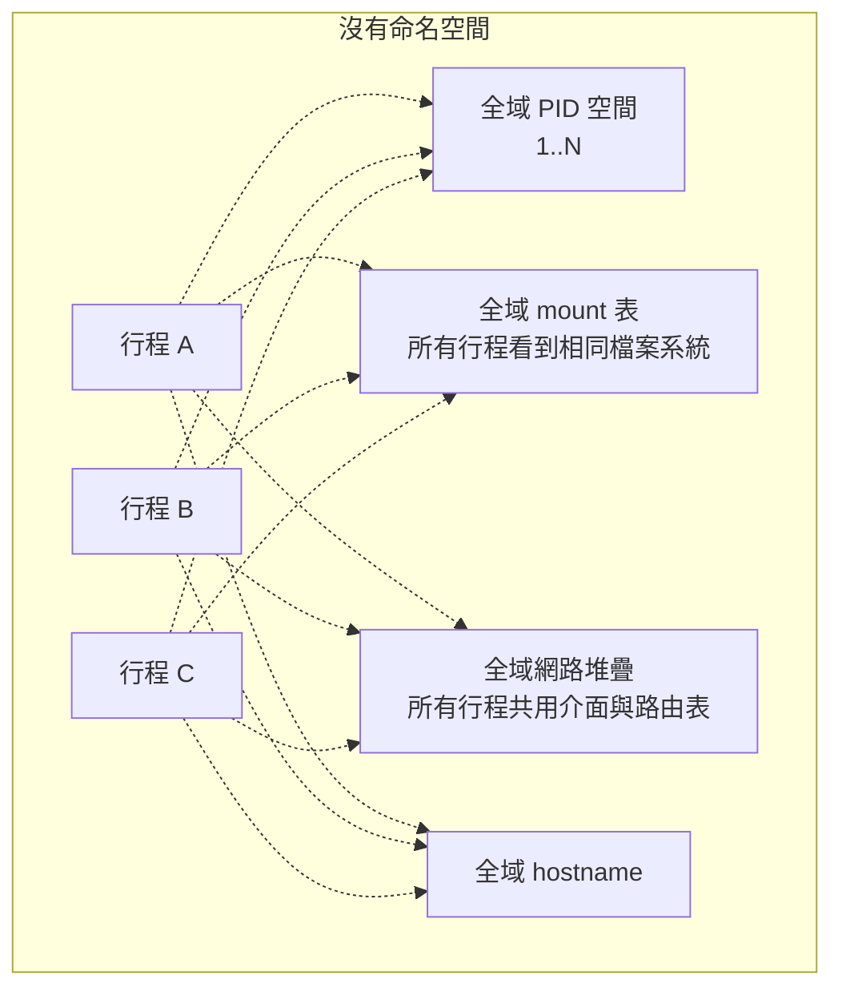
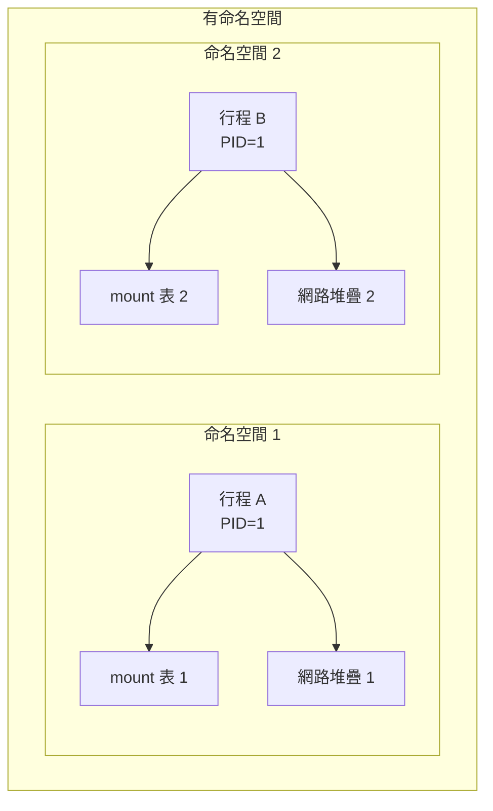
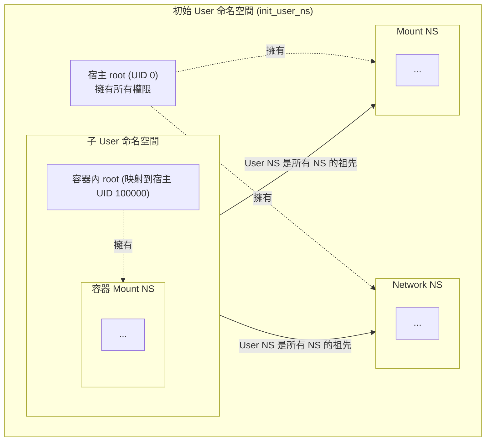
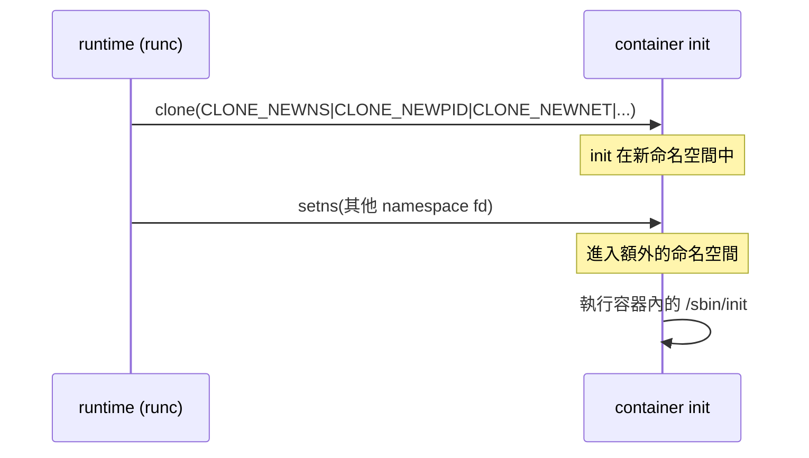

# 3.1 2002 年起 Linux 命名空間的演進

## 一個古老的構想：Plan 9 的「名稱空間」

Linux 命名空間的思想來源不是 Unix，而是 Bell Labs 的 **Plan 9**。

1993 年，Rob Pike、Dave Presotto、Ken Thompson、Howard Trickey 發表了論文 *The Use of Name Spaces in Plan 9*（ACM SIGOPS Operating Systems Review, 27(2)）。Plan 9 的核心主張是：**「名稱」不應是全域的。** 每個行程可以有自己的名稱視角：

- 每個行程有自己的「檔案系統名稱」視角（mount 命名空間的直覺來源）。
- 每個行程有自己的「程序名稱」視角（PID 命名空間的直覺來源）。
- 每個行程有自己的「網路名稱」視角。

Plan 9 用一個極簡的系統呼叫 `namespace()` 就能切換視角。這個思想在 Unix 世代被忽略了大約十年，因為 Unix 的設計哲學是「一切都是檔案，一切都是全域的」。

**但雲端改變了這個前提。** 當你要在一台機器上跑 5,000 個彼此不信任的應用程式時，「一切都是全域的」不再是可接受的假設。

## Linux 命名空間的加入時程

| 年份 | 核心版本 | 命名空間 | 貢獻者 |
|---|---|---|---|
| 2002 | 2.4.19 | Mount（`CLONE_NEWNS`） | Al Viro |
| 2006 | 2.6.19 | UTS、IPC | — |
| 2008 | 2.6.24 | PID | Pavel Emelyanov |
| 2009 | 2.6.29 | Network | 大量貢獻 |
| 2013 | 3.8 | User | Eric W. Biederman |
| 2016 | 4.6 | Cgroup | Tejun Heo |
| 2020 | 5.6 | Time | — |

第一個命名空間（Mount）在 2002 年的 2.4.19 內核中出現。它的旗標名是 `CLONE_NEWNS`——注意名字裡沒有 "MOUNT"，因為它是第一個，所以沿用了「NEWNS = New Namespace」這個泛稱。這是一個歷史遺留的痕跡。

## 命名空間解決的問題

在命名空間出現之前，Linux 的行程共享**所有**全域狀態：



命名空間的核心機制是：**每個行程攜帶一組「命名空間引用」，核心在提供任何全域資源時，先檢查呼叫者所在的命名空間鏈。**



## 八種命名空間

| 命名空間 | 隔離什麼 | 旗標 |
|---|---|---|
| **Mount** (`mnt`) | 檔案系統掛載點的視角 | `CLONE_NEWNS` |
| **PID** (`pid`) | 行程 ID 的編號空間與行程列表 | `CLONE_NEWPID` |
| **Network** (`net`) | 網路介面、路由表、socket、防火牆規則 | `CLONE_NEWNET` |
| **IPC** (`ipc`) | System V IPC 物件與 POSIX 訊息佇列 | `CLONE_NEWIPC` |
| **UTS** (`uts`) | hostname 與 NIS domain name | `CLONE_NEWUTS` |
| **User** (`user`) | UID/GID 映射與權限能力 | `CLONE_NEWUSER` |
| **Cgroup** (`cgroup`) | cgroup 階層路徑的視角 | `CLONE_NEWCGROUP` |
| **Time** (`time`) | `CLOCK_MONOTONIC`、`CLOCK_BOOTTIME` | `CLONE_NEWTIME` |

### 為什麼要分這麼多種？

這是 Unix「機制而非策略」哲學的具體體現：**每一種命名空間只隔離一種資源，任何一種都可以單獨使用，不綁定其他。**

例如：

- systemd 的 `PrivateTmp=yes` 只用 Mount 命名空間。
- systemd 的 `PrivateNetwork=yes` 只用 Network 命名空間。
- Chrome 的 renderer sandbox 用 User + PID + Network 命名空間，但刻意**不**用 Mount（renderer 需要共享某些資源）。
- PostgreSQL 的 `pg_ctl` 在某些發行版用 User 命名空間做權限降級。

> **正交性是關鍵。** 如果命名空間是一個「開關式」的整體（例如「開啟隔離模式」），就無法組出「只隔離網路」的這種需求，也就無法支撐 systemd、Chrome、Flatpak 這些差異極大的使用情境。

## 命名空間的行政階層（Administrative Hierarchy）

一個容易被忽略但極其重要的設計：**每個非 user 命名空間都「屬於」（owned by）某個 user 命名空間。**



規則是：

1. 當一個非 user 命名空間被建立時，它歸屬於**建立當下呼叫者所在的 user 命名空間**。
2. 要對某個命名空間做管理操作（例如改變網路介面的 IP），呼叫者必須在**擁有該命名空間的 user 命名空間**中擁有 `CAP_SYS_ADMIN`。
3. 因為初始 user 命名空間是所有其他命名空間的祖先，**宿主機的 root 永遠擁有對所有命名空間的控制權**。

這是安全模型的基石。容器內的 root（UID 0 in container）其實是宿主上的非特權使用者；即使它逃離了 namespace 邊界，宿主核心也只會把它當成 UID 100000 的普通使用者。

### User 命名空間的 UID 映射

```c
// 讓當前行程在新的 user namespace 中映射 uid/gid
uid_map: 0 100000 1     // 容器內 UID 0  →  宿主 UID 100000
gid_map: 0 100000 1
```

映射是多對一的。核心在權限檢查時做兩次轉換：

```
容器內行程：getuid() → 0
核心檢查 → 轉換為宿主 UID 100000 → 檢查宿主權限
```

這就是為什麼「容器內的 root」在宿主眼中不值錢，也是為什麼 `--cap-drop=ALL` 後的容器 root 幾乎沒有能力。

### 能力的重新劃分

在 user 命名空間中建立行程時，該行程在**新 user namespace 內**獲得完整的能力集（capabilities），但在**父 user namespace 中**的能力集被限制為那些「擁有者具備」的能力。

> 這個機制讓「容器內 root 可以 `mount`、`chown` 自己的檔案」與「容器內 root 無法 `mount` 主機的裝置」同時成立。

## 命名空間的生命週期與銷毀

一個命名空間在沒有任何參考時會被核心自動銷毀。保持存活的條件（任一）：

1. 命名空間內有活著的行程。
2. 有子命名空間存活（PID 與 User 命名空間是嚴格嵌套的）。
3. 有人持有 `/proc/<pid>/ns/<kind>` 這個符號連結的 fd。
4. **有 bind mount 建立在該命名空間的檔案系統上**。

第四條是一個非常巧妙也非常重要的機制。舉例：

```bash
# 用 bind mount 保持網路命名空間存活，即使沒有行程
touch /var/run/netns/mycontainer
ip netns add mycontainer        # 會做 bind mount
ip netns exec mycontainer ip a  # 進入該命名空間
```

`ip netns add` 的實作是：在 `/var/run/netns/` 下建立檔案，並把該命名空間的 `/proc/<pid>/ns/net` bind mount 到該檔案上。因此，即使原始行程已死，只要這個檔案還在，命名空間就還活著，而且可以透過 `setns()` 重新進入。

這就是 `nsenter` 與 `ip netns exec` 能工作的原理。

## 系統呼叫

四個核心系統呼叫：

| 系統呼叫 | 用途 |
|---|---|
| `clone(flags, ...)` | 建立行程，同時可以指定要建立哪些命名空間 |
| `unshare(flags)` | 讓**當前**行程脫離父行程的命名空間（進入新的） |
| `setns(fd, nstype)` | 讓當前行程**加入**一個已存在的命名空間 |
| `ioctl(fd, NS_GET_*)` | 查詢命名空間的行政關係（父命名空間、擁有者等） |

`setns` 是 `clone`/`unshare` 的互補。`clone` + `unshare` 適合「建立一個新環境」；`setns` 適合「進入別人已經建立好的環境」，例如：

- `nsenter -t <pid> -n` 進入某行程的網路命名空間。
- 工具（`runc`、`crun`）在建立容器時，先 `clone` 出 init 行程，再對 init 執行 `setns` 進入目標命名空間。
- `systemd-nspawn` 用 `setns` 進入容器的命名空間以執行指令。



## 現況：八種命名空間的實際使用率

| 命名空間 | 誰在用 | 成熟度 |
|---|---|---|
| Mount | 所有容器系統、systemd 沙箱、Chrome | 非常成熟 |
| PID | 所有容器系統 | 非常成熟 |
| Network | 所有容器系統、CNI | 非常成熟 |
| UTS | 容器、systemd | 成熟 |
| IPC | 容器、systemd | 成熟 |
| User | rootless 容器、Chrome、Flatpak、systemd | 成熟但仍有邊角情況 |
| Cgroup | 容器、kubelet | 新但已被廣泛採用（4.6 起） |
| Time | 少數（需要時間隔離的場景） | 新興 |

## 為什麼 User 命名空間花了 11 年？

命名空間支援「免特權容器」的關鍵是 User 命名空間，但它在 2002 年就出現在設計圖上，卻直到 2013 年（Linux 3.8）才「完整可用」。

中間的障礙包括：

- **安全模型的重建**：原本的權限檢查假定「UID 0 == 無限制」。引入 user namespace 後，每一個權限檢查點都必須知道「在誰的命名空間視角下」。這是一個侵入式的核心修改。
- **檔案系統的 UID 映射**：檔案 inode 上記錄的是**宿主**的 UID。要讓容器內的行程正確存取檔案，需要 inode 與 process 兩邊都用同一套映射。
- **setuid 程式**：setuid binary 在 user namespace 中的行為極其複雜（`no_new_privs` 與 `AT_SECURE` 的處理）。

**這段歷史給我們一個重要啟示：一個「概念上簡單」的原語，落地到核心時的成本可能被嚴重低估。** 命名空間的「視角隔離」概念在 2002 年就清晰了，但把它安全地接進 Linux 既有的權限模型，花了整整 11 年。

## 小結

1. 命名空間的思想源自 Plan 9（1993）：名稱不應是全域的。
2. Linux 從 2002 年到 2020 年分八步加入八種命名空間，每一種只隔離一種資源，高度正交。
3. 行政階層規則（非 user 命名空間歸屬於某個 user 命名空間）是整套安全模型的基石；容器內 root 在宿主眼中是非特權使用者。
4. `setns` 讓「進入既有命名空間」成為可能，是所有容器執行器與工具的基礎。
5. 命名空間回答「**能看見什麼**」，但沒有回答「**能用掉多少**」——那是 cgroups 的任務。
