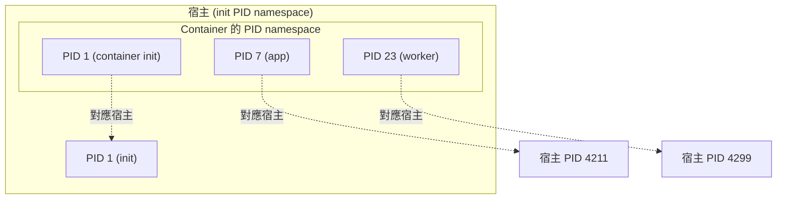
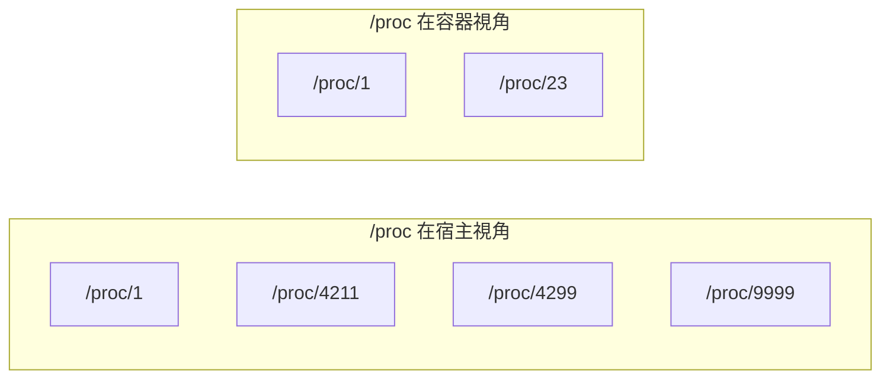
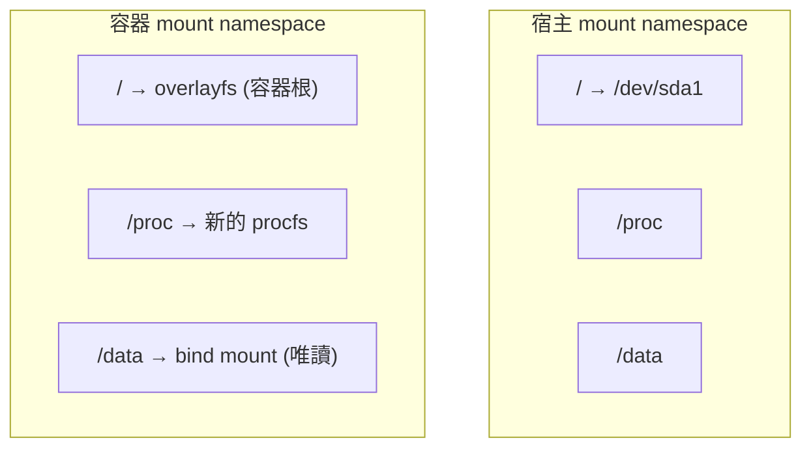
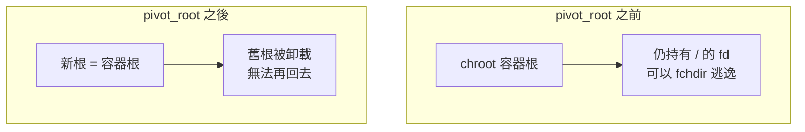
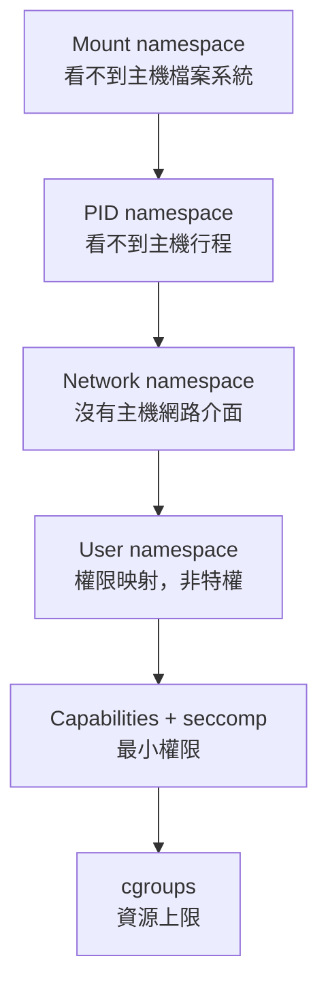

# 3.2 PID 與 Mount 命名空間的視角隔離

## PID 命名空間：行程 ID 的重編號

### 核心語意

PID 命名空間是**嚴格嵌套**的。一個行程在從根命名空間到自己所在命名空間的每一層，都有一個 PID。



- 在**容器內**看到 `ps` 的輸出，PID 是 1、7、23……連續且從 1 開始。
- 在**宿主上** `ps` 看到的是 4211、4299。
- 容器內的行程透過 `/proc/self/status` 裡的 `NSpid:` 欄位可以看到自己在各層的 PID：

```
Name:   myapp
NSpid:  4299    4211    23
        ↑宿主   ↑中間   ↑容器內
```

### PID 1 的特殊地位

新的 PID 命名空間中，第一個行程被分配 PID 1，並且獲得一連串 init 特有的待遇：

1. **孤兒行程的養父**：命名空間內所有父行程先退出的行程，都會被重新掛到 PID 1 底下。對宿主來說，這些行程的父行程其實是建立該命名空間的那個行程（在宿主命名空間中的 PID）。
2. **信號語意**：PID 1 會**忽略**那些沒有安裝 handler 的預設動作信號（`SIGTERM`、`SIGINT`、`SIGQUIT` 等）。也就是說，`kill -9 1` 在容器內無效。
3. **命名空間的銷毀**：當 PID 1 退出，核心會向命名空間內**所有**剩餘行程發送 `SIGKILL`，然後整個命名空間被銷毀。

第 2 點是容器實務上最常見的困惑來源：

```bash
# 在容器內
kill -9 1
# → 無法終止 PID 1：即使 SIGKILL 也被忽略（對 init 行程）
```

因此容器內必須有**一個真正的 init 程序**（`docker run` 預設的 `docker-init` / `tini` / `dumb-init`，或應用程式本身的 `PID 1`），它的職責是**正確地轉發信號並回收孤兒行程**。

> 這是一個「機制（核心）與策略（使用者空間）」的典型分工：核心提供「PID 1 有特權」這個機制，回收子行程與信號轉發這個策略則交給使用者空間的 init 程序。

### `/proc` 的視角化

`/proc` 是 PID 命名空間隔離最直觀的體現。核心在列舉 `/proc` 目錄時，只列出**呼叫者所在命名空間及其後代命名空間**中的行程。



容器內 `ls /proc` 只會看到自己的行程。這不只影響 `ps`——**所有基於 `/proc` 的工具都自動被隔離**：

- `top`、`htop`、`ps`
- `free`（讀 `/proc/meminfo`，但這是 host-wide 的——這是 containers 的一個已知不一致性）
- `lsof`
- 大多數 JVM / Go runtime 的診斷端點

**注意 `/proc/meminfo` 是全域的**：它顯示的是宿主機的記憶體總量與用量，而不是容器的。容器內 `free -h` 看到的是宿主資料，這是一個長期存在的誤導來源（後來由 cgroup v2 的 `memory.current` 與 `memory.max` 補正）。

### `NSpid` 與 `/proc/<pid>/ns/`

```
$ ls -l /proc/self/ns/
lrwxrwxrwx 1 root root 0 pid  →  pid:[4026531836]
lrwxrwxrwx 1 root root 0 mnt  →  mnt:[4026531840]
lrwxrwxrwx 1 root root 0 net  →  net:[4026531968]
lrwxrwxrwx 1 root root 0 uts  →  uts:[4026531838]
lrwxrwxrwx 1 root root 0 ipc  →  ipc:[4026531839]
lrwxrwxrwx 1 root root 0 user →  user:[4026531837]
lrwxrwxrwx 1 root root 0 cgroup → cgroup:[4026531835]
lrwxrwxrwx 1 root root 0 time →  time:[4026531834]
```

這些 inode 號碼是命名空間物件的唯一識別。**相同 inode 代表相同命名空間**——這是判斷「兩個行程是否在同一個命名空間」的權威方法：

```bash
# 比較兩個行程的 net namespace inode
readlink /proc/1234/ns/net
readlink /proc/5678/ns/net
```

這也是 `nsenter` 的工作原理：讀 `/proc/<pid>/ns/net` 取得 fd，然後 `setns(fd, CLONE_NEWNET)`。

## Mount 命名空間：檔案系統視角的隔離

### 核心語意

Mount 命名空間控制**掛載點的視角**。建立新命名空間時，現有的掛載表會被**複製**一份給新的命名空間。此後，兩個命名空間的掛載變化**互不影響**。



### 為什麼「複製」而不是「共享」？

這是 mount namespace 最核心也最容易被誤解的機制。

在命名空間建立的那一刻，核心會把當前的 mount tree 複製一份。**複製之後，兩邊各自獨立**。所以：

- 容器內 `mount -t tmpfs tmpfs /mnt` → 宿主看不到。
- 宿主 `mount /dev/sdb1 /mnt` → 容器看不到。

但有一個例外機制：**shared subtree（共享子樹）**。若一個掛載點被標記為 `shared`，其子掛載的建立與移除會**在同組的 shared 掛載點之間傳播**。

```bash
# 把 /mnt 標記為 shared，之後在 /mnt 下的 mount 會傳播到 peer group
mount --make-shared /mnt
mount --bind /hostdir /mnt/hostdir

# 反過來，標記為 private 或 slave
mount --make-private /mnt
mount --make-slave /mnt     # 接收來自 master 的傳播，但不向外傳播
```

**這個機制是容器與宿主之間「資料卷掛載」得以運作的技術基礎。** 當 `docker run -v /host/data:/container/data` 時，runtime 需要讓這個 bind mount 在兩個命名空間之間「對應」，而 shared subtree 提供了受控的傳播機制。

**這裡有一個重要的安全陷阱**：如果容器的 mount namespace 裡某個路徑被設為 `rshared`，那麼容器內的行程就可以透過它影響宿主的掛載表——這是容器逃逸的已知手法之一。因此現代 runtime 會確保容器內的根掛載是 `rprivate` 或 `rslave`。

### `pivot_root` 與 `chroot`

要讓容器看到「自己的根目錄」，有兩種技術：

**`chroot(path)`**：把根目錄改成 `path`。但它有著名的缺陷：

- 行程仍然持有舊根目錄的 fd，可以 `fchdir` 回去。
- 行程仍然可以 `chroot(".")` 反覆呼叫，做出自己的子 chroot。
- 需要 `CAP_SYS_CHROOT` 權限。

**`pivot_root(old_root, new_root)`**：原子地切換根目錄，並且**摧毀舊根目錄的引用**。這是現代容器 runtime（`runc`、`crun`）的標準做法：



Linux 2.6.40（2011）為 `pivot_root` 加入了一個關鍵修正：允許在 rootless（user namespace）情境下使用。**這是 rootless 容器能夠存在的技術前提之一。**

### 核心概念：命名空間與 `chroot` 的差異

| 面向 | `chroot` | Mount namespace |
|---|---|---|
| 隔離範圍 | 只有檔案系統根 | 整個掛載表視角 |
| 能否看到 `/proc` 裡的其他行程 | 能 | 由 PID namespace 決定 |
| 能否看到宿主網路 | 能 | 由 Network namespace 決定 |
| 逃逸難度 | 低（持有 fd 可逃） | 高（配合 user namespace 的權限檢查） |

**這是容器安全的一個核心教訓：單一機制不足。** `chroot` 給你的錯安全感，是容器逃逸歷史中反覆出現的主題。真正的隔離需要多層原語疊加：



任何單層被突破，還有其他層擋著。這就是「縱深防禦」。

## 實務：一個最小化的 namespace 沙箱

用 `unshare` 就能做出一個簡易沙箱：

```bash
# 建立一個只有自己的 PID / mount / net / uts 視角的環境
unshare --map-root-user --fork --pid --mount-proc --root="${chrootdir}" "$@"
```

參數解析：

| 參數 | 作用 |
|---|---|
| `--map-root-user` | 在新的 user namespace 中把當前 UID 映射為 UID 0 |
| `--fork` | 必須 fork，因為 `unshare` 只影響呼叫者，而 PID namespace 需要子行程才能成為 PID 1 |
| `--pid` | 建立新的 PID namespace |
| `--mount-proc` | 在新的 mount namespace 中掛載新的 `/proc`（這一步至關重要，否則 `/proc` 裡看到的是宿主的行程） |
| `--root=` | 搭配 `--mount` 使用，把新的根設為該目錄 |

`--mount-proc` 這個細節很多人會忘記，但它完美說明了「命名空間必須組合使用」：只建立 PID namespace 而不重新掛載 `/proc`，則 `ps` 看到的仍是宿主行程。

### 逃逸與「路徑穿越」

即使做了上述所有隔離，仍需注意：

- `/proc/sys/...`（某些情況下可寫）
- 已開啟的 fd（`pivot_root` 解決）
- `setns()` 逃逸到父命名空間（需要 `CAP_SYS_ADMIN` 在**父** user namespace 中，因此 user namespace 是關鍵防線）
- 核心漏洞（無論如何防禦）

## 觀測：如何確認隔離真的生效

```bash
# 命名空間 inode 對照
ls -l /proc/$$/ns/*

# 每個行程的命名空間分組
lsns -t pid -o NS,PID,COMMAND | head

# 找出某個命名空間中的所有行程
lsns -t net | grep 4026531968
```

`lsns` 工具專門為此設計，是排查「容器裡看到宿主行程」這類問題的第一選擇。

## 小結

1. PID 命名空間為每個層級重新編號行程 ID；容器內的 PID 1 具有特殊權力（忽略信號、收養孤兒、退出時殺光整個命名空間），因此容器需要一個真正的 init 程序。
2. `/proc` 被自動視角化，意味著幾乎所有以 `/proc` 為基礎的診斷工具都自動獲得隔離；但 `/proc/meminfo` 等少數節點仍是 host-wide。
3. Mount 命名空間在建立時複製掛載表，此後獨立；`shared subtree` 是控制跨命名空間掛載傳播的機制，也是容器逃逸的攻擊面。
4. `pivot_root`（Linux 2.6.40 起支援 rootless）比 `chroot` 安全得多，是現代 runtime 的標準做法。
5. **單一機制不足**：真正的隔離是 Mount + PID + Network + User + Capabilities + seccomp + cgroups 的疊加。

下一節，我們處理另一半問題：**限制能看到的，還不夠；還得限制能用的。**
