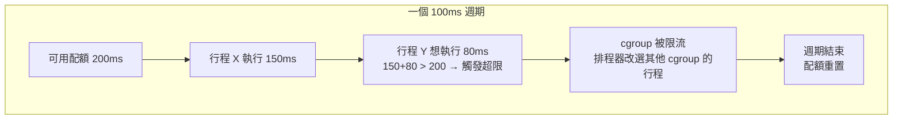
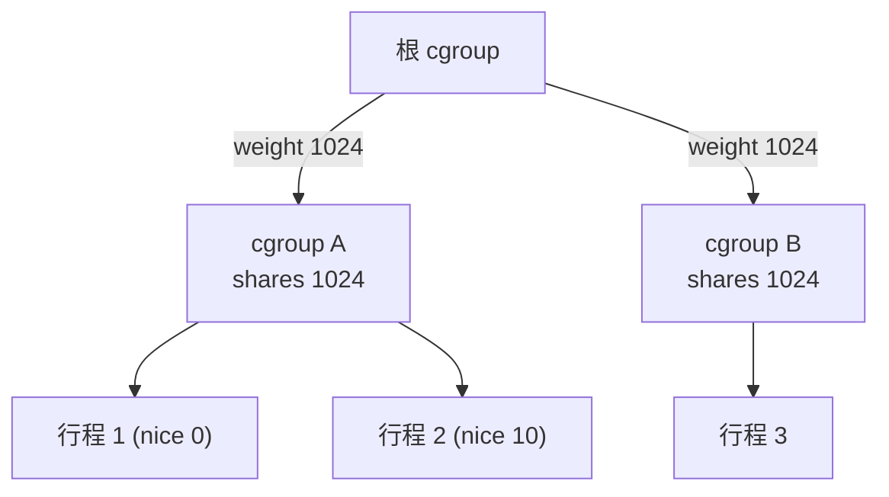
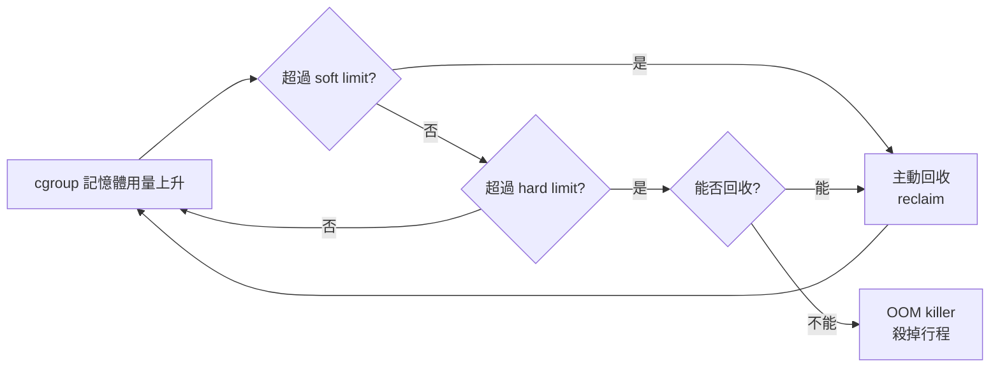
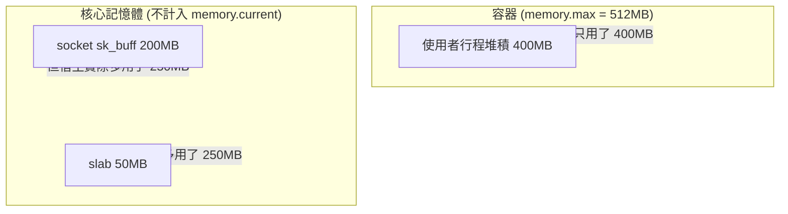
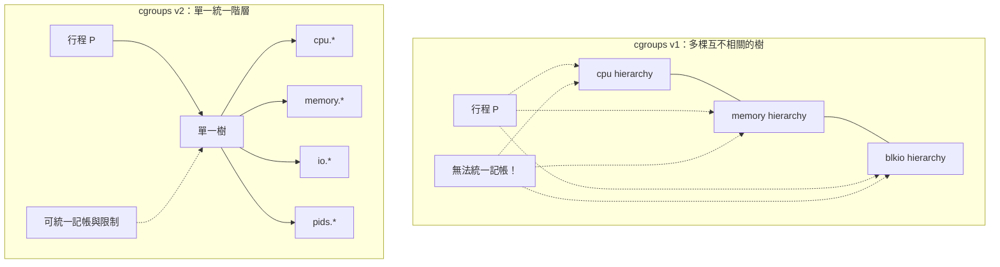

# 3.3 2007 年 Cgroups 的資源配額與記帳

## 從 Google 的「Process Containers」開始

2006 年，Google 的工程師 Paul Menage 與 Rohit Seth 開始做一個稱為 **"Process Containers"** 的功能。原始動機來自 Google 內部大規模的集群管理需求：他們需要能夠對一組行程做資源限制、統計，並且在資源不足時**整組一起**被 OOM killer 殺掉。

2007 年 5 月，LWN 刊登了 Jonathan Corbet 的文章 *Process containers*，描述了這個設計。文中提到一個關鍵的命名決定：

> 由於「container」這個詞在 Linux 世界已經有太多含義（Linux-VServer 的 container、FreeBSD jail、Solaris zone…），這個功能改名為 **"Control Groups"**，簡稱 **cgroups**。

2007 年 10 月 29 日，cgroups 合併進核心 2.6.24（2008 年 1 月發布）。

> 這個命名事件本身就是 Linux 歷史的一個縮影：**同一個技術，「container」這個名字太寬泛，導致概念混淆。** 而今天「容器」這個詞之所以能指稱一種主流的 OS 級虛擬化技術，正是因為原本的 Linux 內核刻意迴避了這個詞。

## 設計目標：四種能力

cgroups 提供的能力可以分為四類：

| 類別 | 說明 | 範例 |
|---|---|---|
| **限制（Limit）** | 限制資源使用量 | 記憶體上限 512MB、CPU 配額 2 核 |
| **優先（Prioritize）** | 決定資源分配的相對權重 | `cpu.shares` 讓 A 組拿 2 倍份額 |
| **記帳（Accounting）** | 統計資源使用量 | 這個 cgroup 用了多少 CPU 時間與 I/O 頻寬 |
| **控制（Control）** | 主動介入行程行為 | 凍結（freeze）、重啟 |

### 為什麼「配額」比「優先」更重要？

在虛擬機的世界裡，資源隔離通常透過 hypervisor 的計時器與硬體計數器實現——例如 VM 只能佔用 2 個 vCPU。但作業系統級隔離要面對一個更難的問題：

> **多個行程共享同一個 CPU 硬體計時器。核心必須在行程排程上下文中做週期性檢查，才能維持配額。**

這就是 cgroup 的 CPU controller 的核心機制：**cfs quota + timer tick 檢查**。讓我們看具體的數學。

## CPU 控制：cfs_quota 與週期

cgroups v1 的 `cpu.cfs_quota_us` 與 `cpu.cfs_period_us` 定義了配額：

- `cpu.cfs_period_us = 100000`（100ms）
- `cpu.cfs_quota_us = 200000`（200ms）

語意：**每 100ms 的週期內，這個 cgroup 的所有行程合計最多可以獲得 200ms 的 CPU 時間。** 也就是 2 個 CPU 的份額。

核心的執行方式：在排程器每次選擇下一個行程時（或週期到期時），檢查

$$
r_{quota} = t_{used} + t_{slice} > t_{quota} \Rightarrow \text{把這個 cgroup 標記為超限，停止選取它的行程}
$$

直到下一個週期開始， $r_{used}$ 歸零。



**這種機制的代價**：CPU 使用量不是連續平滑的，而是以 100ms 為單位呈現「爆發-限制」的模式。對延遲敏感的服務，週期太長會導致尾延遲 (tail latency) 惡化。Kubernetes 因此提供 `cpu.cfs_period_us` 設定（部分版本支援）。

### `cpu.shares` 與 `cpu.weight`：相對權重

`cpu.shares`（v1）與 `cpu.weight`（v2）定義的是**相對**份額：

| cgroup A shares | cgroup B shares | A : B 的 CPU 比例 |
|---|---|---|
| 1024（預設） | 1024 | 1 : 1 |
| 512 | 1536 | 1 : 3 |
| 2048 | 1024 | 2 : 1 |

在總 CPU 足夠時，這就是權重比例。但要注意：

- 若總 CPU 需求 < 可用 CPU，**沒有人被限流**，比例無從體現。
- `shares` 的範圍是 2 到 262144。

v2 的 `cpu.weight` 把範圍正規化到 1–10000，並且線性映射到 v1 的 shares（`shares = 1 + ((weight - 1) * 262143) / 9999`），遷移時保持語意。

### 完全公平排程器（CFS）與 cgroups 的整合

Linux 2.6.23（2007 年 10 月）引入的 **CFS（Completely Fair Scheduler）** 是理解 cgroup CPU 控制的基礎。

CFS 的核心是維護每個行程的「虛擬執行時間」 $v_i$ ：

$$
v_i(t) = \int_0^{t} \frac{w_i}{w_{total}} \cdot \frac{1}{S} \, d\tau
$$

其中 $w_i$ 是行程權重， $w_{total} = \sum w_i$ 是總權重， $S$ 是 CPU 數量。排程器總是選擇 $v_i$ 最小（最「落後」）的行程。

cgroup 層級是透過 **task group（task_group）** 結構整合進 CFS 的：每個 cgroup 有一個 task group，其權重是該 cgroup 內所有行程權重的總和。這形成了一個**兩層的公平性**：先在 cgroup 之間分配，再在 cgroup 內部分配。



CFS 的到來（2007 年 10 月）與 cgroups 的到來（2007 年 10 月 29 日）在時間上幾乎重疊——**這不是巧合**。Google 需要的不只是「限制」，還需要「公平的分配」，而 CFS 的引入讓「限制 + 公平」這兩件事有了統一的數學框架。

## 記憶體控制：memcg

記憶體控制器（`memory` controller）是最複雜的 cgroup controller，因為它要處理的不只是配額，還有**回收**與 **OOM**。

### 三道防線

```
memory.limit_in_bytes  (硬上限)
memory.soft_limit_in_bytes (軟上限)
memory.memsw.limit_in_bytes (記憶體 + swap 上限)
```

當 cgroup 的記憶體用量超過**軟上限**時，核心會主動**回收**（reclaim）該 cgroup 的頁面（把乾淨頁寫回、丟棄髒頁需要的話寫回）。超過**硬上限**時，核心會嘗試回收；若無法回收，則觸發 **OOM killer**。



### OOM killer 的選擇問題

OOM killer 必須從候選行程中挑一個殺掉。挑錯了，就會殺掉最重要的那個行程（例如殺掉 Redis 而不是某個 leak 的 worker）。

Linux 的評分邏輯很複雜，但概念上：

1. 排除 `oom_score_adj = -1000`（完全免疫）與核心行程。
2. 每個行程有一個**記憶體佔用量**（`oom_score` 的主要因子）。
3. 每個行程有 `oom_score_adj`（-1000 到 +1000），調整該行程被殺的**傾向性**。
4. 得分最高者被殺。

**問題**：cgroup v1 時代，OOM killer 是**全域**的——它看到整台主機的所有行程，無法知道「哪個 cgroup 超配了」。這意味著：某個容器的記憶體超限，可能導致它殺掉**別的容器的**行程。

**Linux 4.19（2018 年 10 月）** 引入了 **cgroup-aware OOM killer**：可以選擇在某個 cgroup 的範圍內選 victim（`memory.oom.group=1` 讓整個 cgroup 一起被殺），並且有 `oom_kill_allocating_task` 選項。**這是容器化環境中極其重要的一個修復**——它讓 OOM 成為「cgroup 內的事故」，而不是「主機上的事故」。

### `kmem`：限制核心自己用的記憶體

2013 年（Linux 3.8）加入的 `kmem` controller，讓 cgroup 可以限制**核心為自己消耗的記憶體**（slab 結構、socket 緩衝區、頁表）。

這對容器特別重要，因為核心記憶體是「隱形的」——一個只宣告 512MB 記憶體的容器，實際上可能因為開了 10,000 個 socket 而消耗數百 MB 的核心記憶體，而這些**不算在容器的記憶體用量裡**。



**在 cgroups v2 中，`kmem` 被併入 `memory` controller 並且預設對核心記憶體記帳**（`memory.stat` 中的 `kernel` 欄位），這是 v2 的一個重要改進。

## I/O 控制

cgroups v1 的 `blkio` controller 控制**塊裝置**（block I/O）的頻寬：

```
blkio.weight          # 相對權重（10-1000）
blkio.throttle.read_bps / write_bps
blkio.throttle.read_iops / write_iops
```

限制機制是**节流（throttling）**：當 cgroup 的 I/O 速率超過閾值，相關行程被放入一個等待佇列，直到速率降到閾值以下。

v1 的一個著名缺陷是：**`blkio` 不區分「讀」與「寫」以外的裝置層級**，且必須在檔案系統掛載時就決定使用哪個 controller，無法動態改變。

cgroups v2 的 `io` controller 重新設計了這一切：

```
io.max          # 裝置層級的 max 速率/IOPS
io.weight       # 相對權重
io.stat         # 統計
```

v2 的 `io` controller 直接以 **block device** 為單位配置限制，並且在同一個介面上同時支援配額（`io.max`）與權重（`io.weight`）。這是 v2 相對 v1 的重大改進。

## 檔案系統控制：v2 的新能力

cgroups v2（Linux 4.5，2016）引入了一個 v1 完全沒有的能力：**在同一個 hierarchy 中，同時掛載多個控制器**。

v1 的致命設計缺陷是：

> 一個控制器只能掛在一個 hierarchy 上。若你想同時用 `cpu` 與 `blkio`，就必須建兩棵獨立的樹，而這兩棵樹的行程歸屬**互不關聯**——你無法用「cgroup X 的 CPU 用量」和「cgroup X 的磁碟 I/O」做一致的記帳。

v2 的**統一 hierarchy** 徹底解決了這個問題：所有控制器都在同一棵樹上，同一個行程只屬於一個 cgroup 路徑，所有控制器的視角一致。



**這是容器化雲原生時代最重要的基礎設施變更之一**：因為叢集需要同時限制 CPU、記憶體與 I/O，同時對三者做一致的用量記帳（這是雲端計費的基礎），v1 的多樹設計在雲原生規模下是不可用的。

## 介面：cgroup 虛擬檔案系統

cgroups 透過一個偽檔案系統暴露控制介面。

### v1

```bash
# /sys/fs/cgroup/cpu,cpuacct/ 是把兩個控制器掛在一起的一個「combined hierarchy」
ls /sys/fs/cgroup/
# blkio  cpu  cpu,cpuacct  cpuacct  devices  freezer  memory  net_cls  perf_event  pids

cat /sys/fs/cgroup/cpu,cpuacct/mygroup/cpu.cfs_quota_us
echo 200000 > /sys/fs/cgroup/cpu,cpuacct/mygroup/cpu.cfs_quota_us
echo 100000 > /sys/fs/cgroup/cpu,cpuacct/mygroup/cpu.cfs_period_us
```

### v2

```bash
# 統一的 hierarchy
ls /sys/fs/cgroup/
# cgroup.controllers  cgroup.max.depth  cgroup.procs  cgroup.stat
# cgroup.subtree_control  cpu.max  cpu.stat  io.max  memory.max  memory.current
# pids.max  ...

# 啟用某個控制器給子階層使用
echo "+cpu +memory +io +pids" > /sys/fs/cgroup/cgroup.subtree_control

# 建立子 cgroup
mkdir /sys/fs/cgroup/myapp

# 設定限制
echo "200000 100000" > /sys/fs/cgroup/myapp/cpu.max      # 2 CPU
echo "512M"          > /sys/fs/cgroup/myapp/memory.max
echo "100M"          > /sys/fs/cgroup/myapp/io.max         # 簡化
echo "256"           > /sys/fs/cgroup/myapp/pids.max       # 最大 256 個行程

# 檢查用量
cat /sys/fs/cgroup/myapp/memory.current
cat /sys/fs/cgroup/myapp/cpu.stat
cat /sys/fs/cgroup/myapp/memory.events
```

### v2 的關鍵語意：subtree_control 與「no internal processes」

v2 的一條重要規則（No Internal Process Constraint）：

> **一個 cgroup 如果有子 cgroup，就不能自己直接含有行程**（除非該 cgroup 是「threaded」的）。

這是為了保證一致性：控制器只在子階層的層級被啟用，這樣「限制」永遠作用在葉子節點上，不會出現「同一個行程同時被限制兩次」或「父層限制被子層繞過」的問題。

### 凍結（Freezer）

v1 的 `freezer` controller 與 v2 的 `cgroup.freeze` 允許**凍結**一個 cgroup 內的所有行程：

```bash
echo 1 > /sys/fs/cgroup/myapp/cgroup.freeze
# 所有行程被放入不可中斷的睡眠狀態
echo 0 > /sys/fs/cgroup/myapp/cgroup.freeze
```

這個看似簡單的功能，是**容器快照（checkpoint/restore）**、**有狀態服務的無縫遷移**、以及 **CRIU（Checkpoint/Restore in Userspace）** 的基礎。

Kubernetes 的 `kubectl exec` 與 `kubectl debug --copy-to` 等功能，也部分依賴類似的機制。

## 行程加入 cgroup 的方式

```bash
# 方法一：寫入 cgroup.procs（或 v1 的 tasks）
echo $$ > /sys/fs/cgroup/myapp/cgroup.procs

# 方法二：從一開始就讓行程在正確的 cgroup 中
cgexec -g memory:mygroup -g cpu:mygroup mycommand
```

在容器世界中，runtime 的行為是：

1. 建立 cgroup 目錄。
2. 以 `clone` 建立 container init。
3. 把 init 的 PID 寫入 `cgroup.procs`。
4. 設定各項限制。

`systemd` 則透過 **`systemd-run`** 與 slice 單位自動管理：

```bash
systemd-run --scope -p MemoryMax=512M -p CPUQuota=200% myservice
```

## cgroups 的被低估的影響力

回顧歷史，cgroups 的採用時間表：

| 年份 | 事件 |
|---|---|
| 2006 | Google 開始 "Process Containers" |
| 2007.10 | 合併進 2.6.24 |
| 2010.11 | RHEL 6.0 預設採用 |
| 2013 | Docker 採用 |
| 2014 | Kubernetes 設計時即依賴 cgroups |
| 2016.03 | cgroups v2 合併進 4.5 |
| 2019.10 | Fedora 31 預設改用 cgroup v2 |

**cgroups 是 Linux 歷史上被應用最廣、但最少被「談論」的機制之一。** 幾乎每一個 modern Linux 系統的每個資源控制，都最終落在 cgroup 之上。雲端廠商的「資源配額」計費，本質上就是 cgroup 的 `cpu.stat` 與 `memory.stat` 的取樣。

## 小結

1. cgroups 起源於 Google 2006 年的 "Process Containers"，2007 年合併，後因與「container」混淆而改名。
2. 四種能力：限制、優先、記帳、控制。CPU 限制靠 CFS 的週期性配額檢查；記憶體靠三道防線（軟限、主動回收、OOM）。
3. `kmem`（Linux 3.8）解決了「核心記憶體不計入容器用量」的問題；cgroup-aware OOM killer（Linux 4.19）讓 OOM 成為 cgroup 內的事故。
4. v1 的多 hierarchy 設計無法統一記帳，阻礙了雲原生規模的部署；v2 的統一 hierarchy 是關鍵改進。
5. cgroups 是雲原生時代「多租戶資源治理」的基礎，也是雲端計費的技術底層。

下一節，我們進入 cgroups v2，看看這個「統一 hierarchy」的設計細節，以及它如何讓 Linux 終於能夠同時對 CPU、記憶體、I/O 做一致的治理。
